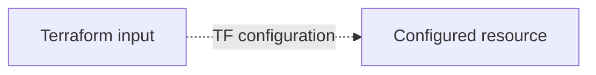
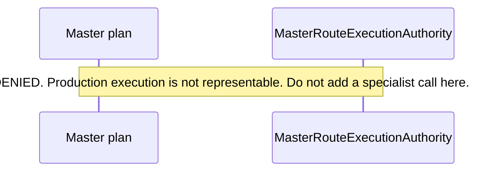

# Wilvor documentation standards

This file is the canonical documentation standard for `wilvor-infra`. Writers follow it when adding or editing technical documentation. The Cursor rule `.cursor/rules/wilvor-documentation.mdc` attaches these constraints while Markdown documentation is being edited.

**Baseline:** branch `docs/wilvor-documentation`, commit `86f4d7b`. That commit is `origin/ai-operations-copilot` at the time this standard was written. Examples below were read in that tree. A later page re-reads the cited file before copying an example. This file does not certify that any AWS account currently matches the Terraform in the repository.

**Canonical legend:** maturity labels are defined only in this file. Other pages link here and apply labels to one component. They do not publish a second definition.

## Implementation status

This file is documentation policy. It is not an application module, a Terraform root, or a test.

| Question | Result at `86f4d7b` | Source |
| --- | --- | --- |
| Policy text | This file | `docs/DOCUMENTATION_STANDARDS.md` |
| Application code for this policy | None | This file is Markdown |
| Terraform for this policy | None | This file is Markdown |
| Tests for this policy | None | This file is Markdown |
| Deployment of any Wilvor component | UNKNOWN | No account observation is recorded here |
| Production authorization granted by this file | None | This file defines writing rules |

## Known limitations

- Examples in this file were checked at `86f4d7b` and can become stale. Re-read the source before repeating them.
- The repository has two Terraform roots, `envs/dev` and `envs/dev-historical-data`. Whether either root is applied in an AWS account is UNKNOWN.
- Current pytest and Vitest pass counts are UNKNOWN. This standard does not record a suite result.
- The Cursor rule attaches to Markdown globs. Legacy `functions/*.txt` runbooks are covered by the written rules below and do not auto-attach that rule.
- Two ownership assignments are section-scoped. They are listed under [Decisions pending review](#decisions-pending-review).
- This file does not create the documentation tree, rewrite READMEs, or start parallel writers.

## Scope

Use this standard for technical documentation: `docs/**/*.md`, `README.md` files, module and package Markdown, test and script READMEs, AI contract and review Markdown, and legacy runbooks when a documentation task edits them.

Colocated package READMEs stay the canonical deep specification for `wilvor_operational`, `wilvor_historical`, `wilvor_historical_query`, and `wilvor_ai`. A `docs/` page maps, links, and states maturity. It does not paste those READMEs into a second copy.

One topic has one canonical page. Other pages link to it.

During a documentation task, leave Python, TypeScript, Terraform, tests, operational scripts, and infrastructure unchanged. This standard does not forbid those changes when the task is software implementation. The Cursor rule is file-scoped so it does not become a standing ban on development.

Documentation work reads the repository. It does not run Terraform apply, deployment scripts, AWS-mutating commands, or external live validation in order to produce a maturity label.

## Markdown headings, structure, and names

- Use ATX headings (`#`, `##`, `###`). One `#` heading per file, equal to the topic.
- New headings use sentence case, matching existing Wilvor prose such as "Contract package" and "Contextual freshness".
- Do not skip a heading level.
- When an existing file already uses a different heading style, leave its current headings in place. New sections added to that file use sentence case and the required section names from the [page template](#page-template).
- Do not mass-reformat a file while correcting one claim.
- Put the maturity line and, where the template requires it, the production-authorization line directly under the `#` heading, before the first `##`.
- Use fenced code with a language tag. Use tables for maturity and claim matrices.
- Prefer Markdown over HTML.
- New pages under `docs/` use kebab-case file names (`docs/api/operational-api.md`).
- Colocated documentation keeps the name `README.md`.
- `docs/DOCUMENTATION_STANDARDS.md` is the reserved name for this standard. Do not add a second standards file.
- New technical pages go under `docs/` or an existing `README.md` so the documentation rule can attach. Do not invent a new top-level documentation root.

## Internal links

- Use a relative Markdown link from the file that contains the link.
- Use forward slashes. Do not use absolute Windows paths or `file://` URLs. `functions/local_runner_documentation.txt` contains a hardcoded local path; do not copy that pattern into new pages.
- Link a heading only when that heading exists. GitHub-style anchors are lowercase, with spaces as hyphens and punctuation removed.
- Link the canonical page. Do not reproduce its body.
- Link a path that exists, or a path listed in [File ownership](#file-ownership) that the same change creates.
- For a page another workstream will create, write the repository-relative path in backticks and name the owning workstream. Do not leave a broken link, and do not invent a path outside the ownership map.
- Source citations inside prose use the [source-reference convention](#source-reference-convention). A citation path is repository-relative even when the Markdown link is relative to the file.

Example from a future `docs/ai/master-agent.md`:

```markdown
[`MasterRouteExecutionAuthority`](../../functions/shared/wilvor_ai/master_routing.py)
```

## Mermaid diagrams

Use Mermaid for architecture and for ordered interactions. Use `flowchart` for structure and data movement. Use `sequenceDiagram` for a request, tool, or verification order.

- One diagram states one relationship. Split a diagram that mixes ingestion, processing, and AI authority.
- Node ids have no spaces. Visible labels use repository module, symbol, or resource names that appear in source.
- A solid edge means the relationship was read in source at the commit named in the caption.
- A dotted edge means configuration only, a library relationship, or a planned path. The edge label says which of those three it is.
- Do not draw a deployed AWS path for a component whose Terraform wiring was not found.
- Do not draw a successful call that the source does not implement. Omit that message. A `Note` may say why it is omitted.
- `MasterRouteExecutionAuthority` contains `DENIED` only, and its docstring states that production execution is not representable (source: `functions/shared/wilvor_ai/master_routing.py`, `MasterRouteExecutionAuthority`). A sequence diagram for Master planning uses a note for that fact and does not add a specialist invocation arrow.
- Subgraph titles may include a maturity label that was verified for that group.
- Do not use color, green nodes, or "production" styling to imply health, deployment, or authorization.
- Do not add `click` links or external URLs.
- Under the diagram, write a caption with the commit and a source reference for each edge class.

The next fence is a notation example. It is not a map of a Wilvor component.



Caption: notation only. A dotted edge records configuration. It does not record an apply.

The next fence is the required shape when a diagram would otherwise show Master execution. It is not a runtime trace.



Caption: shape required while `MasterRouteExecutionAuthority` has only `DENIED`. Source: `functions/shared/wilvor_ai/master_routing.py`, `MasterRouteExecutionAuthority`. Verified at `86f4d7b`. Re-read the enum before reusing the note.

## Verifying a technical claim

A technical claim names behavior, a resource, a route, a status, a count, a schedule, an authority value, or a test result. Every such claim is checked against repository source before it is written.

1. Read the implementation symbol. Record it with the source-reference convention.
2. Search tests for that symbol. Read the assertion before applying UNIT, CONTRACT, INFRA, or INT.
3. Search `envs/dev`, `envs/dev-historical-data`, and `modules/` before applying TF. At `86f4d7b` those two directories are the only Terraform roots.
4. Apply LIVE only when an opt-in harness file exists. A harness file is the LIVE label. A passing run is a separate statement and needs a stored artifact path. That artifact is evidence of a past run.
5. Apply DEPLOYED only from an apply record or an account observation that the writer is allowed to cite. Terraform source supports TF. It does not support DEPLOYED. Documentation work does not query AWS to obtain DEPLOYED.
6. If the search was not done, use UNKNOWN.
7. `absent` is allowed only after a named search at a named commit. Write the search scope. `absent` is not PLANNED unless a comment or document also describes the work as future. `absent` is not a maturity label; it is a finding beside the label it addresses, for example `TF absent at 86f4d7b (search: *.tf for <name>)`.

When an existing Markdown or `.txt` sentence disagrees with code, tests, or Terraform, the current statement comes from code, tests, or Terraform. The older sentence stays in the file under [Historical record](#historical-record). Tests outrank a stale README for current behavior. A Markdown file may be cited as the place a historical sentence lives. It is not a sufficient source for current behavior.

Do not invent modules, routes, table names, tool names, pass counts, account ids, or AWS resources. If the symbol was not read, the sentence is not written, or it is marked UNKNOWN with `not verified` in the source cell.

These words need a source reference and an explicit maturity or authorization line: deployed, production, authorized, granted, enabled, passing, tested, live, safe, clearance, current.

Worked conflict, verified at `86f4d7b` and subject to re-reading:

- `modules/historical_facts/README.md` says `enable_historical_facts` must remain `false` in env/dev.
- `envs/dev/main.tf` assigns `enable_historical_facts = true` in two places (lines 117 and 805 at that commit).

A current-status sentence follows the Terraform assignment and cites the file. The README sentence remains in a historical section until the owning workstream edits that README. This standard does not decide the operational policy for that flag. It requires the two texts to stay distinct.

Claims that stay UNKNOWN unless new evidence is cited:

- Whether the `dev` stack is applied in AWS.
- Current automated-test pass counts.
- Whether an operator live harness would pass if run today.
- Whether the persistent historical bucket exists in the account.
- Whether live Bedrock inference is authorized for the account.
- Any production or staging environment. The repository contains the two Terraform roots named above and no other `envs/*/main.tf`.

## Maturity labels

Apply a label only after the verification step for that label. A component may carry several labels. Omit a label that was not checked, or write `UNKNOWN` when the question matters and the check was not done. Do not collapse labels into the word "tested" or "done".

Write positive labels in this order: CODE, TF, UNIT, CONTRACT, INFRA, INT, LIVE, DEPLOYED, PLANNED, UNKNOWN.

| Label | Meaning |
| --- | --- |
| CODE | Implementation source for the claim exists in the repository. Name the file and symbol. A file's presence is not, by itself, the behavior described in a comment. |
| TF | `envs/dev` or `envs/dev-historical-data` contains Terraform that configures the resource. This is source configuration. |
| UNIT | A test under `tests/unit/` asserts the claim, and the assertion was read. |
| CONTRACT | A test under `tests/contracts/` asserts the claim, and the assertion was read. |
| INFRA | A test under `tests/infrastructure/` asserts the claim, and the assertion was read. |
| INT | A test under `tests/integration/` asserts the claim, and the assertion was read. These tests are written for a deployed dev environment. The test file does not show that the environment is applied now. |
| LIVE | An opt-in operator harness exists, such as a `scripts/validate_*` script. The harness is not a pass result. |
| DEPLOYED | An apply record or an account observation shows the resource present in an environment. Repository Terraform cannot establish this label. |
| PLANNED | A comment, document, or design describes the behavior, and the implementation symbol is absent. |
| UNKNOWN | The claim was not established from evidence the writer read. Use this for live account state, an unread suite, and any inference. |

## Code, tests, Terraform, deployment, and production authorization

These are separate facts. A page that needs more than one of them gives each fact its own row in Implementation status.

| Fact | What establishes it | What a writer records |
| --- | --- | --- |
| Code existence | The implementation symbol was read | CODE, with the source reference |
| Test coverage | The asserting test was read | UNIT, CONTRACT, INFRA, or INT, each named |
| Terraform configuration | A resource or input in a Terraform root was read | TF, with the `.tf` path |
| Deployment | An apply record or account observation was read | DEPLOYED, or UNKNOWN when that evidence is absent |
| Production authorization | An authority, policy, or approval field in source permits that production action | The symbol and its value, quoted |

Production authorization is not a maturity label.

- CODE does not establish a test label, TF, DEPLOYED, or a grant.
- UNIT, CONTRACT, INFRA, and INT are different suites. One of them does not imply the others.
- TF records configuration in Git. DEPLOYED records an environment. A committed `true` input is TF.
- LIVE records a harness. A stored JSON artifact records a past run. Neither is a current pass, and neither is production authorization.
- A structurally valid object, a ready preflight, a listed tool name, or a planning binding is not a grant to run. `READ_ONLY_TOOL_NAMES_BY_SPECIALIST` documents closed catalog names, and the source comment states that a listed name is not a table grant (source: `functions/shared/wilvor_ai/master_execution_policy_boundary.py`). `MasterSpecialistAdapterDescriptor` states that it is a planned binding and that nothing on the object can be called to run a specialist (source: `functions/shared/wilvor_ai/master_specialist_adapters.py`).
- `AgentAuthorityMode` contains `READ_ONLY_ADVISORY` only (source: `functions/shared/wilvor_ai/contracts.py`, `AgentAuthorityMode`). `READ_ONLY_ADVISORY_IS_NOT_SOURCE_READ_AUTHORITY` is a distinct rejection in `functions/shared/wilvor_ai/master_live_ops_execution_readiness.py`. Advisory mode is not source-read authority and is not production execution.
- `MasterRouteExecutionAuthority` contains `DENIED` only. The docstring states that this is planning permission and that production execution is not representable. Writers keep that wording until the enum in source changes. Re-read the enum before writing any other value.
- An opt-in on a live harness authorizes only the invocation that the harness itself defines. Writers quote that limit from the harness instead of generalizing it into a product grant.

## Implementation status and known limitations

Include both `## Implementation status` and `## Known limitations` on any page that describes behavior, a module, a pipeline, an API, a dashboard, an AI component, historical data flow, or an operational procedure.

A link-only index that states no behavior may omit them. The index says that it states no behavior and points at the canonical pages.

`## Implementation status` answers code, Terraform, each relevant test layer, live harness, deployment, and production authorization. Use UNKNOWN for a row that was not verified. Use the source-reference convention in the source column.

`## Known limitations` states boundaries that a reader could otherwise miss: schedules disabled in a named environment, missing test layer, unattached policy, deny-by-default authority, fail-closed verifier behavior, and evidence the page does not have. Limitations are copied from source. They are not softened.

`## Historical record` is required when the edit supersedes an existing sentence. On a new page, the section may say: "No superseded statement is stored on this page."

## Aviation advisory and human review

Documentation preserves Wilvor's advisory boundary. The live-operations console README states: "Wilvor is advisory decision support. It is not air traffic control and not a flight-control system." Risk scoring, airport assessment, trajectory projection, encounter geometry, and recommendation logic stay in the deterministic backend (source: `dashboard/README.md`).

The AI package README states that deterministic services remain authoritative for aircraft state, projections, hazards, encounters, risk, airport assessments, recommendations, alerts, geometry, trajectories, and state transitions. AI text may explain and summarize verified deterministic results. It does not replace those calculations, and it does not convert missing evidence into assumed facts (source: `functions/shared/wilvor_ai/README.md`).

`FinalAIResponse.human_review_required` is a required Boolean. The contract README states that both `True` and `False` are structurally valid, and that qualified human review is required for safety-sensitive operational guidance, including routing or diversion recommendations and other output intended to support an aviation operational action. A pure informational summary or historical analysis may represent `False`. The package does not decide when review is mandatory (source: `functions/shared/wilvor_ai/README.md`; field defined with `wilvor.ai.response.v1` in `functions/shared/wilvor_ai/contracts.py`). Writers do not drop `human_review_required`, and they do not treat a structurally valid `False` as a waiver of the safety-sensitive review rule.

`V1_AUTHORITY` uses `READ_ONLY_ADVISORY`. The allowed capability set is retrieval, explanation, comparison, summarization, and visualization specifications over verified evidence. The prohibited set in `PROHIBITED_V1_CAPABILITIES` is:

- `MUTATE_OPERATIONAL_STATE`
- `MUTATE_ALERTS`
- `CREATE_OR_OVERWRITE_DETERMINISTIC_RECOMMENDATIONS`
- `ALTER_RISK_RESULTS`
- `ALTER_AIRCRAFT_PROJECTIONS`
- `ALTER_HAZARD_RECORDS`
- `EXECUTE_REROUTES`
- `ISSUE_AUTONOMOUS_FLIGHT_CONTROL_INSTRUCTIONS`
- `ISSUE_LANDING_INSTRUCTIONS`
- `ISSUE_ALTITUDE_INSTRUCTIONS`
- `ISSUE_ATC_INSTRUCTIONS`
- `MUTATE_AWS_INFRASTRUCTURE`

Source: `functions/shared/wilvor_ai/contracts.py`, `ALLOWED_V1_CAPABILITIES` and `PROHIBITED_V1_CAPABILITIES`. Writers do not document a prohibited capability as a product feature. An allowed capability name is not evidence that a deployed runtime exists.

When a page describes decision output, it preserves the renderer limits. These sentences are source text in `functions/shared/wilvor_ai/decision_answer_renderer.py`:

- "Stored recommendation actions are advisory evidence only."
- "The stored EVALUATE_DIVERSION label is not a clearance, not a selected diversion, not a route, and not a dispatch or ATC instruction."
- "No encounter is selected by this answer."
- "No recommendation is selected by this answer."
- "A stored LOW level is not a statement that the aircraft is safe."
- "Unavailable evidence does not establish an unsafe result."
- "A candidate count of zero does not mean that no safe airport exists."
- "Risk absence is not a LOW risk classification."

`MasterSpecialist` names three specialists: `LIVE_OPS`, `HISTORICAL_ANALYTICS`, and `DECISION` (source: `functions/shared/wilvor_ai/master_contracts.py`). Writers use that enum when they name the roster. They do not add specialists that are absent from the enum.

Pages do not give a clearance, a dispatch decision, an ATC instruction, a landing instruction, an altitude instruction, or a reroute. They do not describe the Operational API as an AI execution path unless an import or route in source shows that path.

## AI evidence

AI documentation treats evidence fields as verified data. It does not repair, upgrade, or fill them.

### Verification

- Unsupported factual claims stay unverified unless the deterministic verifier accepts them. The historical-specialist README states that model quality is not the factual safety boundary and that unsupported factual claims are not rendered unless deterministic evidence verification passes (source: `functions/shared/wilvor_ai/README.md`).
- Fail closed. When verification cannot establish a claim, write UNKNOWN or omit the claim. Do not supply a plausible value.
- `ToolResult.data` is the application payload. It is not source authenticity. First-class `Evidence` is the provenance surface (source: `functions/shared/wilvor_ai/README.md`).
- `classify_master_provenance` is an offline audit. The module states that supplied `ToolResult` and `Evidence` metadata are not an authenticated read, that a proposed dispatcher event is not a completed read, and that authenticated source-read provenance is not available. It states that `AUTHENTICATED_SOURCE_READ_AVAILABLE` is false, that source authenticity stays `NOT_ESTABLISHED`, and that production authority and Master execution authority stay `DENIED` (source: `functions/shared/wilvor_ai/master_provenance_trace.py`).
- Matching identifiers, source versions, or timestamps do not establish the origin of a read. Public dataclass fields are not proof of trust. Writers keep those distinctions when they describe provenance.

### Freshness

`FreshnessStatus` is `FRESH`, `ACCEPTABLE`, `STALE`, `UNAVAILABLE`, or `UNKNOWN` (source: `functions/shared/wilvor_ai/contracts.py`).

Freshness is contextual. The contract package does not calculate it and does not define one global freshness algorithm. For current operational evidence, freshness refers to the applicable current-state age or timeliness expectation. For historical evidence, the age of the historical event does not make the evidence stale. When freshness cannot be established, the contract uses `UNKNOWN` with a limitation. SIGMET `AVAILABLE` in existing subsystem vocabulary describes source availability, not an age-based freshness grade (source: `functions/shared/wilvor_ai/README.md`).

Writers do not relabel `STALE`, `UNAVAILABLE`, or `UNKNOWN` as `FRESH`. A dashboard or API cache interval is a separate number from `FreshnessStatus` and is cited from the implementation that sets it.

### Confidence

`ConfidenceLevel` is `HIGH`, `MEDIUM`, `LOW`, or `UNKNOWN` (source: `functions/shared/wilvor_ai/contracts.py`). The values keep the meaning supplied by the producer. Phase 0 does not calculate or reconcile projection, risk, recommendation, or AI-response confidence (source: `functions/shared/wilvor_ai/README.md`). Writers do not invent a numeric score or map LOW to "safe".

### Provenance

`Evidence` identifies the deterministic source, supporting `SourceRecord` values, record ids, optional source version, optional event timestamp, query timestamp, contextual freshness, source confidence where applicable, limitations, originating tool-call id, and temporal scope. Optional provenance includes `SourceCompleteness`, `MatchCardinality`, `QueryExecutionTrace`, and `error_code`.

Zero source records are valid for a verified no-match or an unavailable source. Optional versions and event timestamps stay `None` when they are unavailable. The contract does not fabricate them (source: `functions/shared/wilvor_ai/README.md`).

Clock roles stay distinct: source-event time, query time, observation time, evaluation time, requested evaluation time, tool as-of time, and completeness evaluated-as-of time. Different values across those roles are not, by themselves, `INCONSISTENT_TIMESTAMPS` (source: `functions/shared/wilvor_ai/master_provenance_trace.py`). Writers name the clock they mean.

`ToolResultStatus` is `SUCCESS`, `PARTIAL`, `NOT_FOUND`, `STALE`, `UNAVAILABLE`, or `UNKNOWN` (source: `functions/shared/wilvor_ai/contracts.py`). `NOT_FOUND` may carry an explicitly verified empty result and a zero count. That status is distinct from `UNKNOWN` and `UNAVAILABLE`. `PARTIAL`, `STALE`, `UNAVAILABLE`, and `UNKNOWN` keep their limitations in the documentation summary.

The dashboard README states a separate presentation rule: missing attributes render as an em dash, not as `0`, because pipeline writers strip `None` before `put_item`. A verified zero count in a tool result and a missing attribute in the console are different cases. Writers cite the case they are documenting.

`TemporalScope` includes `CURRENT`, `HISTORICAL`, and `HYBRID`. Scope describes the evidence or result, not the wording of the user request (source: `functions/shared/wilvor_ai/README.md`). There is also `PERSISTED` on the same enum (source: `functions/shared/wilvor_ai/contracts.py`, `TemporalScope`). Writers use the enum member they read for the component they are documenting.

### Non-hallucination

- Do not invent record ids, timestamps, versions, counts, routes, or resources.
- Do not upgrade confidence, freshness, tool status, or provenance in prose.
- Do not present model output as an operational fact.
- Do not drop a limitation, an `UNKNOWN`, or a `human_review_required` value while summarizing.
- Do not treat a stored live JSON artifact as a new live pass. The historical-specialist README states that stored live JSON artifacts are historical evidence and are not rewritten when harness accounting later changes (source: `functions/shared/wilvor_ai/README.md`).
- Do not publish a test-suite count without a dated command result. Counts were not collected for this standard.
- Quote a safety or authority sentence from source when paraphrasing would weaken it.

## Updating existing READMEs

Existing READMEs and review notes hold phase history, contract baselines, and superseded claims. An update corrects the current statement and keeps the older record readable.

- Do not delete a phase narrative, a dated baseline, a contract version, or a security-review finding to make the file look current.
- When a current-status sentence is false, move that sentence under `## Historical record` and name the commit or phase it described, when that is known. Write the replacement in `## Implementation status` with a source reference.
- A dated review keeps its original findings. Current information is an addendum after that baseline. `functions/shared/wilvor_ai/SPRINT3A_MA7_SECURITY_REVIEW.md` is addendum-only for the documentation program: the baseline stays, including statements that were true at the baseline commit named in that file.
- `functions/shared/wilvor_ai/MA5_MA7_INTERFACE_CONTRACT.md` keeps historical file lists. Label them historical. Do not silently replace them with the current tree.
- Do not rewrite a README into a different document. Add or correct sections. Leave unrelated sections byte-for-byte unchanged when the assignment is section-scoped.
- Do not expand the five legacy runbooks under `functions/`. The allowed edit is a deprecation banner and pointers. The existing body stays. The double-extension file name stays until the pending review under [Decisions pending review](#decisions-pending-review) chooses otherwise.
- `functions/shared/wilvor_operational/README.md` stays the canonical current-set specification. Documentation pages link to it. Parallel documentation work does not rewrite it.
- Match the file's existing voice for untouched sections. New required sections use the headings in the page template.

## File ownership

Parallel documentation writers have disjoint file sets. Before editing, confirm the file is on your workstream list. If it is not, do not create it, edit it, rename it, reformat it, or "fix" it.

Shared files with no workstream owner:

- `docs/DOCUMENTATION_STANDARDS.md`
- `.cursor/rules/wilvor-documentation.mdc`

Change those two files only in a standards revision. A page-writing task does not edit them.

Unassigned files stay untouched. That includes application code, Terraform, tests, operational scripts, and `functions/shared/wilvor_operational/README.md`.

A fact that belongs to another canonical page is linked, not copied. New files are created only on paths in the owning workstream's list.

### WS1 — Platform entry, lifecycle, testing

Owns:

- `README.md`
- `docs/README.md`
- `docs/overview/**`
- `docs/operations/**`
- `docs/testing/**`
- `tests/README.md`
- `tests/integration/README.md`
- `tests/infrastructure/README.md`
- `scripts/README.md`, and only these topics inside it: the `enable_historical_facts` wording, and the planned-testing section

Does not own package READMEs, pipeline module READMEs, `functions/shared/wilvor_ai/*.md`, or `dashboard/README.md`.

`docs/overview/` may link to this standard for the maturity legend. It does not redefine the labels. `docs/README.md` is an index and contribution pointer. It does not copy this file.

### WS2 — Ingestion and reference data

Owns:

- `docs/ingestion/**`
- `modules/aircraft_foundation/README.md`
- `modules/sigmet/README.md`
- `modules/metar/README.md`
- `modules/taf/README.md`
- `modules/station_reference/README.md`
- `modules/runway_metadata/README.md`
- `modules/weather_events/README.md`
- `functions/shared/wilvor_weather/README.md`
- `functions/shared/wilvor_aircraft/README.md`
- `tests/unit/aircraft/README.md`
- `tests/unit/sigmet/README.md`
- `tests/unit/metar/README.md`
- `tests/unit/taf/README.md`
- `tests/unit/runway_metadata/README.md`
- `functions/metar_pipeline_runbook.txt`
- `functions/weather_pipeline_reproducibility.txt`
- `functions/local_runner_documentation.txt`
- `functions/Runway_Metadata_Commands.txt`
- `functions/Wilvor_Aircraft_SIGMET_Integration_Test_Runbook_Original_Structure.txt.txt`

The `.txt` files receive a banner and pointers only. Their bodies stay.

### WS3 — Processing, data model, Operational API, dashboard

Owns:

- `docs/processing/**`
- `docs/data/dynamodb.md`
- `docs/api/**`
- `docs/dashboard/**`
- `modules/projection/README.md`
- `modules/encounter/README.md`
- `modules/risk/README.md`
- `modules/airport_status/README.md`
- `modules/airport_assessment/README.md`
- `modules/recommendations/README.md`
- `modules/active_alerts/README.md`
- `modules/operational_api/README.md`
- `dashboard/README.md`
- `functions/operational_api/README.md`

Does not own `functions/shared/wilvor_operational/README.md`.

Until the dashboard decision below is reviewed, `dashboard/README.md` remains the canonical dashboard document. A page under `docs/dashboard/` is a pointer to that README, not a second architecture.

### WS4 — Historical facts and analytics

Owns:

- `docs/historical/**`
- `modules/historical_facts/README.md`
- `modules/historical_facts_data/README.md`
- `modules/historical_analytics/README.md`
- `modules/historical_analytics/validation/README.md`
- `functions/shared/wilvor_historical/README.md`
- `functions/shared/wilvor_historical_query/README.md`

The historical specialist in `wilvor_ai` is documented by WS5. WS4 may link to that page and does not edit it.

### WS5 — AI Operations Copilot

Owns:

- `docs/ai/**`
- `functions/shared/wilvor_ai/README.md`
- `functions/shared/wilvor_ai/MA5_MA7_INTERFACE_CONTRACT.md`
- `functions/shared/wilvor_ai/SPRINT3A_MA7_SECURITY_REVIEW.md` (addendum only; the historical baseline stays)
- `tests/contracts/README.md`

AI pages keep execution authority, deployment, and live-harness results as separate rows. They do not describe execution as granted while `MasterRouteExecutionAuthority` is `DENIED`. They do not describe Terraform deployment, an Agent API, or a dashboard `/ai` route unless the cited source contains that wiring.

## Page template

Use this template for a new behavior page. Existing READMEs gain the required sections without a full rewrite. Delete a section only when the page is a link-only index, and say that the page states no behavior.

```markdown
# <Topic in sentence case>

**Canonical page:** this page | `<other-path>`
**Verified against:** `<commit>` on `<branch>`
**Maturity:** CODE, TF
**Production authorization:** <quoted symbol and value, or "no grant found in `<file>`">

## Purpose

One short description of what this page covers and which canonical page owns related detail.

## Implementation status

| Question | Result | Source |
| --- | --- | --- |
| Code | CODE or absent or UNKNOWN | `path` (`Symbol`) |
| Terraform | TF or absent or UNKNOWN | `path` |
| Unit tests | UNIT or none found or UNKNOWN | `tests/unit/...` |
| Contract tests | CONTRACT or none found or UNKNOWN | `tests/contracts/...` |
| Infrastructure tests | INFRA or none found or UNKNOWN | `tests/infrastructure/...` |
| Integration tests | INT or none found or UNKNOWN | `tests/integration/...` |
| Live harness | LIVE or none found or UNKNOWN | `scripts/...` |
| Deployment | DEPLOYED or UNKNOWN | evidence path, or `not verified` |
| Production authorization | <value> | `path` (`Symbol`) |

## Behavior

Verified behavior, with a source reference on each technical claim.

## Interfaces

Routes, events, tables, tools, or environment inputs that were read in source. Omit this section when the component has none.

## Known limitations

Boundaries, missing evidence, and fail-closed behavior. Do not soften a source limitation.

## Historical record

No superseded statement is stored on this page.

## Sources

- Source: `path` (`Symbol`)
- Tests: `path` (`test_name`)
```

The diagram caption, when a diagram is used, sits with the figure and names the commit.

## Source-reference convention

A technical claim ends with a source reference, or the claim sits in a table that has a Source column. The reference is specific enough that a later reader can open the same symbol.

Prose form:

```text
(source: `<repo-relative-path>`, `<Symbol>`)
```

When a test was read:

```text
(source: `<path>`, `<Symbol>`; tests: `<test-path>`, `<test_name>`)
```

Table form:

| Claim | Maturity | Source | Tests |
| --- | --- | --- | --- |
| `<what is true>` | CODE | `<path>` (`<Symbol>`) | `<test-path>` (`<test_name>`) or `not read` |

Rules:

- Paths are repository-relative and use forward slashes.
- Name the symbol: type, function, constant, Terraform resource, or test.
- Prefer a symbol over a line number. A line number includes the commit, because lines move: ``envs/dev/main.tf`` at `86f4d7b` line 117.
- Cite a test only after reading the assertion. `not read` is honest. An invented test name is not.
- Cite implementation and tests separately. A test file does not replace the implementation source.
- A Markdown document may appear as the historical location of a sentence. Current behavior cites code, Terraform, or a test.
- If the file was not read, the source cell is `not verified` and the maturity cell is UNKNOWN.
- Do not cite an absolute developer path.

Worked prose example, checked at `86f4d7b`:

`MasterRouteExecutionAuthority` defines `DENIED` and no other member (source: `functions/shared/wilvor_ai/master_routing.py`, `MasterRouteExecutionAuthority`).

The tests cell for that statement stays `not read` until the writer opens the assertion. This standard does not invent one.

## Decisions pending review

These items have a temporary rule so writers do not invent an answer. A standards revision changes them. Parallel page writers do not.

1. **Dashboard canonical page.** Temporary rule: `dashboard/README.md` is canonical. `docs/dashboard/` holds pointers only. The alternative, a full `docs/dashboard/live-operations-console.md`, is not chosen.
2. **Legacy runbooks.** Temporary rule: banner and pointers only. Bodies stay. `functions/Wilvor_Aircraft_SIGMET_Integration_Test_Runbook_Original_Structure.txt.txt` keeps its name. An archive directory and a rename are not chosen.
3. **Section-scoped files.** `scripts/README.md` (WS1, two topics only) and `SPRINT3A_MA7_SECURITY_REVIEW.md` (WS5, addendum only) can collide if a second writer opens them. Temporary rule: only the named workstream opens the file, and only for the allowed edit. A human confirms that constraint before parallel work starts.
4. **Cursor rule coverage.** The rule attaches to Markdown. `.txt` runbooks follow this document when edited and do not auto-attach the rule. Extending the glob is a standards change, not a workstream edit.

## Sources

Claims in this standard that describe Wilvor were read at `86f4d7b` on `docs/wilvor-documentation`:

- `functions/shared/wilvor_ai/contracts.py` — `TemporalScope`, `ConfidenceLevel`, `FreshnessStatus`, `ToolResultStatus`, `AgentAuthorityMode`, `ALLOWED_V1_CAPABILITIES`, `PROHIBITED_V1_CAPABILITIES`
- `functions/shared/wilvor_ai/master_routing.py` — `MasterRouteExecutionAuthority`
- `functions/shared/wilvor_ai/master_contracts.py` — `MasterSpecialist`
- `functions/shared/wilvor_ai/master_provenance_trace.py` — provenance audit module text
- `functions/shared/wilvor_ai/master_execution_policy_boundary.py` — `READ_ONLY_TOOL_NAMES_BY_SPECIALIST`
- `functions/shared/wilvor_ai/master_specialist_adapters.py` — `MasterSpecialistAdapterDescriptor`
- `functions/shared/wilvor_ai/master_live_ops_execution_readiness.py` — `READ_ONLY_ADVISORY_IS_NOT_SOURCE_READ_AUTHORITY`
- `functions/shared/wilvor_ai/decision_answer_renderer.py` — advisory limit sentences
- `functions/shared/wilvor_ai/README.md` — authority, evidence, freshness, confidence, human review, stored live artifacts
- `dashboard/README.md` — advisory decision-support boundary
- `modules/historical_facts/README.md` — enablement sentence
- `envs/dev/main.tf` — `enable_historical_facts = true` at lines 117 and 805
- `envs/dev/main.tf` and `envs/dev-historical-data/main.tf` — the two Terraform roots
