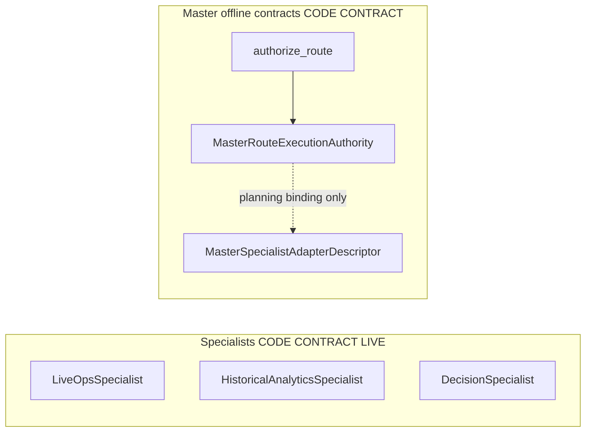
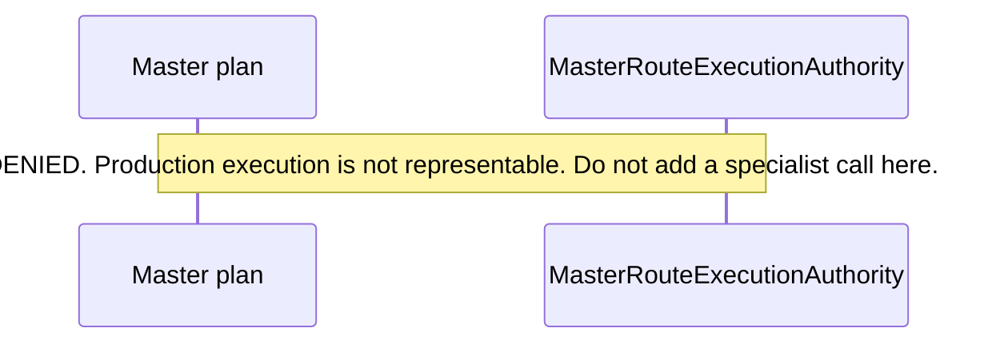

# AI system architecture

**Canonical page:** this page
**Verified against:** `8abd2d5` on `docs/ws5-ai-copilot`
**Maturity:** CODE, CONTRACT, LIVE
**Production authorization:** `MasterRouteExecutionAuthority.DENIED`; `MasterProductionAuthority.DENIED`; no Agent API, `/ai` route, or Terraform AI wiring found

## Purpose

This page distinguishes the three `MasterSpecialist` implementations from Master Agent contracts and states each component's implementation and verification status. Tool catalogs are on [Tools and data access](tools.md). Authority and fail-closed verification are on [Evidence and safety](evidence-and-safety.md). Test inventory is on [Tests and maturity](tests-and-maturity.md).

## Implementation status

| Question | Result | Source |
| --- | --- | --- |
| Code | CODE | `functions/shared/wilvor_ai/` (`LiveOpsSpecialist`, `HistoricalAnalyticsSpecialist`, `DecisionSpecialist`, `master_*.py`) |
| Terraform | TF absent at `8abd2d5` (search: `envs/dev`, `envs/dev-historical-data`, and `modules/**/*.tf` for `wilvor_ai`, `bedrock`, `agent_api`) | named search |
| Unit tests | UNIT for Historical and Decision operator-harness dry-run modules; Live Ops harness tests are CONTRACT; specialist behavior is under `tests/contracts/` | `tests/unit/scripts/test_validate_historical_specialist_anthropic_live.py`; `tests/unit/scripts/test_validate_decision_specialist_anthropic_live.py`; `tests/contracts/test_live_ops_anthropic_live_harness.py` |
| Contract tests | CONTRACT | `tests/contracts/test_*.py` (117 files at this commit) |
| Infrastructure tests | none found at `8abd2d5` (search: `tests/infrastructure/` for `wilvor_ai`) | named search |
| Integration tests | none found at `8abd2d5` (search: `tests/integration/` for `wilvor_ai`) | named search |
| Live harness | LIVE | `scripts/validate_live_ops_specialist_anthropic_live.py`; `scripts/validate_historical_specialist_anthropic_live.py`; `scripts/validate_decision_specialist_anthropic_live.py` |
| Current live pass | UNKNOWN | this documentation task did not run a provider or AWS harness |
| Deployment | UNKNOWN | no apply record or account observation is cited |
| Production authorization | `DENIED` | `functions/shared/wilvor_ai/master_routing.py` (`MasterRouteExecutionAuthority`); `functions/shared/wilvor_ai/master_contracts.py` (`MasterProductionAuthority`) |
| Agent API | absent at `8abd2d5` (search: `functions/operational_api` for `"/ai"`; `dashboard/src/routes/routeDefinitions.ts`; Terraform as above) | named search |

## Behavior

`MasterSpecialist` names three specialists: `LIVE_OPS`, `HISTORICAL_ANALYTICS`, and `DECISION` (source: `functions/shared/wilvor_ai/master_contracts.py`, `MasterSpecialist`). No other specialist member exists.

Wilvor's deterministic services remain authoritative for aircraft state, projections, hazards, encounters, risk, airport assessments, recommendations, alerts, geometry, trajectories, and state transitions. AI text may explain and summarize verified deterministic results. It does not replace those calculations, and it does not convert missing evidence into assumed facts (source: `functions/shared/wilvor_ai/README.md`; `dashboard/README.md`).

`AgentAuthorityMode` contains `READ_ONLY_ADVISORY` only. `V1_AUTHORITY` binds that mode to `ALLOWED_V1_CAPABILITIES` and `PROHIBITED_V1_CAPABILITIES` (source: `functions/shared/wilvor_ai/contracts.py`, `AgentAuthorityMode`, `V1_AUTHORITY`). The declaration is a testable contract, not runtime authorization enforcement (source: `functions/shared/wilvor_ai/README.md`).

### Live Operations Specialist

`LiveOpsSpecialist` implements `LiveOpsSpecialistPort.run`. It sequences an injected provider, LO1 dispatch, LO2 verification, LO3A export, and LO3B rendering. It does not call a vendor SDK, LangGraph, or AWS (source: `functions/shared/wilvor_ai/live_ops_specialist.py`, `LiveOpsSpecialist`). Canonical page: [Live Operations Specialist](live-operations-specialist.md).

### Historical Analytics Specialist

`HistoricalAnalyticsSpecialist` runs a provider-neutral `ModelProvider` loop around the bound historical adapter. It does not verify claims, render factual answers, create AWS clients, or import provider SDKs (source: `functions/shared/wilvor_ai/historical_specialist.py`, `HistoricalAnalyticsSpecialist`). Verification and rendering are a second stage: `finalize_historical_specialist_run` (source: `functions/shared/wilvor_ai/historical_answer_renderer.py`). Canonical page: [Historical Analytics Specialist](historical-analytics-specialist.md).

### Decision Specialist

`DecisionSpecialist` dispatches the closed Decision Tools, then DE1 verification and DE2 rendering. It does not calculate aviation facts, select an encounter, rank a recommendation, or treat persisted evidence as current (source: `functions/shared/wilvor_ai/decision_specialist.py`, `DecisionSpecialist`). Canonical page: [Decision Specialist](decision-specialist.md).

### Master Agent contracts

Master modules plan, classify, admit, corroborate, render nonfactual policy text, and assess execution readiness. They do not grant production execution. `MasterRouteExecutionAuthority` defines `DENIED` only. The docstring states that this is planning permission and that production execution is not representable (source: `functions/shared/wilvor_ai/master_routing.py`, `MasterRouteExecutionAuthority`). `reserved_production_adapter` raises `production_authority_not_issued` (source: `functions/shared/wilvor_ai/master_contracts.py`, `reserved_production_adapter`). Canonical page: [Master Agent](master-agent.md).

`run_synthetic_master_workflow` is test-only LangGraph orchestration over injected fake workers. Synthetic completion is not verified aviation evidence. `execution_authority` stays `DENIED` (source: `functions/shared/wilvor_ai/master_orchestration.py`). No `master_*.py` module dispatches `LiveOpsSpecialist`, `HistoricalAnalyticsSpecialist`, or `DecisionSpecialist`.

Caption: verified at `8abd2d5`. Solid edge: `authorize_route` returns `MasterRouteExecutionAuthority` (source: `functions/shared/wilvor_ai/master_routing.py`). Dotted edge: planned path; `MasterSpecialistAdapterDescriptor` is a planning binding and nothing on the object can be called to run a specialist (source: `functions/shared/wilvor_ai/master_specialist_adapters.py`, `MasterSpecialistAdapterDescriptor`). No specialist invocation edge is drawn.

Caption: shape required while `MasterRouteExecutionAuthority` has only `DENIED`. Source: `functions/shared/wilvor_ai/master_routing.py`, `MasterRouteExecutionAuthority`. Verified at `8abd2d5`.

## Interfaces

| Component | Public entry | Catalog |
| --- | --- | --- |
| Live Ops | `LiveOpsSpecialist.run` | `LIVE_OPS_TOOLS` (8 names) |
| Historical | `HistoricalAnalyticsSpecialist.run` then `finalize_historical_specialist_run` | `HISTORICAL_ANALYTICS_TOOLS` (4 names) |
| Decision | `DecisionSpecialist` over `DecisionToolsAdapter.invoke` | `DECISION_TOOLS` (4 names) |
| Master planning | `authorize_route` | none; execution denied |
| Master production adapter | `reserved_production_adapter` | raises; no grant |

`import wilvor_ai` remains contracts-only. It does not load `historical_analytics`, `live_ops`, `wilvor_historical_query`, or provider SDKs (source: `functions/shared/wilvor_ai/__init__.py`; `functions/shared/wilvor_ai/README.md`).

Catalog names were checked against exported catalogs and `READ_ONLY_TOOL_NAMES_BY_SPECIALIST` (source: `functions/shared/wilvor_ai/master_execution_policy_boundary.py`, `READ_ONLY_TOOL_NAMES_BY_SPECIALIST`; tests: `tests/contracts/test_master_execution_policy_boundary.py`, `test_vocabularies_and_read_only_catalogs_are_the_existing_ones`). Details are on [Tools and data access](tools.md).

## Known limitations

- Master execution authority is `DENIED`. Production authority is `DENIED`. Source authenticity is `NOT_ESTABLISHED`. Request coverage is `NOT_ESTABLISHED` (source: `functions/shared/wilvor_ai/master_routing.py`; `functions/shared/wilvor_ai/master_contracts.py`; `functions/shared/wilvor_ai/master_evidence_admission.py`).
- No production specialist dispatch is authorized by offline contracts. Adapter code must not dispatch from `CONTRACT_READY_FOR_FUTURE_INTEGRATION` (source: `functions/shared/wilvor_ai/MA5_MA7_INTERFACE_CONTRACT.md`, section 11.4; `functions/shared/wilvor_ai/master_execution_preflight.py`).
- An Agent API, API Gateway `/ai` route, dashboard `/ai` surface, and Terraform `wilvor_ai` / Bedrock wiring were not found at `8abd2d5`. Search scopes are in Implementation status.
- `modules/historical_analytics/iam.tf` describes an unattached query policy for a future Agent API. That policy is not an execution principal (source: `modules/historical_analytics/iam.tf`).
- LIVE records harness files. A current live pass is UNKNOWN. Stored live JSON artifacts, when cited in older README text, are historical evidence of a past run and are not a new pass (source: `functions/shared/wilvor_ai/README.md`).
- This page does not certify that any AWS account matches the repository.

## Historical record

No superseded statement is stored on this page. Stale current-status sentences that previously lived in `functions/shared/wilvor_ai/README.md` (Master Agent and Live Ops Expert described as unimplemented after those modules existed) are recorded on that README under Historical record.

## Sources

- Source: `functions/shared/wilvor_ai/master_contracts.py` (`MasterSpecialist`, `MasterProductionAuthority`, `reserved_production_adapter`)
- Source: `functions/shared/wilvor_ai/master_routing.py` (`MasterRouteExecutionAuthority`, `authorize_route`)
- Source: `functions/shared/wilvor_ai/live_ops_specialist.py` (`LiveOpsSpecialist`)
- Source: `functions/shared/wilvor_ai/historical_specialist.py` (`HistoricalAnalyticsSpecialist`)
- Source: `functions/shared/wilvor_ai/decision_specialist.py` (`DecisionSpecialist`)
- Source: `functions/shared/wilvor_ai/master_orchestration.py` (`run_synthetic_master_workflow`)
- Source: `functions/shared/wilvor_ai/master_specialist_adapters.py` (`MasterSpecialistAdapterDescriptor`)
- Source: `functions/shared/wilvor_ai/contracts.py` (`V1_AUTHORITY`, `AgentAuthorityMode`)
- Tests: `tests/contracts/test_master_execution_policy_boundary.py` (`test_vocabularies_and_read_only_catalogs_are_the_existing_ones`)
