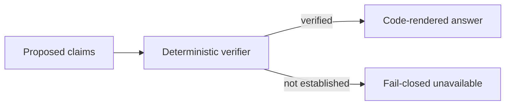

# Evidence and safety

**Canonical page:** this page
**Verified against:** `8abd2d5` on `docs/ws5-ai-copilot`
**Maturity:** CODE, CONTRACT
**Production authorization:** `MasterRouteExecutionAuthority.DENIED`; `V1_AUTHORITY` is `READ_ONLY_ADVISORY`; advisory mode is not source-read authority and is not production execution

## Purpose

This page explains deterministic claim verification, provenance, freshness, confidence, unsupported evidence, and fail-closed responses. It distinguishes advisory recommendations from prohibited autonomous execution. Specialist pipelines are on their own pages. Master authority is on [Master Agent](master-agent.md).

## Implementation status

| Question | Result | Source |
| --- | --- | --- |
| Code | CODE | `functions/shared/wilvor_ai/live_ops_evidence_verifier.py`; `functions/shared/wilvor_ai/historical_evidence_verifier.py`; `functions/shared/wilvor_ai/decision_evidence_verifier.py`; `functions/shared/wilvor_ai/master_provenance_trace.py` |
| Terraform | TF absent at `8abd2d5` (search: `*.tf` for `wilvor_ai`, `bedrock`, `agent_api`) | named search |
| Unit tests | none found under `tests/unit/` for verifiers | named search |
| Contract tests | CONTRACT | `tests/contracts/test_live_ops_evidence_verifier.py`; `tests/contracts/test_historical_verification.py`; `tests/contracts/test_decision_evidence_verifier.py`; `tests/contracts/test_sprint3a_ma7_safety_regression.py`; `tests/contracts/test_evidence_provenance.py` |
| Infrastructure tests | none found at `8abd2d5` (search: `tests/infrastructure/` for `wilvor_ai`) | named search |
| Integration tests | none found at `8abd2d5` (search: `tests/integration/` for `wilvor_ai`) | named search |
| Live harness | LIVE harnesses exist; they are not a current verifier pass | [Tests and maturity](tests-and-maturity.md) |
| Deployment | UNKNOWN | not verified |
| Production authorization | `DENIED` | `functions/shared/wilvor_ai/master_routing.py` (`MasterRouteExecutionAuthority`) |

## Behavior

### Advisory boundary

Wilvor is advisory decision support. It is not air traffic control and not a flight-control system (source: `dashboard/README.md`). Deterministic services remain authoritative for aircraft state, projections, hazards, encounters, risk, airport assessments, recommendations, alerts, geometry, trajectories, and state transitions (source: `functions/shared/wilvor_ai/README.md`).

`FinalAIResponse.human_review_required` is a required Boolean. Both `True` and `False` are structurally valid. Qualified human review is required for safety-sensitive operational guidance, including routing or diversion recommendations and other output intended to support an aviation operational action. A pure informational summary or historical analysis may represent `False`. The package does not decide when review is mandatory (source: `functions/shared/wilvor_ai/README.md`; `functions/shared/wilvor_ai/contracts.py`, `wilvor.ai.response.v1`).

`V1_AUTHORITY` uses `READ_ONLY_ADVISORY`. Allowed capabilities: retrieval, explanation, comparison, summarization, and visualization specifications over verified evidence. Prohibited capabilities (source: `functions/shared/wilvor_ai/contracts.py`, `PROHIBITED_V1_CAPABILITIES`):

- `MUTATE_OPERATIONAL_STATE`
- `MUTATE_ALERTS`
- `CREATE_OR_OVERWRITE_DETERMINISTIC_RECOMMENDATIONS`
- `ALTER_RISK_RESULTS`
- `ALTER_AIRCRAFT_PROJECTIONS`
- `ALTER_HAZARD_RECORDS`
- `EXECUTE_REROUTES`
- `ISSUE_AUTONOMOUS_FLIGHT_CONTROL_INSTRUCTIONS`
- `ISSUE_LANDING_INSTRUCTIONS`
- `ISSUE_ALTITUDE_INSTRUCTIONS`
- `ISSUE_ATC_INSTRUCTIONS`
- `MUTATE_AWS_INFRASTRUCTURE`

An allowed capability name is not evidence that a deployed runtime exists. `READ_ONLY_ADVISORY_IS_NOT_SOURCE_READ_AUTHORITY` is a distinct rejection (source: `functions/shared/wilvor_ai/master_live_ops_execution_readiness.py`, `MasterLiveOpsInterfaceConflict`).

### Deterministic claim verification

Unsupported factual claims stay unverified unless the deterministic verifier accepts them. Model quality is not the factual safety boundary (source: `functions/shared/wilvor_ai/README.md`).

| Specialist | Verifier | Authority |
| --- | --- | --- |
| Live Ops | `verify_live_ops_claims` | raw `ToolResult`; projections only for model-visible rows |
| Historical | `verify_historical_specialist_run` | full `ToolResult` and first-class `Evidence` |
| Decision | `verify_decision_evidence` | full raw `ToolResult`; not `DecisionToolProjection` or `DecisionEvidenceSnapshot` |

Fail closed. When verification cannot establish a claim, the specialist omits a factual answer or returns `UNAVAILABLE` / `UNKNOWN`. Historical any-failure path: `VerifierOutcome.FAILED`, empty `verified_claims`, `SpecialistStatus.UNAVAILABLE` with `CLAIM_VERIFICATION_FAILED`. No verification retry and no provider call (source: `functions/shared/wilvor_ai/README.md`). Decision fail-closed renderer sentence: "Wilvor could not verify the proposed decision claims against deterministic evidence, so no factual decision answer is being returned." (source: `functions/shared/wilvor_ai/decision_answer_renderer.py`). Live Ops tool failure: "No operational facts are verified." (source: `functions/shared/wilvor_ai/live_ops_public_contracts.py`, `LIVE_OPS_ANSWER_TOOL_FAILED`).

Master MA5 does not admit operational claims. Untrusted evidence renders only "Supplied evidence is not sufficient for an operational claim." (source: `functions/shared/wilvor_ai/master_response_renderer.py`; tests: `tests/contracts/test_sprint3a_ma7_safety_regression.py`, `test_untrusted_evidence_produces_no_operational_factual_response`).

### Provenance

`classify_master_provenance` is an offline audit. Supplied `ToolResult` and `Evidence` metadata are not an authenticated read. A proposed dispatcher event is not a completed read. Authenticated source-read provenance is not available. `AUTHENTICATED_SOURCE_READ_AVAILABLE` is false. Source authenticity stays `NOT_ESTABLISHED`. Production authority and Master execution authority stay `DENIED` (source: `functions/shared/wilvor_ai/master_provenance_trace.py`).

Clock roles stay distinct: source-event time, query time, observation time, evaluation time, requested evaluation time, tool as-of time, and completeness evaluated-as-of time. Different values across those roles are not, by themselves, `INCONSISTENT_TIMESTAMPS`.

### Freshness

`FreshnessStatus`: `FRESH`, `ACCEPTABLE`, `STALE`, `UNAVAILABLE`, `UNKNOWN`. Freshness is contextual and is never calculated by the contract package. For current operational evidence, freshness refers to the applicable current-state age or timeliness expectation. For historical evidence, the age of the historical event does not make the evidence stale. When freshness cannot be established, the contract uses `UNKNOWN` with a limitation. Live Ops V1 uses `UNKNOWN` with `FRESHNESS_NOT_ESTABLISHED`. Writers do not relabel `STALE`, `UNAVAILABLE`, or `UNKNOWN` as `FRESH` (source: `functions/shared/wilvor_ai/contracts.py`; `functions/shared/wilvor_ai/README.md`).

### Confidence

`ConfidenceLevel`: `HIGH`, `MEDIUM`, `LOW`, or `UNKNOWN`. Values keep the meaning supplied by the producer. Phase 0 does not calculate or reconcile projection, risk, recommendation, or AI-response confidence (source: `functions/shared/wilvor_ai/contracts.py`; `functions/shared/wilvor_ai/README.md`). Writers do not invent a numeric score or map LOW to "safe". A stored LOW level is not a statement that the aircraft is safe (source: `functions/shared/wilvor_ai/decision_answer_renderer.py`).

### Distinctions that stay fail-closed

#### Matching identifiers are not authentication

A second `authorize_route` for the same proposal can yield an equal invocation that is not the object retained by `open_session`. The registry rejects a copy with `copied_invocation_identifier`. Provenance records `MATCHING_IDENTIFIERS_NOT_ORIGIN` and stays `NOT_ESTABLISHED`. Matching source versions, timestamps, or request identifiers do not establish the origin of a read (source: `functions/shared/wilvor_ai/master_provenance_trace.py`; tests: `tests/contracts/test_sprint3a_ma7_safety_regression.py`, `test_matching_identifiers_are_not_authentication`).

#### Structural readiness is not execution permission

A Live Ops step with gate `NOT_REQUIRED` may have `ready_to_execute` true. The session, scope, preflight, and Live Ops binding all keep dispatch false. Naming `CONTRACT_READY_FOR_FUTURE_INTEGRATION` still binds with `dispatch_permitted` false and every provenance requirement missing. `evaluate_execution_preflight` returns `BLOCKED_BY_AUTHORIZATION` (tests: `tests/contracts/test_sprint3a_ma7_safety_regression.py`, `test_structurally_ready_plan_cannot_execute`). A listed tool name is not a table grant (source: `functions/shared/wilvor_ai/master_execution_policy_boundary.py`). `MasterSpecialistAdapterDescriptor` is a planned binding; nothing on the object can be called to run a specialist (source: `functions/shared/wilvor_ai/master_specialist_adapters.py`).

#### Intermediate results are not automatically authoritative evidence

The parallel bundle may accept a `HistoricalSpecialistRunResult` as a historical artifact type. Admission rejects it with `HISTORICAL_RUN_NOT_FINAL_ARTIFACT`. Response policy stays `INSUFFICIENT_EVIDENCE`, not `UNAVAILABLE`. A caller-reported `PROPOSED_CLAIMS` dependency is `REQUIRED_INTERMEDIATE`, not a terminal or final gate (tests: `tests/contracts/test_sprint3a_ma7_safety_regression.py`, `test_historical_intermediate_results_are_not_final_evidence`). `ToolResult.data` is not source authenticity. `ALL_VERIFIED` is not production authority.

#### Missing records do not establish zero risk

Risk absence is not a LOW risk classification. Unavailable evidence does not establish an unsafe result. A candidate count of zero does not mean that no safe airport exists. Coverage blocked is not zero. Master rejects fabricated verified-zero claims (`VERIFIED_ZERO_CLAIM_NOT_AUTHENTICATED`). A `NOT_FOUND` payload that says `source_authenticated: true` and `aircraft_count: 0` is `UNSUPPORTED_ARTIFACT` at admission; the payload is not read as a population count (tests: `tests/contracts/test_sprint3a_ma7_safety_regression.py`, `test_supplied_tool_results_do_not_establish_source_authenticity`, `test_verified_zero_cannot_be_fabricated`). Historical certified zero requires `NOT_FOUND` plus evaluable exact-zero proof.

#### Persisted airport candidates do not establish current suitability

`get_persisted_airport_candidate_evidence` is not current airport suitability, not a selected diversion, and not route validation. COMPLETE means persisted assessment scoring completed. Route, runway, and congestion evidence stay unavailable. "Persisted airport-evaluation evidence is not current airport suitability." (source: `functions/shared/wilvor_ai/decision_tools.py`; `functions/shared/wilvor_ai/decision_answer_renderer.py`). `TemporalScope.PERSISTED` is distinct from `CURRENT`. Do not describe CURRENT plus PERSISTED as `HYBRID`.

#### The LLM cannot select an ATC clearance, flight level, or operational diversion command

The stored `EVALUATE_DIVERSION` label is not a clearance, not a selected diversion, not a route, and not a dispatch or ATC instruction. No encounter is selected by the Decision answer. No recommendation is selected by the Decision answer. Stored recommendation actions are advisory evidence only (source: `functions/shared/wilvor_ai/decision_answer_renderer.py`). `PROHIBITED_V1_CAPABILITIES` includes `ISSUE_ATC_INSTRUCTIONS`, `ISSUE_ALTITUDE_INSTRUCTIONS`, `ISSUE_LANDING_INSTRUCTIONS`, `ISSUE_AUTONOMOUS_FLIGHT_CONTROL_INSTRUCTIONS`, and `EXECUTE_REROUTES`. Pages do not give a clearance, a dispatch decision, an ATC instruction, a landing instruction, an altitude instruction, or a reroute.

Advisory recommendations remain stored deterministic evidence that a human may review. They are not autonomous execution.

Caption: verified at `8abd2d5`. Solid edges are the specialist verify-then-render order read in `live_ops_specialist.py`, `historical_answer_renderer.py`, and `decision_specialist.py`. No edge grants Master production execution.

## Known limitations

- Verification of supplied artifacts is not an authenticated production read.
- Master response policy never admits operational claims at this baseline.
- `human_review_required=False` is structurally valid and is not a waiver of the safety-sensitive review rule.
- Dashboard missing attributes render as an em dash, not as `0`, because pipeline writers strip `None` before `put_item`. A verified zero count in a tool result and a missing attribute in the console are different cases (source: `dashboard/README.md`; `docs/DOCUMENTATION_STANDARDS.md`).
- DynamoDB Live Ops composition is not a transactional cross-table snapshot.

## Historical record

No superseded statement is stored on this page. Phase 0 contract narrative that defined evidence fields without specialist verifiers remains in [`functions/shared/wilvor_ai/README.md`](../../functions/shared/wilvor_ai/README.md).

## Sources

- Source: `functions/shared/wilvor_ai/contracts.py` (`V1_AUTHORITY`, `PROHIBITED_V1_CAPABILITIES`, `FreshnessStatus`, `ConfidenceLevel`)
- Source: `functions/shared/wilvor_ai/live_ops_evidence_verifier.py`
- Source: `functions/shared/wilvor_ai/historical_evidence_verifier.py`
- Source: `functions/shared/wilvor_ai/decision_evidence_verifier.py`
- Source: `functions/shared/wilvor_ai/decision_answer_renderer.py`
- Source: `functions/shared/wilvor_ai/master_provenance_trace.py` (`classify_master_provenance`)
- Source: `dashboard/README.md`
- Tests: `tests/contracts/test_sprint3a_ma7_safety_regression.py`
