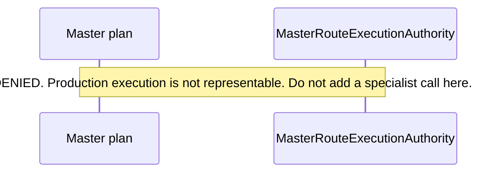

# Master Agent

**Canonical page:** this page
**Verified against:** `8abd2d5` on `docs/ws5-ai-copilot`
**Maturity:** CODE, CONTRACT
**Production authorization:** `MasterRouteExecutionAuthority.DENIED`; `MasterProductionAuthority.DENIED`; `MasterSourceAuthenticity.NOT_ESTABLISHED`; `MasterRequestCoverage.NOT_ESTABLISHED`

## Purpose

This page documents MA1–MA7 interfaces and responsibilities. It distinguishes synthetic/test-only orchestration from production execution. Specialist runtimes are documented on their own pages. Shared MA5/MA6/MA7 contract text remains in [`MA5_MA7_INTERFACE_CONTRACT.md`](../../functions/shared/wilvor_ai/MA5_MA7_INTERFACE_CONTRACT.md).

## Implementation status

| Question | Result | Source |
| --- | --- | --- |
| Code | CODE | `functions/shared/wilvor_ai/master_*.py` (26 modules) |
| Terraform | TF absent at `8abd2d5` (search: `*.tf` for `wilvor_ai`, `MasterRoute`, `authorize_route`) | named search |
| Unit tests | none found under `tests/unit/` for Master | named search |
| Contract tests | CONTRACT | `tests/contracts/test_master_*.py`; `tests/contracts/test_ma4_*.py`; `tests/contracts/test_ma7_*.py`; `tests/contracts/test_sprint3a_ma7_*.py` |
| Infrastructure tests | none found | named search |
| Integration tests | none found under `tests/integration/` | named search |
| Live harness | none found for Master production dispatch | named search: `scripts/validate_*` |
| Deployment | UNKNOWN | not verified |
| Production authorization | `DENIED` | `functions/shared/wilvor_ai/master_routing.py` (`MasterRouteExecutionAuthority`); `functions/shared/wilvor_ai/master_contracts.py` (`_deny_production`) |
| Source authenticity | `NOT_ESTABLISHED` | `functions/shared/wilvor_ai/master_evidence_admission.py` (`MasterSourceAuthenticity`) |
| Request coverage | `NOT_ESTABLISHED` | `functions/shared/wilvor_ai/master_routing.py` (`MasterRequestCoverage`) |

## Current authority boundary

These values are the representable Master path at `8abd2d5`:

| Symbol | Allowed value |
| --- | --- |
| `MasterRouteExecutionAuthority` | `DENIED` only |
| `MasterProductionAuthority` | constructors accept `DENIED` only; `PRODUCTION` is reserved and `_deny_production` raises `production_authority_not_issued` |
| `MasterSourceAuthenticity` | `NOT_ESTABLISHED` only |
| `MasterRequestCoverage` | `NOT_ESTABLISHED` only |
| Runtime flags where present | `dispatch_permitted`, `executable`, `claims_admitted`, `end_to_end_fulfilled` stay `False` |
| `AUTHENTICATED_SOURCE_READ_AVAILABLE` | `False` |
| `PRODUCTION_POLICY_ENGINE_AVAILABLE` | `False` |
| `AUTHENTICATED_PRINCIPAL_AVAILABLE` | `False` |

No production specialist dispatch is authorized merely by offline contracts. Adapter code must not dispatch from `CONTRACT_READY_FOR_FUTURE_INTEGRATION` (source: `functions/shared/wilvor_ai/MA5_MA7_INTERFACE_CONTRACT.md`, section 11.4). `reserved_production_adapter` raises and does not call specialists (source: `functions/shared/wilvor_ai/master_contracts.py`).

Exact agreement between proposal text and the trusted user request does not establish that the proposal understood or covered every part of the natural-language request. `request_coverage` stays `NOT_ESTABLISHED`. `execution_authority` stays `DENIED` (source: `functions/shared/wilvor_ai/master_routing.py`).

Caption: shape required while `MasterRouteExecutionAuthority` has only `DENIED`. Source: `functions/shared/wilvor_ai/master_routing.py`, `MasterRouteExecutionAuthority`. Verified at `8abd2d5`.

## Behavior

### Synthetic versus production execution

| Layer | Module | Invokes specialists? |
| --- | --- | --- |
| Test-only orchestration | `master_orchestration.py` (MA3) | `run_synthetic_master_workflow` compiles a LangGraph StateGraph against injected fake `workers`. There is no global registry and no default specialist. Synthetic completion is not verified aviation evidence. |
| Production specialists | Live Ops, Historical, Decision packages | not called from any `master_*.py` execution path |
| MA4 corroboration | `master_evidence_corroboration.py` | may run deterministic `verify_*` / `finalize_historical_specialist_run` on **supplied** artifacts. That is not a live specialist dispatch and is not source authentication. |

### MA1 — invocation contracts

`master_contracts.py` classifies specialist artifacts for a future Master Agent. It does not run specialists, install an orchestrator, or issue production factual authority. Structural validity and specialist-reported verification are not production authorization (source: `functions/shared/wilvor_ai/master_contracts.py`).

`MasterSpecialist`: `HISTORICAL_ANALYTICS`, `DECISION`, `LIVE_OPS`. `MasterPurpose`: `DISCOVERY`, `ANSWER`. Allowed planning pairs are Live Ops discovery/answer, Historical answer, and Decision answer (source: `functions/shared/wilvor_ai/master_routing.py`, `_ALLOWED_PAIRS`).

`expected_aircraft_id` and `expected_recommendation_id` on `MasterInvocationAuthorization` are comparison inputs only. They are not trusted Decision targets.

### MA2 — routing

`authorize_route` validates an untrusted route proposal against trusted application context and returns a bounded plan, a clarification, an unsupported result, or a safety refusal. It does not call specialists, models, AWS, or LangGraph (source: `functions/shared/wilvor_ai/master_routing.py`). Caps: `MAX_ROUTE_STEPS = 4`, `MAX_DECISION_STEPS = 1`, `MAX_HISTORICAL_WINDOW` of seven days.

An application-supplied aircraft or recommendation id is a comparison candidate only. It is not authenticated identity, currentness, or an executable Decision target. Model-supplied selection hints stay untrusted. A dependency is a planning edge only.

`ready_to_execute` can be true for a step whose only gate is `NOT_REQUIRED`. That structural flag is not execution permission (tests: `tests/contracts/test_sprint3a_ma7_safety_regression.py`, `test_structurally_ready_plan_cannot_execute`).

### MA3 — synthetic orchestration

`run_synthetic_master_workflow` is test-only. The in-process nonce only checks that a run still matches the decision just produced by `authorize_route`. It is not an authenticator and it does not grant production execution (source: `functions/shared/wilvor_ai/master_orchestration.py`). MA3 `SyntheticWorkerResult` / `SyntheticWorkflowResult` cannot be stored as Master evidence (source: `functions/shared/wilvor_ai/master_parallel_contracts.py`).

### MA4 — admission, corroboration, comparability

| Slice | Module | Function |
| --- | --- | --- |
| MA4.1 | `master_evidence_admission.py` | `admit_master_evidence` |
| MA4.2 | `master_evidence_corroboration.py` | `corroborate_master_evidence` |
| MA4.3 | `master_evidence_comparability.py` | `assess_master_evidence_comparability` |

Admission does not call specialists. Source authenticity stays `NOT_ESTABLISHED`. Consistency with supplied evidence is not production verification. Comparability eligibility stays inside `BLOCKED`, `UNSUPPORTED`, `NOT_ESTABLISHED`, and `CONTRACT_CHECKABLE_ONLY`. None of those is operational agreement or conflict (source: `functions/shared/wilvor_ai/MA5_MA7_INTERFACE_CONTRACT.md`, section 6).

### Shared parallel contracts

`master_parallel_contracts.py` records one Master request, the MA2 plan, evidence inputs, comparison requests, a nonfactual response-policy handoff, an execution-preflight report, and a safety handoff. It does not call admission, corroboration, comparison, a specialist, or a renderer (source: `functions/shared/wilvor_ai/master_parallel_contracts.py`). Schema: `wilvor.ai.master_parallel_contracts.v1`.

`execution_preflight_for` returns `BLOCKED_BY_AUTHORIZATION` when the plan has any step, because MA2 execution authority is `DENIED`, and `NOT_EXECUTABLE` when the plan has no steps. `executable` is false. This helper never returns `CONTRACT_READY_FOR_FUTURE_INTEGRATION` (source: `functions/shared/wilvor_ai/MA5_MA7_INTERFACE_CONTRACT.md`, section 3).

`MasterProvenanceRequirement` lists seven future proof categories. This module cannot mark any of them satisfied:

- `TRUSTED_SOURCE_ADAPTER`
- `AUTHORIZED_EXECUTION_CONTEXT`
- `SOURCE_READ_PROVENANCE`
- `REQUEST_ENTITY_BINDING`
- `OBSERVATION_EVALUATION_TIME`
- `SOURCE_VERSION_INTEGRITY`
- `POPULATION_SCOPE_COMPLETENESS`

### MA5 — response policy and renderer

`evaluate_master_response_policy` maps a bundle onto closed nonfactual states. `claims_admitted` stays false. There is no answer field (source: `functions/shared/wilvor_ai/master_response_policy.py`; `functions/shared/wilvor_ai/MA5_MA7_INTERFACE_CONTRACT.md`). `render_master_response` copies a fixed status sentence (source: `functions/shared/wilvor_ai/master_response_renderer.py`):

- `NOT_EVALUATED`: "Response policy has not been evaluated."
- `UNSUPPORTED`: "The request is unsupported. No operational conclusion is available."
- `UNAVAILABLE`: "Required evidence is unavailable. No count or zero is inferred."
- `INSUFFICIENT_EVIDENCE`: "Supplied evidence is not sufficient for an operational claim."

Required limitations include source authenticity not established, production authority denied, no operational claim, and execution denied. MA5 must not add aircraft, SIGMET, risk, or recommendation sentences.

### MA6 — preflight, adapters, scope, session, gates, provenance, bindings

The future sequence is: MA2 authorized planning; separately reviewed execution authorization; trusted adapter invocation; native specialist result; provenance validation; MA4 checks; MA5 response policy. MA6 modules stop before the separately reviewed execution authorization (source: `functions/shared/wilvor_ai/master_execution_preflight.py`; `functions/shared/wilvor_ai/master_specialist_adapters.py`).

| Module | Responsibility | Does not |
| --- | --- | --- |
| `master_execution_preflight.py` | `evaluate_execution_preflight`; `dispatch_permitted=False` | dispatch |
| `master_specialist_adapters.py` | `MasterSpecialistAdapterDescriptor`; planned binding only | hold a dispatch callable |
| `master_execution_scope.py` | `bind_master_execution_scope` | grant execution |
| `master_planning_session.py` | process-local session registry | authenticate a principal |
| `master_local_capability.py` | single-use local capability bookkeeping | production authorization (`PROCESS_LOCAL_RANDOM_TOKEN_IS_DISTRIBUTED_PRODUCTION_AUTHORIZATION = False`) |
| `master_gate_resolution.py` | `inspect_route_gates`; caller failure is diagnostic | treat caller-reported failure as an authoritative terminal |
| `master_provenance_trace.py` | `classify_master_provenance`; all seven requirements stay unsatisfied | authenticated source-read (`AUTHENTICATED_SOURCE_READ_AVAILABLE = False`) |
| `master_live_ops_binding.py` | prepare public `LiveOpsRunRequest` | call `LiveOpsSpecialist.run` |
| `master_historical_binding.py` | prepare historical binding | call the specialist or finalizer |
| `master_decision_binding.py` | prepare Decision binding | mint a trusted target |
| `master_execution_integration.py` | `inspect_master_execution_handoff` | execute, dispatch, or generate a factual response |
| `master_execution_policy_boundary.py` | `assess_master_execution_policy`; `specialist_dispatched=False` | permit a specialist to run |

Matching identifiers, source versions, or timestamps do not establish the origin of a read. Public dataclass fields are not proof of trust (source: `functions/shared/wilvor_ai/master_provenance_trace.py`). Clock roles stay distinct: source-event time, query time, observation time, evaluation time, requested evaluation time, tool as-of time, and completeness evaluated-as-of time. Different values across those roles are not, by themselves, `INCONSISTENT_TIMESTAMPS`.

### MA7 — safety boundaries

There is no `master_ma7.py`. MA7 at this baseline is `MasterSafetyHandoff` plus Sprint 3A boundary modules and safety tests.

| Module | Assessment | Does not |
| --- | --- | --- |
| `master_session_origin_boundary.py` | `assess_session_origin` | authenticate a principal or authorize sibling invocations |
| `master_live_ops_execution_readiness.py` | Live Ops readiness | construct trusted context or call tools |
| `master_historical_execution_readiness.py` | Historical readiness | store/finalize a run or copy plan windows into tool arguments |
| `master_decision_execution_readiness.py` | Decision readiness | grant `trusted_aircraft_id` |
| `master_source_read_trace_boundary.py` | `assess_source_read_trace` | mark a provenance requirement satisfied; `observed_trusted_runtime_events` stays empty |

Historical Sprint 3A review findings remain in [`SPRINT3A_MA7_SECURITY_REVIEW.md`](../../functions/shared/wilvor_ai/SPRINT3A_MA7_SECURITY_REVIEW.md). The current-baseline addendum on that file records that the seven modules named as absent at `7073b3a` now exist, while authority values are unchanged.

## Interfaces

Trusted planning identity lives on `MasterPlanningContext`: application-owned Master request id, correlation id, application request time, and canonical user text. That identity is not source authentication (source: `functions/shared/wilvor_ai/MA5_MA7_INTERFACE_CONTRACT.md`, section 4).

The Operational API Lambda is not an AI execution path. This contract does not route AI execution through `functions/operational_api` (source: `functions/shared/wilvor_ai/MA5_MA7_INTERFACE_CONTRACT.md`). Search of `functions/operational_api` for `"/ai"` at `8abd2d5` found no route.

## Known limitations

- Master execution authority `DENIED`. Production authorization `DENIED`. Source authenticity `NOT_ESTABLISHED`. Request coverage `NOT_ESTABLISHED`.
- No production specialist dispatch from offline contracts.
- Structural readiness (`ready_to_execute`, named `CONTRACT_READY_FOR_FUTURE_INTEGRATION`) is not execution permission.
- Process-local session ownership is not an authenticated principal.
- Single-use registry transitions are not dispatch permits.
- Matching identifiers are not authentication.
- Intermediate Historical runs are not final evidence.
- Decision comparison candidates cannot authorize targets.
- Verified zero cannot be fabricated from unauthenticated claims.
- Untrusted evidence produces no operational factual Master response.
- Agent API, dashboard `/ai`, and Terraform Master wiring are absent at this commit.
- `test_ma7_master_safety_matrix.py` still says "MA5 and MA6 modules are absent on this branch". That sentence is stale relative to this tree; the modules exist. The test file is not owned by this workstream and was not edited.

## Historical record

Package README sentences that said "Master Agent remains future work" after MA1–MA7 modules existed are moved to Historical record on [`functions/shared/wilvor_ai/README.md`](../../functions/shared/wilvor_ai/README.md). What remains unimplemented is production execution, an Agent API, and dashboard/Terraform wiring—not the existence of the offline Master contract suite.

`MA5_MA7_INTERFACE_CONTRACT.md` section 10 file lists and the "PROPOSED FOR LATER" heading described the foundation commit. Those lists are labeled historical on that file. The modules named there now exist in this tree.

## Sources

- Source: `functions/shared/wilvor_ai/master_contracts.py`
- Source: `functions/shared/wilvor_ai/master_routing.py` (`authorize_route`, `MasterRouteExecutionAuthority`)
- Source: `functions/shared/wilvor_ai/master_orchestration.py` (`run_synthetic_master_workflow`)
- Source: `functions/shared/wilvor_ai/master_parallel_contracts.py`
- Source: `functions/shared/wilvor_ai/master_specialist_adapters.py` (`MasterSpecialistAdapterDescriptor`)
- Source: `functions/shared/wilvor_ai/master_provenance_trace.py` (`classify_master_provenance`)
- Tests: `tests/contracts/test_master_routing.py`
- Tests: `tests/contracts/test_master_orchestration.py`
- Tests: `tests/contracts/test_sprint3a_ma7_safety_regression.py`
