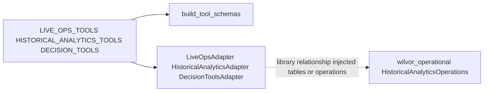

# Tools and data access

**Canonical page:** this page
**Verified against:** `8abd2d5` on `docs/ws5-ai-copilot`
**Maturity:** CODE, CONTRACT
**Production authorization:** listed catalog names are not table grants; `READ_ONLY_ADVISORY` is not source-read authority

## Purpose

This page records the approved read-only tool catalogs after validating exported names against source catalogs, adapter handlers, and `READ_ONLY_TOOL_NAMES_BY_SPECIALIST`. It does not infer tools from file names alone.

## Implementation status

| Question | Result | Source |
| --- | --- | --- |
| Code | CODE | `functions/shared/wilvor_ai/live_ops.py` (`LIVE_OPS_TOOLS`); `functions/shared/wilvor_ai/historical_analytics.py` (`HISTORICAL_ANALYTICS_TOOLS`); `functions/shared/wilvor_ai/decision_tools.py` (`DECISION_TOOLS`) |
| Catalog restatement | CODE | `functions/shared/wilvor_ai/master_execution_policy_boundary.py` (`READ_ONLY_TOOL_NAMES_BY_SPECIALIST`) |
| Terraform | TF absent at `8abd2d5` (search: `*.tf` for catalog tool names) | named search |
| Unit tests | none found under `tests/unit/` for catalogs | named search |
| Contract tests | CONTRACT | `tests/contracts/test_master_execution_policy_boundary.py` (`test_vocabularies_and_read_only_catalogs_are_the_existing_ones`); `tests/contracts/test_tool_schema.py`; `tests/contracts/test_live_ops_tools.py`; `tests/contracts/test_historical_analytics_tools.py`; `tests/contracts/test_decision_tools.py` |
| Infrastructure tests | none found at `8abd2d5` (search: `tests/infrastructure/` for `wilvor_ai`) | named search |
| Integration tests | CONTRACT integration-style Decision tests exist; they are not `tests/integration/` | `tests/contracts/test_decision_tools_integration.py` |
| Live harness | LIVE harnesses exist per specialist; they are not a current pass | [Tests and maturity](tests-and-maturity.md) |
| Deployment | UNKNOWN | not verified |
| Production authorization | none; a listed name is not a table grant | `functions/shared/wilvor_ai/master_execution_policy_boundary.py` |

## Behavior

### Catalog validation

`READ_ONLY_TOOL_NAMES_BY_SPECIALIST` restates the public read-only catalogs. A listed name is not a table grant (source: `functions/shared/wilvor_ai/master_execution_policy_boundary.py`, `READ_ONLY_TOOL_NAMES_BY_SPECIALIST`).

At `8abd2d5` the restated names equal `frozenset(item.name for item in tools)` for `LIVE_OPS_TOOLS`, `HISTORICAL_ANALYTICS_TOOLS`, and `DECISION_TOOLS` (tests: `tests/contracts/test_master_execution_policy_boundary.py`, `test_vocabularies_and_read_only_catalogs_are_the_existing_ones`). Adapter handler maps use the same names:

| Catalog | Definition | Schema builder | Dispatch |
| --- | --- | --- | --- |
| `LIVE_OPS_TOOLS` | `live_ops.py` | `live_ops_tool_schemas()` | `LiveOpsAdapter._DEFAULT_HANDLERS` |
| `HISTORICAL_ANALYTICS_TOOLS` | `historical_analytics.py` | `historical_analytics_tool_schemas()` | `HistoricalAnalyticsAdapter.get_handler` |
| `DECISION_TOOLS` | `decision_tools.py` | `decision_tool_schemas()` | `DecisionToolsAdapter.invoke` → `_execute` |

No extra catalog-only name or handler-only name was found beyond the lists below.

`build_tool_schemas(catalog)` copies catalog `input_fields`. It does not inspect function signatures. Schema generation fails closed if a catalog field uses a name in `FORBIDDEN_TOOL_SCHEMA_FIELD_NAMES` (`tables`, `now_epoch`, `as_of_utc`, `tool_call_id`, `sql`, `athena`, and related trusted or infrastructure names) (source: `functions/shared/wilvor_ai/tool_schema.py`).

### Source systems

| Specialist | Domain source | Runtime handles | AWS in the tool module |
| --- | --- | --- | --- |
| Live Ops | `wilvor_operational` `discovery`, `query`, `context`, optional `geospatial` | `LiveOpsCall.tables`, `now_epoch` | none; tools do not call AWS |
| Historical | `HistoricalAnalyticsOperations` and Phase 2B request contracts | `HistoricalAnalyticsCall.operations`, `as_of_utc` | none; adapter does not call AWS or render SQL |
| Decision | `decision_context`, `persisted_airport_evidence` over `wilvor_operational` | `DecisionToolsRuntime.tables`, `now_epoch`, `query_timestamp_utc` | none |

Whether injected tables point at a deployed DynamoDB account is UNKNOWN. Documentation work did not query AWS.

Caption: verified at `8abd2d5`. Solid edges are catalog-to-schema and catalog-to-adapter relationships read in source. The dotted edge is a library relationship: tool modules wrap domain functions and do not create AWS clients.

### Live Ops tools

All eight: `READ_ONLY_ADVISORY`, `RETRIEVE_DETERMINISTIC_OPERATIONAL_CONTEXT`, `TemporalScope.CURRENT` in mapped results.

| Name | Model-visible `input_fields` | Domain call |
| --- | --- | --- |
| `search_current_hazards` | optional `region`, `product_type`, `hazard_type`, `hazard_ids` | `discovery.discover_current_hazards` or `geospatial.discover_current_hazards_in_region` |
| `search_current_impacts` | same hazard filters | `query.search_current_impacts` |
| `search_current_encounters` | optional `aircraft_id`, `callsign`, `hazard_id`, `hazard_ids` | `query.search_current_encounters` |
| `get_observed_network_state` | none | `query.get_observed_network_state` |
| `get_aircraft_operational_context` | required `aircraft_id` | `context.build_aircraft_operational_context` |
| `get_hazard_operational_context` | required `hazard_id` | `context.build_hazard_operational_context` |
| `get_airport_operational_context` | required `airport_id` | `context.build_airport_operational_context` |
| `find_aircraft_by_callsign` | required `callsign` | `discovery.discover_aircraft_by_callsign` |

Adapter-level restriction: a hazard search requires `region` or nonempty `hazard_ids` even when the unbound catalog marks `region` optional (source: `functions/shared/wilvor_ai/live_ops.py`, `search_current_hazards` description; `functions/shared/wilvor_ai/master_live_ops_execution_readiness.py`).

### Historical Analytics tools

All four: `READ_ONLY_ADVISORY`, `RETRIEVE_HISTORICAL_ANALYTICS`.

| Name | Model-visible `input_fields` |
| --- | --- |
| `summarize_historical_encounters` | required `start_utc`, `end_utc`; optional `aircraft_id`, `hazard_id`, `hazard_type` |
| `summarize_historical_risks` | required `start_utc`, `end_utc`; optional `aircraft_id`, `hazard_id`, `encounter_id`, `risk_level` |
| `summarize_historical_hazard_versions` | required `start_utc`, `end_utc`; optional `hazard_id`, `hazard_type`, `product_type` |
| `list_historical_encounters` | required `start_utc`, `end_utc`; optional `aircraft_id`, `hazard_id`, `limit` |

The historical window is explicit UTC. Hazard-version windows are materialization/event time, not hazard validity-interval overlap (source: `functions/shared/wilvor_ai/historical_analytics.py`). `list_historical_encounters` is not callsign search, live aircraft state, current containment, or geography.

### Decision tools

All four: `READ_ONLY_ADVISORY`, `RETRIEVE_DETERMINISTIC_OPERATIONAL_CONTEXT`.

| Name | Model-visible argument | Scope |
| --- | --- | --- |
| `get_current_decision_context` | required `aircraft_id` | `CURRENT` |
| `get_current_risk_evidence` | required `aircraft_id` | `CURRENT` |
| `get_current_recommendation` | required `aircraft_id` | `CURRENT` |
| `get_persisted_airport_candidate_evidence` | required `recommendation_id` | `PERSISTED` |

The adapter checks request identity, returned tool name, invocation id, correlation id, temporal scope, evidence kind, and domain identity. It fails closed when request and result identity disagree (source: `functions/shared/wilvor_ai/decision_tools.py`; `functions/shared/wilvor_ai/README.md`).

### Evidence contracts

`ToolResult` is the envelope: status, JSON-compatible data, first-class `Evidence`, temporal scope, optional `as_of_utc`, limitations, tool-call identity, optional correlation identity (source: `functions/shared/wilvor_ai/contracts.py`, `ToolResult`).

`ToolResultStatus` is `SUCCESS`, `PARTIAL`, `NOT_FOUND`, `STALE`, `UNAVAILABLE`, or `UNKNOWN`. `NOT_FOUND` may carry an explicitly verified empty result and a zero count. That status is distinct from `UNKNOWN` and `UNAVAILABLE`. `PARTIAL`, `STALE`, `UNAVAILABLE`, and `UNKNOWN` keep their limitations (source: `functions/shared/wilvor_ai/contracts.py`, `ToolResultStatus`).

First-class `Evidence` is the provenance surface. `ToolResult.data` is the application payload. It is not source authenticity (source: `functions/shared/wilvor_ai/README.md`). A verifier must not depend solely on `ToolResult.data["evidence"]` or `ToolResult.data["coverage"]`.

`Evidence` identifies the deterministic source, supporting `SourceRecord` values, record ids, optional source version, optional event timestamp, query timestamp, contextual freshness, source confidence where applicable, limitations, originating tool-call id, temporal scope, and optional `SourceCompleteness`, `MatchCardinality`, `QueryExecutionTrace`, and `error_code` (source: `functions/shared/wilvor_ai/contracts.py`; `functions/shared/wilvor_ai/README.md`).

Zero source records are valid for a verified no-match or an unavailable source. Optional versions and event timestamps stay `None` when unavailable. The contract does not fabricate them.

### Model-visible projections

Projection is a derived view. The original `ToolResult` remains the audit and verifier authority (source: `functions/shared/wilvor_ai/tool_result_projection.py`). `MODEL_VISIBLE_RECORD_MAX = 25`. Forbidden application-data keys include `coverage`, `sql`, `athena`, `traceback`, and related infrastructure names.

| Specialist | Projection function |
| --- | --- |
| Historical | `project_tool_result` |
| Live Ops | `project_live_ops_tool_result` |
| Decision | `project_decision_tool_result` |

Live Ops verification uses raw `ToolResult` as factual authority and projections only to decide which rows the model could see (source: `functions/shared/wilvor_ai/live_ops_evidence_verifier.py`). Decision verification does not consult `DecisionToolProjection` (source: `functions/shared/wilvor_ai/decision_evidence_verifier.py`).

### Tool failure behavior

| Outcome | Behavior |
| --- | --- |
| Invalid request construction (historical) | `UNKNOWN` / `INVALID_REQUEST` without calling operations; no fabricated `as_of_utc` or certified zero |
| Live Ops tool execution failure | public answer `LIVE_OPS_ANSWER_TOOL_FAILED`; no operational facts verified |
| Decision request/result identity mismatch | adapter fails closed |
| Unknown catalog tool | `ContractValidationError` (`unknown_historical_tool` or equivalent validation) |
| Forbidden schema field | schema generation fails closed |
| `NOT_FOUND` with evaluable exact-zero proof | historical certified zero; not a fabricated population zero |
| `PARTIAL` | limitations retained; not rewritten as `SUCCESS` |
| `UNAVAILABLE` / `UNKNOWN` | limitations retained; not rewritten as empty-success |

Caller-reported specialist failures are not authoritative Master gate outcomes (tests: `tests/contracts/test_sprint3a_ma7_safety_regression.py`, `test_caller_reported_specialist_failure_is_not_an_authoritative_gate_outcome`).

### Data freshness and completeness

`FreshnessStatus` is `FRESH`, `ACCEPTABLE`, `STALE`, `UNAVAILABLE`, or `UNKNOWN` (source: `functions/shared/wilvor_ai/contracts.py`). Freshness is contextual. The contract package does not calculate it and does not define one global freshness algorithm.

Live Ops V1 evidence uses `FreshnessStatus.UNKNOWN` with `FRESHNESS_NOT_ESTABLISHED`. `CURRENT` is not `FRESH` (source: `functions/shared/wilvor_ai/live_ops_mapping.py`; `functions/shared/wilvor_ai/README.md`).

For historical evidence, the age of the historical event does not make the evidence stale. Completeness describes source fitness for a requested evaluation window and is never freshness (source: `functions/shared/wilvor_ai/README.md`). Historical mapping may attach `HISTORICAL_FRESHNESS_NOT_ESTABLISHED` (source: `functions/shared/wilvor_ai/historical_analytics_mapping.py`).

SIGMET `AVAILABLE` in existing subsystem vocabulary describes source availability, not an age-based freshness grade (source: `functions/shared/wilvor_ai/README.md`).

Writers do not relabel `STALE`, `UNAVAILABLE`, or `UNKNOWN` as `FRESH`. A dashboard or API cache interval is a separate number from `FreshnessStatus`.

Missing records do not establish zero risk. A verified zero requires the stronger historical `NOT_FOUND` plus evaluable exact-zero proof, or an explicitly verified empty Live Ops result. Master admission rejects fabricated verified-zero claims (`VERIFIED_ZERO_CLAIM_NOT_AUTHENTICATED`) (tests: `tests/contracts/test_sprint3a_ma7_safety_regression.py`, `test_verified_zero_cannot_be_fabricated`).

## Known limitations

- Catalog membership is not a DynamoDB, Athena, or IAM grant.
- `import wilvor_ai` does not export `LIVE_OPS_TOOLS` or `HISTORICAL_ANALYTICS_TOOLS`.
- Region text is not geospatial coverage authority.
- Historical `as_of_utc` is runtime-controlled, not a model argument.
- Decision persisted rows are not current airport suitability.
- No Agent API attaches these tools to a Lambda role at this commit.

## Historical record

Phase 0 README text said Phase 0 defines no tools. Later phases added the three catalogs above. That Phase 0 sentence remains historical on the package README.

## Sources

- Source: `functions/shared/wilvor_ai/live_ops.py` (`LIVE_OPS_TOOLS`)
- Source: `functions/shared/wilvor_ai/historical_analytics.py` (`HISTORICAL_ANALYTICS_TOOLS`)
- Source: `functions/shared/wilvor_ai/decision_tools.py` (`DECISION_TOOLS`)
- Source: `functions/shared/wilvor_ai/master_execution_policy_boundary.py` (`READ_ONLY_TOOL_NAMES_BY_SPECIALIST`)
- Source: `functions/shared/wilvor_ai/tool_schema.py` (`build_tool_schemas`, `FORBIDDEN_TOOL_SCHEMA_FIELD_NAMES`)
- Source: `functions/shared/wilvor_ai/tool_result_projection.py` (`project_tool_result`)
- Tests: `tests/contracts/test_master_execution_policy_boundary.py` (`test_vocabularies_and_read_only_catalogs_are_the_existing_ones`)
