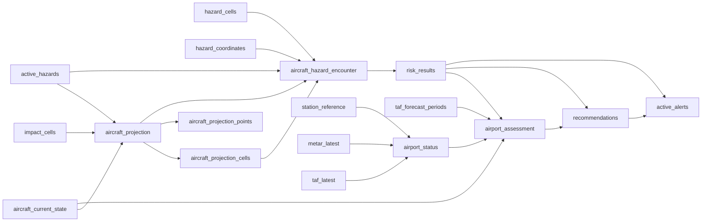

# DynamoDB operational tables

**Canonical page:** this page
**Verified against:** `8abd2d5` on `docs/ws3-processing-api`
**Maturity:** CODE, TF, UNIT
**Production authorization:** no grant found in table Terraform or processor writers. Table tags such as `TableRole = advisory-output` describe stored advisory evidence, not an approved flight-control action.

## Purpose

This page inventories DynamoDB tables used by operational processing and the Operational API. Physical keys, GSIs, TTL, and streams come from Terraform. Producer and reader relationships come from Lambda IAM and Python access. Current-set membership is defined only in [`functions/shared/wilvor_operational/README.md`](../../functions/shared/wilvor_operational/README.md) and `current_set.py`. Ingestion writer internals: [`docs/ingestion/README.md`](../ingestion/README.md).

## Implementation status

| Question | Result | Source |
| --- | --- | --- |
| Code | CODE | Processor writers under `functions/`; `functions/shared/wilvor_operational/{current_set,readers,access}.py`; `functions/operational_api/repository.py` |
| Terraform | TF | `modules/*/tables.tf`; `modules/aircraft_foundation/main.tf`; `envs/dev/main.tf` |
| Unit tests | UNIT | `tests/unit/shared/test_wilvor_operational_current_set.py`; `tests/unit/shared/test_wilvor_operational_readers.py`; processor writer tests under `tests/unit/{projection,encounter,risk,airport_status,recommendations,active_alerts}/` |
| Contract tests | none found for table schemas | search: `tests/contracts/` for DynamoDB key contracts |
| Infrastructure tests | none found for these table resources | search: `tests/infrastructure/` for `aws_dynamodb_table` operational processors |
| Integration tests | none found | search: `tests/integration/` for these tables |
| Live harness | none found | search: `scripts/validate_*` for DynamoDB inventory |
| Deployment | UNKNOWN | `not verified` |
| Production authorization | no grant found | table Terraform and processor writers |

## Naming, billing, streams, and PITR

Physical names follow `${var.name_prefix}-<kebab-slug>` with `name_prefix = "${var.project_name}-${var.environment}"` (source: `envs/dev/main.tf`, `local.name_prefix`). Example: `aws_dynamodb_table.aircraft_projection` is `"${var.name_prefix}-aircraft-projection"`.

Operational processing tables use `PAY_PER_REQUEST`. `station_reference` uses `PROVISIONED` (source: `modules/station_reference/tables.tf`).

No `stream_enabled` / `stream_view_type` was found under `modules/**/*.tf` at `8abd2d5`.

`envs/dev/main.tf` passes `enable_point_in_time_recovery = false` into the operational processing modules. SIGMET and METAR table resources hard-code `point_in_time_recovery { enabled = false }` in their `tables.tf`.

SSE (`server_side_encryption { enabled = true }`) is declared on `airport_status`, `airport_assessment`, `recommendations`, `active_alerts`, and `station_reference`. Projection, encounter, and risk table resources in this tree do not declare that block.

## Physical retention versus operational currentness

DynamoDB TTL deletion is asynchronous. Physical presence is never proof that a record is operationally current (source: `functions/shared/wilvor_operational/README.md`).

| Entity | Operational currentness (API / `current_set`) | Physical retention |
| --- | --- | --- |
| AircraftCurrentState | `expires_at_epoch > now_epoch` (`is_current_aircraft`) | TTL `expires_at_epoch` |
| AirportStatus | same (`is_current_airport_status`) | TTL `expires_at_epoch` |
| AircraftProjection | `READY` and `valid_until_epoch > now_epoch`; per-aircraft max `(generated_at_epoch, projection_id)` | TTL `expires_at_epoch` is retention |
| ActiveHazard | lifecycle: `ACTIVE` and `valid_to_epoch >= now_epoch`; queryable-current also requires `materialization_status == READY` | TTL `expires_at_epoch` is retention |
| AircraftHazardEncounter | `DETECTED`/`MONITORING` plus current projection and hazard lineage; TTL and encounter validity timestamps are not membership | TTL `expires_at_epoch` |
| RiskResult | `encounter_id` in current encounters; present `valid_until_utc` must be strictly future; **missing `valid_until_utc` is accepted** | TTL `expires_at_epoch` |
| Recommendation | list current-set: lifecycle-active plus current `risk_id`; compatibility helper `is_current_recommendation` is non-temporal | TTL `expires_at_epoch` |
| ActiveAlert | list current-set: lifecycle-active plus current `risk_id` **or** `recommendation_id` | TTL `expires_at_epoch` |
| AirportAssessment | no global current rule; no `is_current_airport_assessment` | TTL `expires_at_epoch` |

Shared readers do not apply current-set filters; callers apply `current_set` (source: `functions/shared/wilvor_operational/README.md`). Aircraft and airport **detail** GetItem paths do not apply the expiry predicate, so a retained expired row can be returned.

## Processing output tables

Attribute lists below are fields verified in the named writer. They are not a claim that every stored item contains every field: writers strip `None` before `put_item`.

### `aircraft_projection`

| | |
| --- | --- |
| TF resource | `aws_dynamodb_table.aircraft_projection` (`modules/projection/tables.tf`) |
| Physical name | `${name_prefix}-aircraft-projection` |
| Keys | PK `projection_id` (S) |
| GSIs | `aircraft_id-generated_at_epoch-index` (ALL); `projection_status-valid_until_epoch-index` (ALL) |
| TTL | `expires_at_epoch`, enabled |
| Producer | `functions/projection/processor/app.py` (`build_projection_parent`, `create_projection_parent`, `mark_projection_ready`) |
| Readers | encounter `get_projection`; Operational API / `wilvor_operational.readers.get_projection_record`; GSI latest-by-aircraft |
| Verified write attributes | `projection_id`, `aircraft_id`, `aircraft_state_version`, `source_position_time_epoch`, `generated_at_epoch`/`_utc`, `eligibility_checked_at_utc`, `current_aircraft_h3_cell`, `matched_impact_cells`, `trigger_hazard_ids`, `projection_trigger_reason`, `valid_until_epoch`/`_utc`, `projection_horizon_min`, `point_count`, `corridor_width_profile`, `corridor_h3_cell_count`, `confidence`, `projection_status`, algorithm/config versions, `idempotency_key`, `correlation_id`, `schema_version`, `expires_at_epoch`; optional `current_altitude_ft`, `freshness_status` (`build_projection_parent`) |

### `aircraft_projection_points`

| | |
| --- | --- |
| TF resource | `aws_dynamodb_table.aircraft_projection_points` |
| Keys | PK `projection_id` (S), SK `point_key` (S) |
| GSI | `aircraft_id-projected_time_epoch-index` (ALL) |
| TTL | `expires_at_epoch` |
| Producer | `write_projection_points` |
| Readers | `readers.query_projection_points_page`; Operational API aircraft detail first page |
| Currentness | no separate current-set function; composed with the parent projection |

### `aircraft_projection_cells`

| | |
| --- | --- |
| TF resource | `aws_dynamodb_table.aircraft_projection_cells` |
| Keys | PK `projection_id`, SK `h3_cell` |
| GSI | `h3_cell-projection_id-index` (ALL) |
| TTL | `expires_at_epoch` |
| Producer | `generate_projection_cells` / `write_projection_cells` |
| Readers | encounter `query_projection_cells`, `query_projection_cells_by_h3` |
| Role | spatial index for encounter overlap |
| Verified write attributes | `projection_id`, `h3_cell`, `aircraft_id`, `h3_resolution`, `generated_at_utc`, `valid_until_utc`, `projection_status_snapshot`, `created_at_utc`, `correlation_id`, `schema_version`, `expires_at_epoch` |

### `aircraft_hazard_encounter`

| | |
| --- | --- |
| TF resource | `aws_dynamodb_table.aircraft_hazard_encounter` (`modules/encounter/tables.tf`) |
| Keys | PK `encounter_id` (S) |
| GSIs | `aircraft_id-detected_at_epoch-index`; `hazard_id-detected_at_epoch-index`; `projection_id-hazard_version_key-index` (all ALL) |
| TTL | `expires_at_epoch` |
| Producer | `functions/encounter/processor/app.py` (`build_encounter_item`, `write_encounter`) |
| Readers | `readers.get_encounter_record`, candidate scans/queries; Operational API; risk processor GetItem |
| Verified write attributes | `encounter_id`, `aircraft_id`, `aircraft_state_version`, `projection_id`, `hazard_id`, `hazard_source_version`, `hazard_version_key`, `geometry_hash`, `projection_generated_at_utc`, `detected_at_epoch`/`_utc`, `matched_h3_cells`, `matched_h3_cell_count`, `candidate_reason`, `hazard_type`, `severity`, overlap fields (`geometry_overlap_status`, `time_overlap_status`, `altitude_overlap_status`, `corridor_intersects`), `trajectory_confidence`, `freshness_status`, `current_altitude_ft`, `encounter_state`, `evaluation_method`, `valid_from_utc`/`valid_to_utc`, `correlation_id`, `schema_version`, `expires_at_epoch` |

### `risk_results`

| | |
| --- | --- |
| TF resource | `aws_dynamodb_table.risk_results` (`modules/risk/tables.tf`) |
| Keys | PK `risk_id` (S) |
| GSIs | `encounter_id-generated_at_epoch-index`; `aircraft_id-generated_at_epoch-index` |
| TTL | `expires_at_epoch` |
| Producer | `functions/risk/processor/app.py` (`build_risk_result`, `persist_risk_result`) |
| Readers | Operational API; airport assessment GetItem; recommendation GetItem; alerts GetItem and encounter GSI |
| Verified write attributes | `risk_id`, `encounter_id`, `aircraft_id`, `hazard_id`, `hazard_source_version`, `projection_id`, `hazard_type`, `risk_score`, `risk_level`, component scores, `confidence`, `freshness_status`, `reasons`, `limitations`, scoring versions, `generated_at_epoch`/`_utc`, `valid_until_utc`, `correlation_id`, `schema_version`, `expires_at_epoch`; optional `severity` |

### `airport_status`

| | |
| --- | --- |
| TF resource | `aws_dynamodb_table.airport_status` (`modules/airport_status/tables.tf`) |
| Keys | PK `airport_id` (S) |
| GSIs | `station-updated-index` (`station_id`, `updated_at_epoch`); `weather-risk-updated-index`; `weather-impact-updated-index` |
| TTL | `expires_at_epoch` |
| SSE | enabled |
| Producer | `functions/airport_status/materializer/app.py` (`build_airport_status_item`) |
| Readers | airport assessment scan; Operational API list/detail; `readers.get_airport_status_record` |
| Verified write attributes | identity and geo from station/METAR/TAF, `has_metar`/`has_taf`, freshness ages, copied weather fields, `weather_risk_level`, `weather_impact_status`, `assessment_status`, `is_diversion_weather_ready`, `source_*_version`, `updated_at_epoch`/`_utc`, `schema_version`; optional `expires_at_epoch` when `AIRPORT_STATUS_TTL_SECONDS > 0` |

### `airport_assessment`

| | |
| --- | --- |
| TF resource | `aws_dynamodb_table.airport_assessment` (`modules/airport_assessment/tables.tf`) |
| Keys | PK `evaluation_id` (S), SK `airport_id` (S) |
| GSIs | `airport_assessment_id-index`; `airport_id-created_at_epoch-index` |
| TTL | `expires_at_epoch` |
| SSE | enabled |
| Producer | `functions/airport_assessment/processor/app.py` (`build_candidate`) |
| Readers | recommendation query by `evaluation_id`; Operational API recent assessments via `airport_id-created_at_epoch-index`; `readers.query_airport_assessments_for_evaluation` |
| Verified write attributes | `evaluation_id`, `evaluation_version`, `airport_id`, `airport_assessment_id`, `risk_id`, `aircraft_id`, `aircraft_state_version`, hazard fields, geo/ETA fields, weather copies, `assessment_status` (`COMPLETE` / `WAITING_FOR_WEATHER`), scores/ranks when complete, `taf_period_ids`, `known_limitations`, `created_at_epoch`/`_utc`, `expires_at_epoch`, `schema_version` |
| Currentness | none (evaluation-scoped) |

### `recommendations`

| | |
| --- | --- |
| TF resource | `aws_dynamodb_table.recommendations` (`modules/recommendations/tables.tf`) |
| Keys | PK `recommendation_id` (S) |
| GSIs | `aircraft_id-created_at_epoch-index`; `risk_id-created_at_epoch-index`; `recommendation_status-updated_at_epoch-index` (**unused** by established readers) |
| TTL | `expires_at_epoch` |
| SSE | enabled |
| Tag | `TableRole = advisory-output` |
| Producer | `functions/recommendations/processor/app.py` (`build_recommendation`, `persist`) |
| Readers | Operational API; alerts GetItem; `readers.get_recommendation_record` |
| Verified write attributes | `recommendation_id`, `recommendation_version`, `recommendation_status`=`ACTIVE`, `risk_id`, `aircraft_id`, `hazard_id`, `hazard_source_version`, `risk_level`, `risk_score`, `confidence`, `primary_action_type`, `primary_action_details`, `alternative_actions`, `reasons`, `limitations`, `evidence_references`, `source_versions`, `ruleset_version`, `advisory_notice`, `valid_from_utc`, `valid_until_utc`, timestamps, `correlation_id`, `schema_version`, `expires_at_epoch`; optional preferred-airport fields |

### `active_alerts`

| | |
| --- | --- |
| TF resource | `aws_dynamodb_table.active_alerts` (`modules/active_alerts/tables.tf`) |
| Keys | PK `fingerprint` (S) |
| GSIs | `alert_id-index`; `aircraft_id-updated_at_epoch-index`; `alert_state-updated_at_epoch-index` |
| TTL | `expires_at_epoch` |
| SSE | enabled |
| Tag | `TableRole = deduplicated-alert-state` |
| Producer | `functions/active_alerts/processor/app.py` (put_item create, update_item dedup path) |
| Readers | Operational API; processor Query on `aircraft_id-updated_at_epoch-index` |
| Verified write attributes | `fingerprint`, `alert_id`, `aircraft_id`, `hazard_id`, `hazard_source_version`, `recommendation_id`, `risk_id`, `risk_level`, `risk_score`, `primary_action_type`, `alert_type`, `alert_state`, `state_reason`, `message`, `notification_count`, `last_notified_at_utc`, `created_at_utc`, `updated_at_epoch`/`_utc`, `valid_until_utc`, `correlation_id`, `schema_version`, `expires_at_epoch`; optional `preferred_airport_id` |

## Upstream tables read by processors or the Operational API

Writer attribute contracts for these tables belong with WS2. Keys and GSIs below are from Terraform. Access patterns are from processing and API source.

| Table | TF | Keys | GSIs | TTL | Operational readers |
| --- | --- | --- | --- | --- | --- |
| `aircraft_current_state` | `modules/aircraft_foundation/main.tf` | PK `aircraft_id` | `current_h3_cell-position_time_epoch-index`; `callsign-position_time_epoch-index` | `expires_at_epoch` | projection GetItem; airport assessment GetItem; Operational API list/detail/map |
| `active_hazards` | `modules/sigmet/tables.tf` | PK `hazard_id` | `status-valid_to_epoch-index`; `source_product_id-created_at_utc-index` | `expires_at_epoch` | projection GetItem; encounter GetItem; Operational API `/hazards/active` |
| `impact_cells` | `modules/sigmet/tables.tf` | PK `h3_cell`, SK `hazard_version_key` | `hazard_version_key-h3_cell-index` | `expires_at_epoch` | projection eligibility Query |
| `hazard_cells` | `modules/sigmet/tables.tf` | PK `h3_cell`, SK `hazard_version_key` | `hazard_version_key-h3_cell-index` | `expires_at_epoch` | encounter overlap Query |
| `hazard_coordinates` | `modules/sigmet/tables.tf` | PK `hazard_version_key`, SK `coordinate_key` | none | `expires_at_epoch` | encounter geometry; Operational API GeoJSON hydration |
| `hazard_station_candidates` | `modules/sigmet/tables.tf` | PK `hazard_version_key`, SK `station_id` | `station-hazard-index` | `expires_at_epoch` | not on the Operational API table map in `envs/dev/main.tf` |
| `metar_latest` | `modules/metar/tables.tf` | PK `station_id` | `airport-id-observed-time-index` | `expires_at_epoch` | airport status GetItem; Operational API airport detail |
| `taf_latest` | `modules/taf/tables.tf` | PK `station_id` | `airport_id-issued_at_epoch-index` | `expires_at_epoch` | airport status GetItem; Operational API airport detail |
| `taf_forecast_periods` | `modules/taf/tables.tf` | PK `taf_version_key`, SK `period_key` | `station_id-period_from_epoch-index` | `expires_at_epoch` | airport assessment ETA window; Operational API airport detail |
| `station_reference` | `modules/station_reference/tables.tf` | PK `station_id` | `airport-station-index`; `h3-station-index` | none | airport status materializer |

`envs/dev/main.tf` `module.operational_api.table_names` does not include `aircraft_projection_cells`, `impact_cells`, `hazard_cells`, `hazard_station_candidates`, `station_reference`, or `runway_reference`. Search of the seven processing Lambdas found no reads of `runway_reference`.

METAR and TAF latest tables have no `is_current_metar` / `is_current_taf` in `current_set.py`. They are latest-row tables (one row per `station_id`).

## Producer to consumer graph

Caption: table reads and writes at `8abd2d5` from processor IAM and Python. Solid edges are GetItem/Query/Scan or put/update found in source. This diagram is storage movement, not EventBridge.

## Known limitations

- Attribute contracts are writer-verified, not live table samples. Deployment is UNKNOWN.
- `recommendation_status-updated_at_epoch-index` exists in Terraform and is unused by established readers.
- No global current airport assessment.
- Encounter producer vs API projection exact-end validity differ ([`docs/processing/README.md`](../processing/README.md)).
- TTL enablement is not current-set membership except for aircraft and airport-status list filters.

## Historical record

No superseded statement is stored on this page.

## Sources

- Source: `modules/projection/tables.tf`; `modules/encounter/tables.tf`; `modules/risk/tables.tf`; `modules/airport_status/tables.tf`; `modules/airport_assessment/tables.tf`; `modules/recommendations/tables.tf`; `modules/active_alerts/tables.tf`
- Source: `modules/aircraft_foundation/main.tf` (`aws_dynamodb_table.aircraft_current_state`); `modules/sigmet/tables.tf`; `modules/metar/tables.tf`; `modules/taf/tables.tf`; `modules/station_reference/tables.tf`
- Source: `functions/shared/wilvor_operational/current_set.py`; `functions/shared/wilvor_operational/README.md`
- Source: `envs/dev/main.tf` (`module.operational_api.table_names`)
- Tests: `tests/unit/shared/test_wilvor_operational_current_set.py`; `tests/unit/shared/test_wilvor_operational_readers.py`
