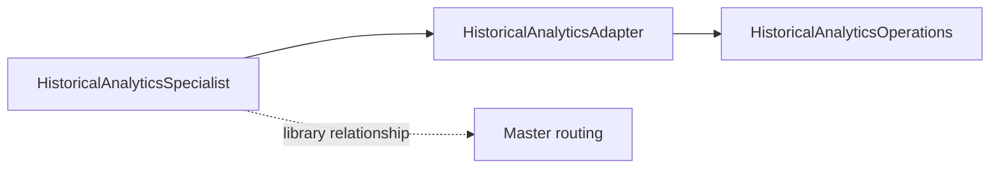
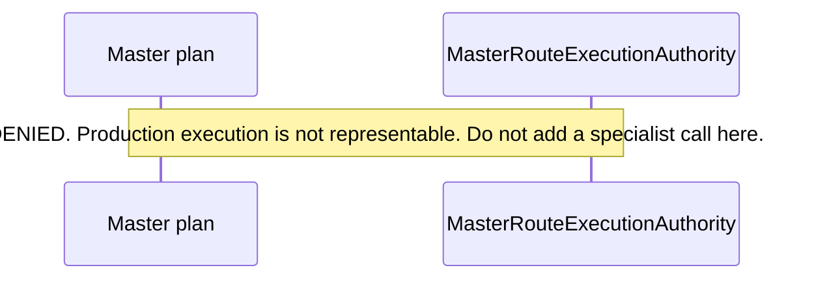

# Historical query tools and the AI specialist

**Canonical page:** this page
**Verified against:** `8abd2d5` on `docs/ws4-historical`
**Maturity:** CODE, UNIT, CONTRACT, LIVE
**Production authorization:** `MasterRouteExecutionAuthority.DENIED`. Production execution is not representable (source: `functions/shared/wilvor_ai/master_routing.py`, `MasterRouteExecutionAuthority`).

## Purpose

This page records the boundary between deterministic historical query code (WS4) and the Historical Analytics Specialist library (WS5). It does not document specialist orchestration as deployed AI infrastructure. Specialist internals stay on `docs/ai/**` (WS5) and [`functions/shared/wilvor_ai/README.md`](../../functions/shared/wilvor_ai/README.md).

## Implementation status

| Question | Result | Source |
| --- | --- | --- |
| Code | CODE | `functions/shared/wilvor_ai/historical_analytics.py`, `historical_analytics_mapping.py`, `historical_specialist.py` |
| Terraform | TF absent for this specialist | search: `*.tf` for `wilvor_ai`, `bedrock`, `anthropic` at `8abd2d5`: no matches |
| Unit tests | UNIT for query runtime; none found for the specialist class | `tests/unit/historical_query/`; search: `tests/unit/` for `HistoricalAnalyticsSpecialist` |
| Contract tests | CONTRACT | `tests/contracts/test_historical_analytics_mapping.py` (`test_verified_zero_maps_to_not_found_with_first_class_proof`; WS5-owned, not edited here) |
| Infrastructure tests | none found for Agent API | no Agent API resource in `modules/operational_api/api.tf` `local.route_keys` |
| Integration tests | none found | search: `tests/integration/` for `historical` |
| Live harness | LIVE for Anthropic specialist script | `scripts/validate_historical_specialist_anthropic_live.py` (no AWS/Athena/Bedrock per `scripts/README.md`) |
| Deployment | UNKNOWN | `not verified`; no TF wiring found |
| Production authorization | `DENIED` | `functions/shared/wilvor_ai/master_routing.py` (`MasterRouteExecutionAuthority`) |

## Behavior

Three layers stay distinct.

| Layer | Package | Authority |
| --- | --- | --- |
| Fact and query contracts | `wilvor_historical` | schema, windows, `evaluate_collection_window`, `is_verified_zero` |
| Deterministic runtime | `wilvor_historical_query` | fixed SQL, Athena executor, coverage store/gate, `HistoricalAnalyticsOperations` |
| AI-safe adapter and specialist | `wilvor_ai` | `ToolResult` mapping, bound adapter, offline specialist loop |

`HistoricalAnalyticsAdapter` does not implement an agent, call AWS, render SQL, or decide coverage (source: `functions/shared/wilvor_ai/historical_analytics.py`, module docstring). Trusted runtime constructs `HistoricalAnalyticsCall` with `HistoricalAnalyticsOperations`, `as_of_utc`, and `tool_call_id`. Those fields are not model-visible tool arguments.

`HISTORICAL_ANALYTICS_TOOLS` names the same four public operations as V1. Each tool uses `AgentAuthorityMode.READ_ONLY_ADVISORY` and `AgentCapability.RETRIEVE_HISTORICAL_ANALYTICS`. Model-visible `input_fields` are a per-tool allowlist. All four tools require `start_utc` and `end_utc`. Optional fields are stored filters (`aircraft_id`, `hazard_id`, `hazard_type`, `encounter_id`, `risk_level`, `product_type`) and list `limit`. There is no fifth risk-distribution tool.

`map_historical_query_response` maps domain status onto `ToolResultStatus` through `_STATUS_MAP` (source: `functions/shared/wilvor_ai/historical_analytics_mapping.py`):

| `HistoricalQueryStatus` | `ToolResultStatus` |
| --- | --- |
| `SUCCEEDED` | `SUCCESS` |
| `VERIFIED_ZERO` | `NOT_FOUND` |
| `RESULT_TRUNCATED` | `PARTIAL` |
| `COVERAGE_BLOCKED` | `UNAVAILABLE` |
| `COVERAGE_STORE_UNAVAILABLE` | `UNAVAILABLE` |
| `QUERY_FAILED` | `UNAVAILABLE` |
| `QUERY_CANCELED` | `UNAVAILABLE` |
| `QUERY_TIMEOUT` | `UNAVAILABLE` |
| `INVALID_REQUEST` | `UNKNOWN` |

`VERIFIED_ZERO` mapping requires `Evaluability.EVALUABLE`, `semantic_match_count == 0`, and `semantic_match_count_is_exact is True`. Incoherent certified status fails mapping rather than upgrading a zero.

`HistoricalAnalyticsSpecialist` is bounded offline orchestration around a provider-neutral `ModelProvider` (source: `functions/shared/wilvor_ai/historical_specialist.py`). It does not verify claims, render factual answers, create AWS clients, or import provider SDKs. Loop bounds in that module include `MAX_MODEL_TURNS = 3` and `MAX_TOOL_CALLS = 2`. Full specialist behavior is owned by WS5.

`MasterSpecialist` includes `HISTORICAL_ANALYTICS` (source: `functions/shared/wilvor_ai/master_contracts.py`). A listed specialist name is not a table grant and is not production execution. `MasterRouteExecutionAuthority` defines `DENIED` only. The docstring states that this is planning permission and that production execution is not representable.

Caption: library composition at `8abd2d5`. Solid edges are calls in `wilvor_ai`: the specialist constructs `HistoricalAnalyticsAdapter`, and the adapter calls `HistoricalAnalyticsOperations`. The dotted edge is a planning roster relationship, not a deployed invocation path. Search of `*.tf` for `bedrock`, `anthropic`, and `wilvor_ai` returned no matches. `MasterRouteExecutionAuthority` is `DENIED`. Sources: `functions/shared/wilvor_ai/historical_analytics.py`; `functions/shared/wilvor_ai/historical_specialist.py`; `functions/shared/wilvor_ai/master_routing.py`.

Do not add a specialist invocation arrow that implies production execution while `MasterRouteExecutionAuthority` contains only `DENIED`.

Caption: shape required while `MasterRouteExecutionAuthority` has only `DENIED`. Source: `functions/shared/wilvor_ai/master_routing.py`, `MasterRouteExecutionAuthority`. Verified at `8abd2d5`.

## What this boundary is not

- Historical query capabilities are not deployed AI infrastructure.
- `HISTORICAL_ANALYTICS_TOOLS` is a closed catalog. A listed name is not a Glue/Athena grant (source comment pattern in `functions/shared/wilvor_ai/master_execution_policy_boundary.py`, `READ_ONLY_TOOL_NAMES_BY_SPECIALIST`).
- The Operational API does not import `wilvor_ai` and has no historical-query HTTP route.
- The Anthropic live harness authorizes only the invocation that harness defines. It is not AWS, Athena, or Bedrock, and it is not a product grant.
- Deterministic services remain authoritative for historical counts, coverage, and `VERIFIED_ZERO`. AI text may explain verified deterministic results. It does not replace those calculations or convert missing evidence into assumed facts (source: `functions/shared/wilvor_ai/README.md`).

## Known limitations

- WS5 owns `docs/ai/**` and `functions/shared/wilvor_ai/README.md`. This page links; it does not copy specialist catalogs or Master safety matrices.
- Authenticated source-read provenance is not available on the Master audit path. `AUTHENTICATED_SOURCE_READ_AVAILABLE` is false in `functions/shared/wilvor_ai/master_provenance_trace.py`.
- `AgentAuthorityMode` contains `READ_ONLY_ADVISORY` only. Advisory mode is not source-read authority.

## Historical record

`functions/shared/wilvor_historical_query/README.md` and `modules/historical_analytics/README.md` still describe Phase 2C as an adapter catalog ready for a future specialist, with no model-backed specialist. After those phase notes, `HistoricalAnalyticsSpecialist` was added as offline library code. That addition is not a Terraform deploy and does not change `MasterRouteExecutionAuthority`.

## Sources

- Source: `functions/shared/wilvor_ai/historical_analytics.py` (`HISTORICAL_ANALYTICS_TOOLS`, `HistoricalAnalyticsAdapter`)
- Source: `functions/shared/wilvor_ai/historical_analytics_mapping.py` (`map_historical_query_response`)
- Source: `functions/shared/wilvor_ai/historical_specialist.py` (`HistoricalAnalyticsSpecialist`)
- Source: `functions/shared/wilvor_ai/master_routing.py` (`MasterRouteExecutionAuthority`)
- Source: `functions/shared/wilvor_ai/master_contracts.py` (`MasterSpecialist.HISTORICAL_ANALYTICS`)
- Tests: `tests/unit/historical_query/test_query_import_isolation.py` (`test_query_package_source_has_no_aws_or_ai_imports`)
- Tests: `tests/contracts/test_historical_analytics_mapping.py` (`test_verified_zero_maps_to_not_found_with_first_class_proof`)
