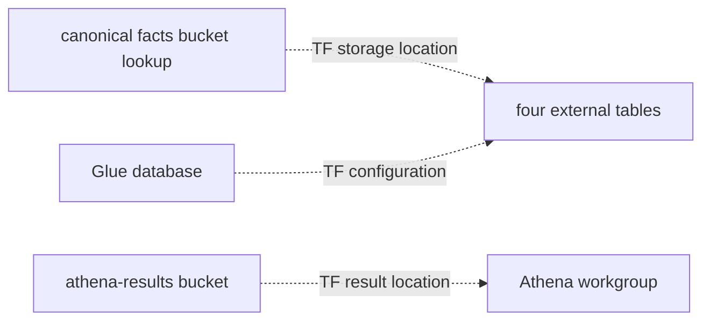

# Historical analytics catalog

**Canonical page:** this page | deep specification [`modules/historical_analytics/README.md`](../../modules/historical_analytics/README.md)
**Verified against:** `8abd2d5` on `docs/ws4-historical`
**Maturity:** CODE, TF, UNIT, INFRA, LIVE
**Production authorization:** no grant found. The query IAM policy is unattached. See [IAM](iam.md).

## Purpose

This page records Glue, Athena, and the disposable results bucket as Terraform configuration. Deterministic query execution is [Queries](queries.md). Catalog SQL templates are [`modules/historical_analytics/validation/README.md`](../../modules/historical_analytics/validation/README.md).

## Implementation status

| Question | Result | Source |
| --- | --- | --- |
| Code | CODE for executor consuming this catalog | `functions/shared/wilvor_historical_query/executor.py` |
| Terraform | TF | `modules/historical_analytics/{glue,athena,results_bucket,iam,monitoring}.tf` |
| Unit tests | UNIT | `tests/unit/historical_facts/test_glue_schema_parity.py` |
| Contract tests | none found | search: `tests/contracts/` for Glue/Athena resources |
| Infrastructure tests | INFRA | `tests/infrastructure/terraform/test_historical_analytics_contract.py`, `test_historical_analytics_validation.py` |
| Integration tests | none found | search: `tests/integration/` for `historical` |
| Live harness | LIVE | `scripts/validate_historical_analytics.ps1` (opt-in; dry-run makes no AWS calls) |
| Deployment | UNKNOWN | `not verified` |
| Production authorization | no grant found | `aws_iam_policy.query` is unattached |

## Behavior

`modules/historical_analytics` is gated by `enable_historical_analytics`. The module default is `false`. `envs/dev` assigns `true` (source: `modules/historical_analytics/variables.tf`; `envs/dev/main.tf` at `8abd2d5` line 143).

This module never declares `aws_s3_bucket` for the canonical facts name. When enabled it looks the bucket up with gated `data.aws_s3_bucket` using the same formula as the data plane (source: `modules/historical_analytics/locals.tf`, `local.historical_bucket_name`).

| Class | Root | `force_destroy` |
| --- | --- | --- |
| Historical facts bucket | `envs/dev-historical-data` | `false` |
| Athena query-results bucket | `envs/dev` / this module | `true` |
| Athena workgroup | `envs/dev` / this module | `true` |

Results bucket name: `${name_prefix}-historical-athena-results-${account_id}-${aws_region}`. Result prefix is `athena-results/`. Tags use `Component = historical-analytics` and `DataType = historical-analytics-derived`. That bucket is not tagged `DataType = historical-facts` (source: `modules/historical_analytics/locals.tf`, `local.common_tags`).

Results are derived analytics artifacts (default 3-day current-object expiry). They are not canonical historical truth and are not part of coverage evaluation.

### Glue

Database name: `${replace(name_prefix, "-", "_")}_historical_facts` (`wilvor_dev_historical_facts` with committed `wilvor-dev` prefix). Description states that Athena can answer which rows are present and that collection completeness remains the coverage evaluator (source: `modules/historical_analytics/glue.tf`, `aws_glue_catalog_database.historical_facts`).

| Table resource | SerDe | Physical prefix |
| --- | --- | --- |
| `aws_glue_catalog_table.structured["encounter"]` | `org.apache.hive.hcatalog.data.JsonSerDe` | `dataset=encounter/` |
| `aws_glue_catalog_table.structured["risk"]` | Hive JsonSerDe | `dataset=risk/` |
| `aws_glue_catalog_table.structured["hazard_version"]` | Hive JsonSerDe | `dataset=hazard_version/` |
| `aws_glue_catalog_table.hazard_geometry` | `org.apache.hadoop.hive.serde2.RegexSerDe`, `input.regex = "^(.*)$"`, column `json_record` | `dataset=hazard_geometry/` |

OpenX (`org.openx.data.jsonserde.JsonSerDe`) is forbidden (source: `modules/historical_analytics/README.md`; tests: `tests/infrastructure/terraform/test_historical_analytics_contract.py`, `test_structured_serde_is_hive_json_not_openx`).

`metadata/`, `errors/`, and `dataset=_collection_control/` are not cataloged.

Partition columns are `year`, `month`, `day`. Projection uses integer year/month/day with digits 4/2/2 and range `projection_year_min`–`projection_year_max` (defaults 2026–2036). Terraform emits `$${year}` so the table parameter contains `${year}` (source: `modules/historical_analytics/glue.tf`, `storage.location.template`). These partitions are canonical event dates, not Firehose arrival time.

Each table sets `wilvor.expected_fact_schema_version` to the v1 constant. The catalog does not union schema versions.

`COUNT(*) = 0` from Athena is not `VERIFIED_ZERO`. See [Coverage](coverage.md).

### Athena workgroup

Resource: `aws_athena_workgroup.historical_analytics` (source: `modules/historical_analytics/athena.tf`).

| Setting | Value |
| --- | --- |
| Name | `${name_prefix}-historical-analytics` |
| State | `ENABLED` |
| Engine | Athena engine version 3 |
| Enforce workgroup configuration | `true` |
| CloudWatch query metrics | `true` |
| Requester pays | `false` |
| Per-query scan cutoff | `10737418240` (10 GiB default) |
| Force destroy | `true` |
| Result location | `s3://<results-bucket>/athena-results/` |
| Result encryption | `SSE_S3` |
| `expected_bucket_owner` | account id |

The workgroup is a cost and control boundary. It is not a query API and it does not decide collection completeness (source: `modules/historical_analytics/athena.tf`, resource `description`).

Result reuse is not a workgroup setting. Each `StartQueryExecution` must set `ResultReuseByAgeConfiguration.Enabled = false` (source: `modules/historical_analytics/README.md`; `functions/shared/wilvor_historical_query/executor.py`).

Exceeding the 10 GiB cutoff cancels or fails that query. It does not change historical truth.

Caption: analytics catalog at `8abd2d5`. Dotted edges are Terraform configuration. Glue tables and the Athena workgroup share enablement; there is no Terraform dependency from tables to the workgroup. Canonical facts remain read-only. Deployment of this catalog is UNKNOWN. Sources: `modules/historical_analytics/glue.tf`; `modules/historical_analytics/athena.tf`; `modules/historical_analytics/results_bucket.tf`.

### Observability

Dashboard name / catalog id: `${name_prefix}-historical-analytics` / `historical-analytics`. Athena service events to EventBridge (`FAILED`, `CANCELED`) are best effort. A missing failure event does not prove a query succeeded. Custom metric: `Wilvor/Pipeline` / `HistoricalAnalyticsQueryFailed`. The Operational API has no Athena query permissions (source: `modules/historical_analytics/README.md`; `modules/historical_analytics/monitoring.tf`).

## Interfaces

| Output | Terraform |
| --- | --- |
| Glue database | `aws_glue_catalog_database.historical_facts` |
| Structured tables | `aws_glue_catalog_table.structured` |
| Geometry table | `aws_glue_catalog_table.hazard_geometry` |
| Workgroup | `aws_athena_workgroup.historical_analytics` |
| Results bucket | `aws_s3_bucket.athena_results` |
| Query policy | `aws_iam_policy.query` (unattached) |

## Known limitations

- This module does not create crawlers, named query APIs, or an execution role.
- `hazard_geometry` is cataloged but not in the V1 query IAM policy (source: `modules/historical_analytics/iam.tf`, Glue resources list `encounter`, `risk`, `hazard_version` only).
- Partition projection means the policy does not grant `glue:GetPartitions`.
- Operator validation SQL is not a query API and is not an AI surface.
- Whether Glue tables currently resolve objects in an account is UNKNOWN.

## Historical record

No superseded statement is stored on this page. Phase 2A.2 / 2B narrative in the module README is preserved there.

## Sources

- Source: `modules/historical_analytics/glue.tf`
- Source: `modules/historical_analytics/athena.tf`
- Source: `modules/historical_analytics/locals.tf`
- Source: `modules/historical_analytics/iam.tf` (`aws_iam_policy.query`)
- Tests: `tests/infrastructure/terraform/test_historical_analytics_contract.py`
- Tests: `tests/unit/historical_facts/test_glue_schema_parity.py`
