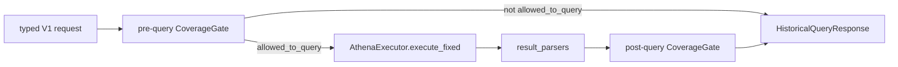

# Deterministic historical queries

**Canonical page:** this page | deep specification [`functions/shared/wilvor_historical_query/README.md`](../../functions/shared/wilvor_historical_query/README.md)
**Verified against:** `8abd2d5` on `docs/ws4-historical`
**Maturity:** CODE, TF, UNIT, INFRA, LIVE
**Production authorization:** no grant found. There is no attached query execution role. `MasterRouteExecutionAuthority` is `DENIED` (source: `functions/shared/wilvor_ai/master_routing.py`, `MasterRouteExecutionAuthority`). Historical query code is not deployed AI infrastructure.

## Purpose

This page records the closed V1 historical analytics operations, their data contracts, and the bounded Athena executor. Coverage rules stay on [Coverage](coverage.md). The AI adapter and specialist stay on [AI boundary](ai-boundary.md).

## Implementation status

| Question | Result | Source |
| --- | --- | --- |
| Code | CODE | `functions/shared/wilvor_historical/query_contracts.py`, `query_windows.py`; `functions/shared/wilvor_historical_query/{query_registry,query_sql,executor,operations,result_parsers}.py` |
| Terraform | TF for catalog/workgroup/policy | `modules/historical_analytics` |
| Unit tests | UNIT | `tests/unit/historical_facts/test_query_contracts.py`, `test_query_windows.py`; `tests/unit/historical_query/*.py` |
| Contract tests | none found for this package | search: `tests/contracts/` for `HistoricalAnalyticsOperations` |
| Infrastructure tests | INFRA | `tests/infrastructure/terraform/test_historical_analytics_query_iam_contract.py` |
| Integration tests | none found | search: `tests/integration/` for `historical` |
| Live harness | LIVE | `scripts/validate_historical_query_runtime.py` |
| Deployment | UNKNOWN | `not verified` |
| Production authorization | no grant found | unattached `aws_iam_policy.query`; no Agent API route |

## Behavior

Dependency direction (source: `functions/shared/wilvor_historical/README.md`):

```text
wilvor_historical <- wilvor_historical_query <- wilvor_ai.historical_analytics
```

`wilvor_historical` never imports the query package. The query package may import `wilvor_historical`. It must not import `boto3`, `botocore`, or `wilvor_ai`. Tests inject fake Athena and S3 clients (tests: `tests/unit/historical_query/test_query_import_isolation.py`).

### V1 operation catalog

Exactly four public operations (source: `functions/shared/wilvor_historical/query_contracts.py`, `HistoricalOperation`; tests: `tests/unit/historical_facts/test_query_contracts.py`, `test_v1_catalog_is_exactly_four_named_operations`):

| Operation | Request type | Result shape |
| --- | --- | --- |
| `summarize_historical_encounters` | `SummarizeHistoricalEncountersRequest` | `EncounterSummaryResult` |
| `summarize_historical_risks` | `SummarizeHistoricalRisksRequest` | `RiskSummaryResult` plus internal risk-level distribution |
| `summarize_historical_hazard_versions` | `SummarizeHistoricalHazardVersionsRequest` | `HazardVersionSummaryResult` |
| `list_historical_encounters` | `ListHistoricalEncountersRequest` | `HistoricalEncounterRecord` rows |

`summarize_historical_risks_by_level` is an `InternalQueryId`, not a fifth `HistoricalOperation` (source: `functions/shared/wilvor_historical_query/query_registry.py`, `InternalQueryId`).

There is no API for raw SQL, table names, column lists, GROUP BY, ORDER BY, arbitrary expressions, or LIMIT fragments. Forbidden request fields include `airport`, `callsign`, `region`, `geometry`, `sql`, `query`, `workgroup`, `output_location` (source: `query_contracts.py`, `FORBIDDEN_QUERY_REQUEST_FIELDS`).

No geometry or geography query exists. `hazard_geometry` is cataloged but not queried by V1 operations.

### Window contract

`[start_utc, end_utc)` is UTC-only, canonical `Z`, and whole-second. Naive timestamps, non-UTC offsets, and fractional-second bounds are rejected. `start` must precede `end`. V1 maximum duration is 7 days (`MAX_QUERY_WINDOW_DAYS = 7`; source: `functions/shared/wilvor_historical/query_windows.py`). There is no implicit "all history" and no implicit current/now request.

Query membership uses persisted `event_time_epoch`. The renderer never uses raw VARCHAR `event_time_utc` comparison as temporal truth. Intra-second order uses a fixed-width canonical key (source: `functions/shared/wilvor_historical_query/README.md`).

Partition predicates emit one exact year/month/day triple per touched UTC date. The renderer never emits Cartesian `year IN (...) AND month IN (...) AND day IN (...)` (tests: `tests/unit/historical_query/test_partitions.py`).

`fact_schema_version` is a code-owned constant. Callers cannot supply it.

### List truncation

`list_historical_encounters` requires `aircraft_id` or `hazard_id`. Limit default 100, min 1, max 200 (`LIST_DEFAULT_LIMIT`, `LIST_MIN_LIMIT`, `LIST_MAX_LIMIT`). Ordering is code-owned: `canonical_event_time_utc ASC`, `record_id ASC`, `dedup_id ASC` (`LIST_HISTORICAL_ENCOUNTERS_ORDERING`). Rendered `LIMIT` is `N + 1`. Truncation proves only `true matches >= N + 1`. It does not compute an exact total.

Selected columns are the `HistoricalEncounterRecord` allowlist. No `SELECT *`. No current DynamoDB enrichment.

### Executor and operations

`AthenaExecutor.execute_fixed(query_id=..., request=...)` is the only supported executor API in this package. It is not a production authorization grant. It does not accept SQL or a caller-built `RenderedQuery` (tests: `tests/unit/historical_query/test_athena_executor.py`, `test_public_executor_accepts_only_fixed_query_id_and_typed_request`).

Deployment values in `AthenaExecutorConfig` are not historical request fields: workgroup, Glue database, `expected_results_prefix` (`s3://<results-bucket>/athena-results/`), timeout default 180 s, poll interval default 2 s.

Every `StartQueryExecution` sets `ResultReuseByAgeConfiguration.Enabled = false`. The executor does not pass `ResultConfiguration.OutputLocation`; the workgroup owns output location. After `SUCCEEDED`, it verifies workgroup, database, output prefix, and submitted SQL equality. Exceeding `max_data_rows` fails with `RESULT_LIMIT_EXCEEDED`. The executor does not compute `VERIFIED_ZERO` or call `evaluate_collection_window`.

`HistoricalAnalyticsOperations` injects `CoverageGate` and `AthenaExecutor`. Successful flow: validate request and `as_of_utc` → pre-query gate → execute only if `EVALUABLE` → parse → post-query gate → `SUCCEEDED` / `VERIFIED_ZERO` / `RESULT_TRUNCATED`. `summarize_historical_risks` is atomic: aggregate, distribution, then a required cross-query count check.

`HistoricalQueryStatus` values: `SUCCEEDED`, `VERIFIED_ZERO`, `RESULT_TRUNCATED`, `COVERAGE_BLOCKED`, `INVALID_REQUEST`, `QUERY_FAILED`, `QUERY_CANCELED`, `QUERY_TIMEOUT`, `COVERAGE_STORE_UNAVAILABLE` (source: `functions/shared/wilvor_historical/query_contracts.py`, `HistoricalQueryStatus`).

Athena API poll states include `CANCELLED`. EventBridge query-state filters use AWS spelling `CANCELED`. Those spellings are distinct.

The Operational API route list has no historical-query HTTP route (source: `modules/operational_api/api.tf`, `local.route_keys`; also noted in [`docs/overview/architecture.md`](../overview/architecture.md)).



Caption: operations flow at `8abd2d5`. Solid edges are calls in `HistoricalAnalyticsOperations._run_single` / `_certify`. If the post-query gate is not `EVALUABLE`, `_certify` returns `_coverage_outcome` and does not keep the parsed Athena result as certified. The executor does not create AWS clients on import. Sources: `functions/shared/wilvor_historical_query/operations.py`; `functions/shared/wilvor_historical_query/executor.py`.

## Known limitations

- Library code plus Terraform catalog is not a deployed query service.
- Operator SSO live runs do not prove the unattached managed policy. See [IAM](iam.md).
- Hazard-version responses include `HAZARD_VERSION_WINDOW_LIMITATION`.
- Custom runtime CloudWatch metrics were not added. There is no deployed Agent API/Lambda to emit them (source: `modules/historical_analytics/README.md`).
- Current pytest pass counts are UNKNOWN. This page does not record a suite result.

## Historical record

The query-package README still lists "model-backed Historical Analytics Specialist" under "Still not implemented." Offline `HistoricalAnalyticsSpecialist` orchestration exists in `functions/shared/wilvor_ai/historical_specialist.py` as library code. That class is not Terraform, not an Agent API, and not a production execution grant. See [AI boundary](ai-boundary.md).

## Sources

- Source: `functions/shared/wilvor_historical/query_contracts.py` (`HistoricalOperation`, `HistoricalQueryStatus`)
- Source: `functions/shared/wilvor_historical/query_windows.py` (`MAX_QUERY_WINDOW_DAYS`)
- Source: `functions/shared/wilvor_historical_query/query_registry.py` (`InternalQueryId`)
- Source: `functions/shared/wilvor_historical_query/executor.py` (`AthenaExecutor.execute_fixed`)
- Source: `functions/shared/wilvor_historical_query/operations.py` (`HistoricalAnalyticsOperations`)
- Tests: `tests/unit/historical_query/test_query_registry.py` (`test_public_registry_is_exactly_the_four_v1_operations`)
- Tests: `tests/unit/historical_query/test_operations.py`
- Tests: `tests/unit/historical_query/test_athena_executor.py`
