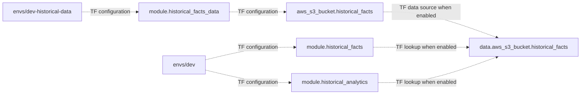

# Historical Terraform roots

**Canonical page:** this page
**Verified against:** `8abd2d5` on `docs/ws4-historical`
**Maturity:** CODE, TF, INFRA
**Production authorization:** no grant found. `enable_historical_facts = true` and `enable_historical_analytics = true` in `envs/dev/main.tf` are Terraform assignments. They do not establish DEPLOYED.

## Purpose

This page records the split between the persistent historical data plane and the recreatable `envs/dev` stack. Transport, analytics, identity, coverage, and query behavior stay on their canonical pages.

## Implementation status

| Question | Result | Source |
| --- | --- | --- |
| Code | CODE | `scripts/historical-data-up.ps1`, `scripts/dev-down.ps1` |
| Terraform | TF | `envs/dev/main.tf`, `envs/dev-historical-data/main.tf` |
| Unit tests | none found | search: `tests/unit/` for these root files |
| Contract tests | none found | search: `tests/contracts/` for these root files |
| Infrastructure tests | INFRA | `tests/infrastructure/terraform/test_historical_facts_contract.py`, `test_historical_data_plane_contract.py`, `test_historical_analytics_contract.py` |
| Integration tests | none found | search: `tests/integration/` for `historical` |
| Live harness | none found for apply state | this page does not run AWS |
| Deployment | UNKNOWN | `not verified` |
| Production authorization | no grant found | `envs/dev/main.tf` assignments are TF only |

## Behavior

The repository contains two Terraform roots at `8abd2d5` (source: `envs/dev/main.tf`; `envs/dev-historical-data/main.tf`).

| Root | Instantiates | Persistence | Ordinary destroy script |
| --- | --- | --- | --- |
| `envs/dev-historical-data` | `module.historical_facts_data` only | persistent bucket, `force_destroy = false` | refused by `scripts/dev-down.ps1` / `scripts/dev-reset.ps1` |
| `envs/dev` | `module.historical_facts`, `module.historical_analytics`, plus operational modules | recreatable transport, Glue, Athena, results bucket | `scripts/dev-down.ps1` |

`envs/dev-historical-data/main.tf` has no `enable_historical_facts` variable. The data-plane module is always instantiated when that root is used (source: `envs/dev-historical-data/main.tf`, `module.historical_facts_data`; tests: `tests/infrastructure/terraform/test_historical_data_plane_contract.py`, `test_data_plane_root_is_separate_and_ungated`).

Committed tfvars for that root use `aws_region = "us-west-1"`, `aws_profile = "wilvor-dev"`, `project_name = "wilvor"`, `environment = "dev"` (source: `envs/dev-historical-data/terraform.tfvars`). Combined with the bucket formula, the configured name is `${name_prefix}-historical-facts-${account_id}-${aws_region}` (source: `modules/historical_facts_data/locals.tf`, `local.bucket_name`). Whether that bucket exists in an account is UNKNOWN.

Caption: root ownership at `8abd2d5`. Dotted edges are Terraform configuration, not a recorded apply. The data-plane root creates the bucket; `envs/dev` modules look it up and do not declare `aws_s3_bucket` for that name. Sources: `envs/dev-historical-data/main.tf`; `envs/dev/main.tf`; `modules/historical_facts/locals.tf`; `modules/historical_analytics/locals.tf`.

## Enablement in `envs/dev`

Module defaults remain `false`:

- `enable_historical_facts` default `false` (source: `modules/historical_facts/variables.tf`, `variable.enable_historical_facts`)
- `enable_historical_analytics` default `false` (source: `modules/historical_analytics/variables.tf`, `variable.enable_historical_analytics`)

The committed `envs/dev` root assigns `true`:

- `module.historical_facts` `enable_historical_facts = true` (source: `envs/dev/main.tf` at `8abd2d5` line 117)
- `module.historical_analytics` `enable_historical_analytics = true` (source: `envs/dev/main.tf` at `8abd2d5` line 143)
- `module.operational_api` `enable_historical_facts = true` (source: `envs/dev/main.tf` at `8abd2d5` line 805)
- `enable_historical_analytics_dashboard` follows `module.historical_analytics.enable_historical_analytics` (source: `envs/dev/main.tf` at `8abd2d5` lines 807–809)

Those assignments are asserted by `test_dev_historical_facts_collection_is_enabled` and `test_dev_wires_analytics_enabled_and_collection_enabled` (tests: `tests/infrastructure/terraform/test_historical_facts_contract.py`; `tests/infrastructure/terraform/test_historical_analytics_contract.py`).

When `enable_historical_facts` is `true`, `modules/historical_facts` looks up the persistent bucket and creates Firehose, EventBridge targets, transform, coverage, and DLQ resources (`local.enabled = var.enable_historical_facts`; source: `modules/historical_facts/locals.tf`). When `false`, `data.aws_s3_bucket.historical_facts` is not evaluated (`count = local.enabled ? 1 : 0`).

When `enable_historical_analytics` is `true`, `modules/historical_analytics` looks up the same bucket name and creates Glue, Athena, the results bucket, and the unattached query policy (source: `modules/historical_analytics/locals.tf`, `local.enabled`).

A committed `true` is TF. It is not evidence that either root has been applied.

## Lifecycle scripts

`scripts/historical-data-up.ps1` may only target a directory matching `dev-historical-data`. There is no `scripts/historical-data-down.ps1` (tests: `tests/infrastructure/terraform/test_historical_facts_contract.py`, `test_dev_down_refuses_data_plane_and_deactivates_when_enabled`).

`scripts/dev-down.ps1` throws if `-TerraformDirectory` matches `dev-historical-data`. When `enable_historical_facts` output is true and a coverage Lambda name is set, that script invokes coverage `DEACTIVATE` and requires a durable deactivation object before destroying `envs/dev` (source: `scripts/dev-down.ps1`).

Operator lifecycle detail for those scripts: [`docs/operations/lifecycle.md`](../operations/lifecycle.md).

## Interfaces

| Interface | Value at `8abd2d5` | Source |
| --- | --- | --- |
| Persistent bucket formula | `${name_prefix}-historical-facts-${account_id}-${aws_region}` | `modules/historical_facts_data/locals.tf`, `local.bucket_name` |
| Facts Firehose name | `${name_prefix}-historical-facts` | `modules/historical_facts/locals.tf`, `local.facts_stream_name` |
| Geometry Firehose name | `${name_prefix}-historical-geometry` | `modules/historical_facts/locals.tf`, `local.geometry_stream_name` |
| Glue database | `${replace(name_prefix, "-", "_")}_historical_facts` | `modules/historical_analytics/locals.tf`, `local.glue_database_name` |
| Athena workgroup | `${name_prefix}-historical-analytics` | `modules/historical_analytics/locals.tf`, `local.workgroup_name` |
| Query policy name | `${name_prefix}-historical-analytics-query` | `modules/historical_analytics/locals.tf`, `local.query_policy_name` |

With committed `name_prefix` `wilvor-dev`, those formulas produce `wilvor-dev-…` names. Presence in AWS is UNKNOWN.

## Known limitations

- This page does not observe AWS. Deployment is UNKNOWN.
- Module variable descriptions still say the flags must remain false until explicit approval (source: `modules/historical_facts/variables.tf`; `modules/historical_analytics/variables.tf`). Those descriptions are module defaults. They do not override the `envs/dev` assignments.
- `enable_historical_facts = true` does not prove Firehose is delivering objects.
- `enable_historical_analytics = true` does not attach the query IAM policy to a principal. See [IAM](iam.md).
- There is no third Terraform root and no production or staging `envs/*/main.tf` besides these two (search at `8abd2d5`: `envs/*/main.tf`).

## Historical record

`modules/historical_facts/README.md` previously stated that `enable_historical_facts` must remain `false` in env/dev until the persistent data plane exists and an approved enable/apply is reviewed. That sentence described an earlier enablement policy. The current `envs/dev/main.tf` assignment is `true` at `8abd2d5`. The README correction lives on that file's Historical record.

## Sources

- Source: `envs/dev/main.tf` (`module.historical_facts`, `module.historical_analytics`, `module.operational_api`)
- Source: `envs/dev-historical-data/main.tf` (`module.historical_facts_data`)
- Source: `modules/historical_facts/variables.tf` (`enable_historical_facts`)
- Source: `modules/historical_analytics/variables.tf` (`enable_historical_analytics`)
- Source: `scripts/dev-down.ps1`
- Source: `scripts/historical-data-up.ps1`
- Tests: `tests/infrastructure/terraform/test_historical_facts_contract.py` (`test_dev_historical_facts_collection_is_enabled`)
- Tests: `tests/infrastructure/terraform/test_historical_data_plane_contract.py` (`test_data_plane_root_is_separate_and_ungated`)
- Tests: `tests/infrastructure/terraform/test_historical_analytics_contract.py` (`test_dev_wires_analytics_enabled_and_collection_enabled`)
