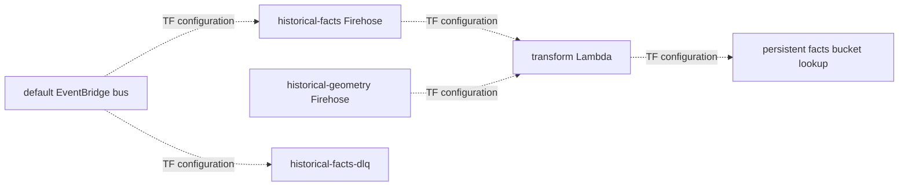

# Historical fact transport

**Canonical page:** this page | deep specification [`modules/historical_facts/README.md`](../../modules/historical_facts/README.md)
**Verified against:** `8abd2d5` on `docs/ws4-historical`
**Maturity:** CODE, TF, UNIT, INFRA
**Production authorization:** no grant found. `enable_historical_facts = true` in `envs/dev/main.tf` is Terraform configuration, not a deployment record.

## Purpose

This page maps fact generation and the recreatable EventBridge / Firehose / S3 path. Persistent bucket ownership is [Terraform roots](terraform-roots.md). Identity rules are [Fact identity](fact-identity.md). Glue and Athena are [Analytics catalog](analytics.md).

## Implementation status

| Question | Result | Source |
| --- | --- | --- |
| Code | CODE | `functions/historical_facts/transform/app.py`, `coverage_control/app.py`, `dlq_gap_consumer/app.py`; producer mapping in `wilvor_historical.from_events` |
| Terraform | TF | `modules/historical_facts/*.tf`, wired from `envs/dev/main.tf` |
| Unit tests | UNIT | `tests/unit/historical_facts/test_transform.py`, `test_from_events.py`, `test_dlq_gap_consumer.py`, `test_coverage_control.py` |
| Contract tests | none found | search: `tests/contracts/` for Firehose transport |
| Infrastructure tests | INFRA | `tests/infrastructure/terraform/test_historical_facts_contract.py` |
| Integration tests | none found | search: `tests/integration/` for `historical` |
| Live harness | none found that proves current S3 delivery | operator scripts under `scripts/` do not replace an apply record |
| Deployment | UNKNOWN | `not verified` |
| Production authorization | no grant found | TF enablement is not a production collection grant |

## Behavior

Producers emit operational EventBridge events as part of current-set processing. Additional historical rules on the default bus copy a subset of those events onto Firehose. Geometry does not use those rules.

### Generation

| Dataset | Producer path | Mapping |
| --- | --- | --- |
| encounter | `wilvor.encounter` / `encounter.updated`, `encounter.resolved` | `fact_from_event` |
| risk | `wilvor.risk` / `risk.updated`, `risk.resolved` | `fact_from_event` |
| hazard_version | `wilvor.weather` / `hazard.materialized` | `fact_from_event` |
| hazard_geometry | SIGMET in-memory READY geometry | `build_hazard_geometry_fact` then DirectPut |

Unknown EventBridge source/detail-type pairs raise `HistoricalMappingError` in the mapper. The transform returns `ProcessingFailed` (never `Dropped`) for malformed JSON, unknown source/detail-type, missing canonical time, contract validation failure, or unsupported geometry. The handler constants are `Ok` and `ProcessingFailed` only (source: `functions/historical_facts/transform/app.py`, `RESULT_OK`, `RESULT_PROCESSING_FAILED`, `_process_record`).

SIGMET geometry DirectPut is fail-open for the operational SIGMET record: blank `HISTORICAL_GEOMETRY_FIREHOSE_STREAM_NAME` returns without PutRecord; payload `> 1_024_000` bytes does not truncate; PutRecord errors emit `HistoricalGeometryPutFailure` and do not fail SIGMET processing (source: `functions/weather/sigmet/processor/app.py`, `publish_historical_geometry_fact`). `envs/dev/main.tf` passes `module.historical_facts.geometry_firehose_stream_name` and ARN into `module.sigmet` (tests: `tests/infrastructure/terraform/test_historical_facts_contract.py`, `test_dev_sigmet_uses_historical_geometry_outputs`).

### Firehose and S3

`modules/historical_facts` does not create the persistent bucket. When enabled it looks up `${name_prefix}-historical-facts-${account_id}-${aws_region}` (source: `modules/historical_facts/locals.tf`, `data.aws_s3_bucket.historical_facts`).

Two DirectPut streams share one transform Lambda (source: `modules/historical_facts/firehose.tf`, `aws_kinesis_firehose_delivery_stream.historical`):

| Stream key | Name formula | Source | Dataset prefixes |
| --- | --- | --- | --- |
| `facts` | `${name_prefix}-historical-facts` | EventBridge historical rules | `encounter`, `risk`, `hazard_version` |
| `geometry` | `${name_prefix}-historical-geometry` | SIGMET / coverage DirectPut | `hazard_geometry` |

Shared destination settings from that resource: `compression_format = "GZIP"`, `buffering_size` default 128 MiB, `buffering_interval` default 900 s, `dynamic_partitioning_configuration.enabled = true`. Lambda processor buffers are 3 MiB / 30 s.

Canonical success prefix (source: `modules/historical_facts/locals.tf`, `local.success_prefix`):

```text
dataset=!{partitionKeyFromLambda:dataset}/year=!{partitionKeyFromLambda:year}/month=!{partitionKeyFromLambda:month}/day=!{partitionKeyFromLambda:day}/
```

Partition keys come from canonical `event_time_utc` (or the control observation clock for `_collection_control` probes). EventBridge envelope time and Firehose `approximateArrivalTimestamp` are not canonical.

Error prefix (diagnostic; may use delivery time):

```text
errors/result=!{firehose:error-output-type}/year=!{timestamp:yyyy}/month=!{timestamp:MM}/day=!{timestamp:dd}/
```

`ACCEPTED_FOR_BOUNDED_DELIVERY_RETRY` means Firehose accepted the record. `DURABLY_PERSISTED` means a successful S3 dataset-prefix delivery was later observed. This module does not prove that observation (source: `modules/historical_facts/README.md`).

### EventBridge rules

Four additional rules on the existing default bus target the **facts** stream only (source: `modules/historical_facts/events.tf`, `local.historical_rules`, `aws_cloudwatch_event_target.historical_facts_firehose`):

| Rule key | `source` | `detail-type` |
| --- | --- | --- |
| encounter | `wilvor.encounter` | `encounter.updated`, `encounter.resolved` |
| risk | `wilvor.risk` | `risk.updated`, `risk.resolved` |
| hazard_version | `wilvor.weather` | `hazard.materialized` |
| control | `wilvor.historical.control` | `collection.probe` |

Retry: `maximum_event_age_in_seconds = 86400`, `maximum_retry_attempts = 185`, `dead_letter_config` on `${name_prefix}-historical-facts-dlq`.

There is no geometry EventBridge rule.



Caption: transport wiring at `8abd2d5`. Dotted-style labels mark Terraform configuration. The bucket resource is owned by `envs/dev-historical-data`, not this module. Whether the path is applied is UNKNOWN. Sources: `modules/historical_facts/events.tf`; `modules/historical_facts/firehose.tf`; `envs/dev-historical-data/main.tf`.

### Failure domains

The module README is the deep specification. Names that appear in source:

| Domain | Meaning in source |
| --- | --- |
| DOMAIN 1 | producer accepted, EventBridge did not; SQS DLQ does not contain these |
| DOMAIN 2 | EventBridge accepted, facts Firehose target failed; `dlq_gap_consumer` copies then deletes |
| DOMAIN 3A | transform `ProcessingFailed` |
| DOMAIN 3B | Firehose accepted, S3 destination unavailable; `POTENTIAL_GAP` / `S3_DESTINATION_FAILURE` |
| GEOMETRY | DirectPut fail-open |

`dlq_gap_consumer` deletes the SQS message only after the S3 incident write succeeds (source: `functions/historical_facts/dlq_gap_consumer/app.py`). Coverage control binds incidents and writes Domain 3B gaps; it does not auto-resolve Domain 3B after a later successful probe (source: `modules/historical_facts/README.md`).

Direct S3 historical control-plane writes under `metadata/*` are create-once (`PutObject` `IfNoneMatch="*"`). Identical retries are idempotent; a conflicting object at the same key fails closed (source: `modules/historical_facts/README.md`; tests: `tests/unit/historical_facts/test_immutable_control_writes.py`).

## Interfaces

| Resource | Terraform symbol |
| --- | --- |
| Facts and geometry streams | `aws_kinesis_firehose_delivery_stream.historical` |
| Historical EventBridge rules | `aws_cloudwatch_event_rule.historical` |
| Facts Firehose target | `aws_cloudwatch_event_target.historical_facts_firehose` |
| Domain-2 DLQ | `aws_sqs_queue.historical_facts_dlq` |
| Transform Lambda | `aws_lambda_function.transform` (name `local.transform_function_name`) |
| Coverage Lambda | coverage resources in `modules/historical_facts/coverage.tf` |
| Bucket lookup | `data.aws_s3_bucket.historical_facts` |

Operational API registers CloudWatch catalog id `historical-facts` only when `enable_historical_facts=true` (source: `modules/operational_api/api.tf`, `local.cloudwatch_dashboard_ids`; `functions/operational_api/cloudwatch_dashboards.py`). That catalog id is not an HTTP query route. While the id is absent, `UnknownDashboard` returns 404, not 500 (source: `functions/operational_api/app.py`).

## Known limitations

- Firehose acceptance is never durable historical persistence.
- This page does not claim every S3 destination outage becomes a replayable `s3delivery-failed` object.
- Domain 1 producer → EventBridge misses are not automatic replay.
- Geometry oversized reject and PutRecord errors are possible geometry coverage gaps.
- Collection enabled in Terraform is not proof that probes, Firehose, or S3 delivery currently succeed.
- `tests/infrastructure/aws/` has no historical-specific live AWS tests (search at `8abd2d5` for `historical` under that directory: no matches).

## Historical record

The earlier README sentence that `enable_historical_facts` must remain `false` in env/dev is stored on [`modules/historical_facts/README.md`](../../modules/historical_facts/README.md) under Historical record. Current `envs/dev` assignment is documented on [Terraform roots](terraform-roots.md).

## Sources

- Source: `modules/historical_facts/events.tf` (`local.historical_rules`, `aws_cloudwatch_event_target.historical_facts_firehose`)
- Source: `modules/historical_facts/firehose.tf` (`aws_kinesis_firehose_delivery_stream.historical`)
- Source: `modules/historical_facts/locals.tf` (`local.success_prefix`, `data.aws_s3_bucket.historical_facts`)
- Source: `functions/historical_facts/transform/app.py` (`RESULT_PROCESSING_FAILED`, `_process_record`)
- Source: `functions/historical_facts/dlq_gap_consumer/app.py`
- Source: `functions/weather/sigmet/processor/app.py` (`publish_historical_geometry_fact`)
- Source: `functions/operational_api/app.py` (`UnknownDashboard`)
- Source: `modules/operational_api/api.tf` (`local.cloudwatch_dashboard_ids`)
- Tests: `tests/infrastructure/terraform/test_historical_facts_contract.py` (`test_two_directput_firehose_streams_share_transform`, `test_four_narrow_eventbridge_patterns_target_facts_only`)
- Tests: `tests/unit/historical_facts/test_transform.py`
