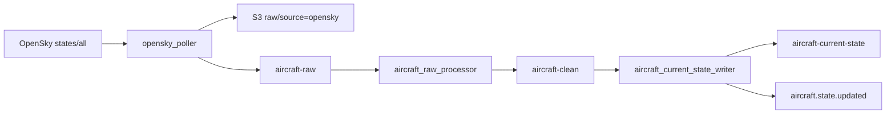

# Aircraft ingestion

**Canonical page:** this page
**Verified against:** `8abd2d5` on `docs/ws2-ingestion`
**Maturity:** CODE, TF, UNIT, INFRA
**Production authorization:** no grant found in `functions/opensky_poller/app.py` or `modules/aircraft_foundation`

## Purpose

This page documents OpenSky acquisition, raw and clean Kinesis processing, DynamoDB current-state writes, and `aircraft.state.updated`. Shared mapping types live in [`functions/shared/wilvor_aircraft/README.md`](../../functions/shared/wilvor_aircraft/README.md). Terraform resources are summarized in [`modules/aircraft_foundation/README.md`](../../modules/aircraft_foundation/README.md). Projection after this event belongs to WS3 (`docs/processing/`).

## Implementation status

| Question | Result | Source |
| --- | --- | --- |
| Code | CODE | `functions/opensky_poller/app.py` (`handler`), `functions/aircraft_raw_processor/app.py`, `functions/aircraft_current_state_writer/app.py`, `functions/shared/wilvor_aircraft/` |
| Terraform | TF | `modules/aircraft_foundation/`; `envs/dev/main.tf` (`module.aircraft_foundation`) |
| Unit tests | UNIT | `tests/unit/aircraft/` |
| Contract tests | none found | search: `tests/contracts` for aircraft / opensky |
| Infrastructure tests | INFRA | `tests/infrastructure/terraform/test_root_contract.py` (`test_dev_poller_schedules_are_disabled`) |
| Live-account infrastructure tests | files exist; require authenticated AWS and `terraform output` | `tests/infrastructure/aws/test_compute.py`, `test_data_services.py`, `test_eventing_monitoring.py`, `test_secrets.py` contain aircraft resource contracts; fixtures in `tests/infrastructure/conftest.py` (`terraform_outputs`, `aws_session`) |
| Integration tests | file exists; assertions read | `tests/integration/aircraft/test_aircraft_pipeline.py` asserts `icao24` and `aircraft_current_state.v1` |
| Live harness | none found for this pipeline | search: `scripts/validate_*`; local runners exist under `functions/opensky_poller/local_runner.py` and are not those harnesses |
| Deployment | UNKNOWN | `not verified` |
| Production authorization | no grant found | cited aircraft sources |

## Behavior

### External source

The poller Lambda `functions/opensky_poller/app.py` (`handler`) loads OAuth client credentials from Secrets Manager (`get_secret`), requests a client-credentials token from `OPENSKY_TOKEN_URL`, then GET `OPENSKY_STATES_URL` with bbox query params `lamin`, `lomin`, `lamax`, `lomax` (`fetch_opensky_states`). Terraform sets those env vars on `aws_lambda_function.opensky_poller` (source: `modules/aircraft_foundation/opensky_poller.tf`):

- Token URL: `https://auth.opensky-network.org/auth/realms/opensky-network/protocol/openid-connect/token`
- States URL: `https://opensky-network.org/api/states/all`
- Bbox comment in that file: "Small San Francisco Bay Area test box" — `37.0`, `-123.0`, `38.5`, `-121.5`

Secret resource: `aws_secretsmanager_secret.opensky_credentials` (source: `modules/aircraft_foundation/secrets.tf`). Terraform does not write the secret value.

### Scheduling

`aws_cloudwatch_event_rule.opensky_poller_schedule` uses `var.opensky_poller_schedule_expression` (default `rate(5 minutes)`) and `state = var.enable_opensky_poller_schedule ? "ENABLED" : "DISABLED"` (source: `modules/aircraft_foundation/opensky_poller.tf`). `envs/dev/main.tf` sets `enable_opensky_poller_schedule = false` (tests: `test_dev_poller_schedules_are_disabled`).

Handler also accepts `event["test"] == "internet"` and `event["test"] == "opensky-token"` smoke paths (`handler`).

### Archive, Kinesis, validation

Each poll archives the full OpenSky JSON to S3 under `raw/source=opensky/year=.../{poll_id}.json` (`archive_raw_response`) and publishes one Kinesis record per state vector (`publish_raw_records`) with `schema_version` `opensky_aircraft_raw.v1` (source: `functions/shared/wilvor_aircraft/schemas.py`, `OPENSKY_RAW_SCHEMA_VERSION`). Partition key is `icao24` or `unknown-{index}`. Batches are 500. Failed `put_records` increment `FailedKinesisRecords` but the handler still returns success if fetch and archive succeeded.

The raw processor (`functions/aircraft_raw_processor/app.py`) is mapped from `aircraft-raw` with `starting_position = LATEST`, batch 100, `ReportBatchItemFailures`, `maximum_retry_attempts = 3` (source: `modules/aircraft_foundation/aircraft_raw_processor.tf`). It validates the envelope, maps through `map_raw_event_to_current_state`, archives mapping/decode rejects to `bad-records/source=opensky/`, and publishes clean records to `aircraft-clean`. Envelope rejects that archive successfully are not retried. Archive failure and clean-publish failure return `batchItemFailures`.

`validate_raw_state_vector` rejects short vectors, missing required fields, incomplete lat/lon, out-of-range kinematics, and timestamps older than epoch `1_262_304_000` or more than 600 seconds in the future (source: `functions/shared/wilvor_aircraft/opensky_mapper.py`). Required clean fields are listed in `OPENSKY_REQUIRED_CLEAN_FIELDS`. Mapped items use `aircraft_id` (lowercased `icao24`), `state_version` / `idempotency_key` `{aircraft_id}#{position_time_epoch}`, `source_system` `OPEN_SKY`, and schema `aircraft_current_state.v2`.

### Current-state writer

The writer (`functions/aircraft_current_state_writer/app.py`) consumes `aircraft-clean` with the same Kinesis mapping pattern. `put_current_state_item` conditions on incoming `position_time_epoch` being newer (or the key being new). When `has_position` is false it also refuses to overwrite a positioned row. `ConditionalCheckFailedException` is treated as a skip, not a batch failure.

On `"written"`, `publish_aircraft_state_updated` puts `Source` `wilvor.aircraft`, `DetailType` `aircraft.state.updated`. PutEvents failure raises and becomes a batch failure.

Caption: aircraft path read at `8abd2d5`. Sources: `functions/opensky_poller/app.py`, `functions/aircraft_raw_processor/app.py`, `functions/aircraft_current_state_writer/app.py` (`publish_aircraft_state_updated`), `modules/aircraft_foundation/main.tf`.

### Freshness and timestamps

| Field | Setter |
| --- | --- |
| `opensky_response_time` | OpenSky response `time` on the raw envelope |
| `position_time_epoch` | OpenSky `time_position` |
| `last_contact_epoch` | OpenSky `last_contact` |
| `fetched_at_utc` / `received_at_utc` | Poller clock |
| `processed_at_utc` | Mapper clock |
| `position_age_seconds` | `processed_at_epoch - position_time_epoch` (clamped at 0) |
| `freshness_status` | `classify_freshness`: `FRESH` ≤ `fresh_seconds` (dev 60), `ACCEPTABLE` ≤ `acceptable_seconds` (dev 180), else `STALE`; missing age → `UNAVAILABLE` |
| `expires_at_epoch` | `processed_at_epoch + ttl_seconds` (dev 1800) |

Writer ordering uses `position_time_epoch`, not `freshness_status` (source: `put_current_state_item`).

### Data quality, idempotency, retries

- New `poll_id` per poll (`uuid.uuid4`).
- DynamoDB condition provides last-write-wins by position time.
- EMF namespace `Wilvor/Pipeline` via `functions/shared/wilvor_aircraft/monitoring.py` (`emit_metric`).
- Kinesis consumers start at `LATEST`; a new mapping does not replay retained shards.

## Interfaces

| Kind | Pattern | Source |
| --- | --- | --- |
| Raw stream | `${name_prefix}-aircraft-raw` | `modules/aircraft_foundation/main.tf` |
| Clean stream | `${name_prefix}-aircraft-clean` | same |
| Table | `${name_prefix}-aircraft-current-state` hash `aircraft_id`; GSIs `current_h3_cell-position_time_epoch-index`, `callsign-position_time_epoch-index`; TTL `expires_at_epoch` | same |
| Archive bucket | `${name_prefix}-aircraft-archive-${account_id}-${aws_region}` | same |
| Secret | `${name_prefix}/opensky/credentials` | `modules/aircraft_foundation/secrets.tf` |
| Event | `wilvor.aircraft` / `aircraft.state.updated` | `publish_aircraft_state_updated` |
| Dev H3 | `aircraft_h3_resolution = 4` | `envs/dev/main.tf` |

## Known limitations

- OpenSky poller schedule is `false` in `envs/dev`.
- Terraform bbox is the San Francisco Bay test box, not a global query.
- `functions/opensky_poller/local_runner.py` sets a continental-US bbox (`OPENSKY_LAMIN=24.0` … `LOMAX=-66.0`) while commenting that it matches Terraform. The Terraform values differ.
- `tools/local_opensky_poller.py` `build_kinesis_records` omits `raw_s3_bucket` / `raw_s3_key`. The raw processor requires that lineage.
- Poller Kinesis partial failures do not fail the invocation.
- `time_position` is not in `OPENSKY_REQUIRED_CLEAN_FIELDS` but mapping requires it.
- Unit fixtures in `tests/conftest.py` (`clean_aircraft_record`) and several unit tests still use `icao24`, `ttl_epoch`, and `aircraft_current_state.v1`. `manual_mapper_test.py` matches v2 (`aircraft_id`, `expires_at_epoch`).
- Integration test `test_raw_stream_reaches_current_state_and_rejects_stale_state` uses DynamoDB key `icao24` and schema `aircraft_current_state.v1`. Current table hash key is `aircraft_id` and schema is v2.
- PITR on the current-state table is `enabled = false` (source: `modules/aircraft_foundation/main.tf`).
- OpenSky secret value is not created by Terraform.
- Live-account tests under `tests/infrastructure/aws/` require an authenticated AWS account and `terraform output`. They are not Terraform-source tests and they do not establish DEPLOYED.

## Historical record

No superseded statement is stored on this page. [`functions/local_runner_documentation.txt`](../../functions/local_runner_documentation.txt) is a preserved operator runbook and is not current status.

## Sources

- Source: `functions/opensky_poller/app.py` (`handler`, `fetch_opensky_states`, `publish_raw_records`)
- Source: `functions/shared/wilvor_aircraft/opensky_mapper.py` (`map_raw_event_to_current_state`, `classify_freshness`)
- Source: `functions/shared/wilvor_aircraft/schemas.py` (`AIRCRAFT_CURRENT_STATE_SCHEMA_VERSION`)
- Source: `functions/aircraft_current_state_writer/app.py` (`put_current_state_item`, `publish_aircraft_state_updated`)
- Source: `envs/dev/main.tf` (`module.aircraft_foundation`)
- Tests: `tests/unit/aircraft/test_opensky_poller.py`, `test_opensky_mapper.py`, `test_aircraft_raw_processor.py`, `test_aircraft_current_state_writer.py`
- Tests: `tests/infrastructure/terraform/test_root_contract.py` (`test_dev_poller_schedules_are_disabled`)
