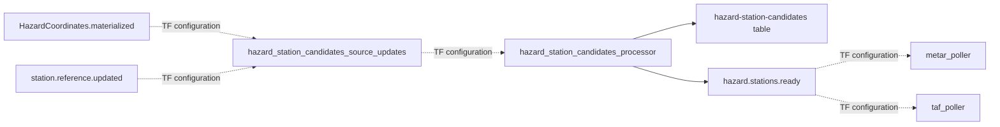

# Hazard station candidates

**Canonical page:** this page
**Verified against:** `8abd2d5` on `docs/ws2-ingestion`
**Maturity:** CODE, TF, UNIT
**Production authorization:** no grant found in `functions/weather/sigmet/hazard_station_candidates_processor/app.py`

## Purpose

This page documents how SIGMET hazard coordinates become station-scoped METAR and TAF polls. SIGMET materialization itself is [SIGMET](sigmet.md). METAR and TAF poller behavior after the ready event is [METAR](metar.md) and [TAF](taf.md). Station identity comes from [Station reference](station-reference.md).

## Implementation status

| Question | Result | Source |
| --- | --- | --- |
| Code | CODE | `functions/weather/sigmet/hazard_station_candidates_processor/app.py` (`process_hazard_version`, `publish_hazard_stations_ready`) |
| Terraform | TF | `modules/sigmet/hazard_station_candidates_processor.tf`; `envs/dev/main.tf` (`module.sigmet`) |
| Unit tests | UNIT | `tests/unit/sigmet/test_hazard_station_candidates_processor.py` |
| Contract tests | none found | search: `tests/contracts` for hazard station |
| Infrastructure tests | none found for this Lambda | `tests/infrastructure/terraform/test_root_contract.py` does not name the HSC function |
| Integration tests | none found | search: `tests/integration` for hazard_station |
| Live harness | none found | search: `scripts/validate_*` |
| Deployment | UNKNOWN | `not verified` |
| Production authorization | no grant found | `functions/weather/sigmet/hazard_station_candidates_processor/app.py` |

## Behavior

The SIGMET processor publishes `HazardCoordinates.materialized` after an ActiveHazards row reaches `READY` (source: `functions/weather/sigmet/processor/app.py`, `publish_hazard_coordinates_materialized`). EventBridge rule `aws_cloudwatch_event_rule.hazard_station_candidates_source_updates` matches sources `wilvor.weather` and `wilvor.reference.station` and detail-types `HazardCoordinates.materialized` and `station.reference.updated` (source: `modules/sigmet/hazard_station_candidates_processor.tf`).

`lambda_handler` then chooses a mode (source: `functions/weather/sigmet/hazard_station_candidates_processor/app.py`, `lambda_handler`):

- `manual_rebuild_all` is true, or `detail-type` is `station.reference.updated` → `rebuild_all_hazard_versions` (scan coordinate rows, skip versions that raise `PermanentProcessingError`).
- Otherwise → `process_hazard_version` for `detail.hazard_version_key`.

`process_hazard_version`:

1. Query `HazardCoordinates` by `hazard_version_key`.
2. `normalize_hazard_metadata` from the event and coordinate rows.
3. `reconstruct_geometry` from coordinate rows.
4. H3 prefilter at `H3_RESOLUTION` (Terraform env default 4) plus `grid_disk` sized from `SELECTION_RADIUS_NM` (dev: 50).
5. Query `StationReference` on GSI `STATION_REFERENCE_H3_INDEX_NAME`.
6. Keep stations inside the polygon or within the radius; skip `active == False`.
7. Delete existing candidate rows for that version, then batch-put the new set.
8. Call `publish_hazard_stations_ready` even when `written_count` is 0.

`determine_change_type` returns `NO_CANDIDATES` when `written_count == 0`, `CREATED` when there were no existing rows, otherwise `UPDATED` (source: `determine_change_type`). The unit test `test_no_h3_station_candidates_publishes_no_candidates_ready` asserts the ready event is still published.

`publish_hazard_stations_ready` puts EventBridge:

- `Source`: `wilvor.weather`
- `DetailType`: `hazard.stations.ready`
- Detail includes `event_type` `hazard.stations.ready`, `change_type`, `hazard_version_key`, `hazard_id`, counts, `selection_radius_nm`, `selection_config_version`, validity timestamps, `correlation_id`, `schema_version`

Schema env in Terraform is `wilvor.hazard_station_candidates.v4.0` (source: `modules/sigmet/hazard_station_candidates_processor.tf`, `aws_lambda_function.sigmet_hazard_station_candidates_processor`).

METAR and TAF pollers subscribe to that detail-type (source: `modules/metar/poller.tf`, `aws_cloudwatch_event_rule.metar_hazard_stations_ready`; `modules/taf/poller.tf`, `aws_cloudwatch_event_rule.taf_poller_hazard_stations_ready`). Those rules are not gated by `enable_metar_poller_schedule` or `enable_taf_poller_schedule`.

Caption: EventBridge and DynamoDB path read at `8abd2d5`. Dotted edges are Terraform-only EventBridge subscriptions and targets: `modules/sigmet/hazard_station_candidates_processor.tf` (`aws_cloudwatch_event_rule.hazard_station_candidates_source_updates`), `modules/metar/poller.tf` (`aws_cloudwatch_event_rule.metar_hazard_stations_ready`), `modules/taf/poller.tf` (`aws_cloudwatch_event_rule.taf_poller_hazard_stations_ready`). Solid edges: `functions/weather/sigmet/hazard_station_candidates_processor/app.py` (`process_hazard_version`, `publish_hazard_stations_ready`).

## Interfaces

| Kind | Name / pattern | Source |
| --- | --- | --- |
| Lambda | `${name_prefix}-sigmet-hazard-station-candidates-processor` | `modules/sigmet/hazard_station_candidates_processor.tf` |
| Table | `${name_prefix}-hazard-station-candidates` hash `hazard_version_key`, range `station_id` | `modules/sigmet/tables.tf` (`aws_dynamodb_table.hazard_station_candidates`) |
| GSI used on stations | `h3-station-index` in `envs/dev` | `envs/dev/main.tf` (`station_reference_h3_index_name`); table GSI in `modules/station_reference/tables.tf` |
| Event in | `HazardCoordinates.materialized`, `station.reference.updated` | `aws_cloudwatch_event_rule.hazard_station_candidates_source_updates` |
| Event out | `hazard.stations.ready` | `publish_hazard_stations_ready` |
| Dev selection | `hazard_station_selection_radius_nm = 50`, `hazard_station_selection_config_version = "hazard-station-selection-v1"` | `envs/dev/main.tf` (`module.sigmet`) |

## Known limitations

- `publish_hazard_stations_ready` runs for `NO_CANDIDATES`. METAR and TAF pollers still receive the event. METAR then returns `NO_ACTIVE_HAZARD_STATIONS` when the candidate query is empty (source: `functions/weather/metar/poller/app.py`, `lambda_handler` path covered by `test_lambda_handler_no_candidates`). TAF with an empty candidate set archives an empty body and publishes zero Kinesis records (source: `functions/weather/taf/poller/app.py`, `fetch_taf_records`).
- `rebuild_all_hazard_versions` scans HazardCoordinates. That path is the `station.reference.updated` handler.
- Module default `station_reference_h3_index_name` is `h3_cell-station_id-index` (source: `modules/sigmet/variables.tf`). The station-reference table GSI name is `h3-station-index` (source: `modules/station_reference/tables.tf`). `envs/dev/main.tf` overrides the SIGMET input to `h3-station-index`. A caller that omits the override would not match the table.
- Python fallback for `STATION_REFERENCE_H3_INDEX_NAME` is also `h3_cell-station_id-index` (source: `functions/weather/sigmet/hazard_station_candidates_processor/app.py`).
- METAR poller filters candidates with `is_candidate_current`. TAF poller `query_candidate_stations_for_hazard` does not apply that expiry filter (source: `functions/weather/taf/poller/app.py`, `get_station_ids`).
- Standalone hazard-coordinates Kinesis consumer is `enabled = false` (source: `modules/sigmet/hazard_coordinates_processor.tf`, `aws_lambda_event_source_mapping.sigmet_raw_to_hazard_coordinates_processor`). The live coordinate rows for this processor come from the main SIGMET processor, not that disabled mapping.
- No integration test was found for this Lambda.
- Live-account tests under `tests/infrastructure/aws/` omit this Lambda from `LAMBDA_OUTPUTS`. Those tests require an authenticated AWS account and do not establish DEPLOYED.

## Historical record

No superseded statement is stored on this page.

## Sources

- Source: `functions/weather/sigmet/hazard_station_candidates_processor/app.py` (`lambda_handler`, `process_hazard_version`, `publish_hazard_stations_ready`, `determine_change_type`)
- Source: `modules/sigmet/hazard_station_candidates_processor.tf` (`aws_cloudwatch_event_rule.hazard_station_candidates_source_updates`)
- Source: `envs/dev/main.tf` (`module.sigmet`, `station_reference_h3_index_name`)
- Tests: `tests/unit/sigmet/test_hazard_station_candidates_processor.py` (`test_hazard_station_candidates_inside_and_near`, `test_no_h3_station_candidates_publishes_no_candidates_ready`)
