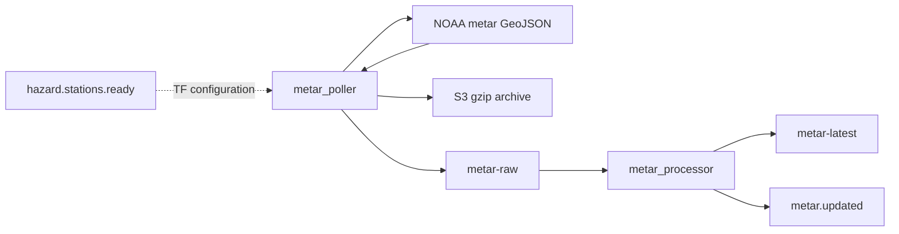

# METAR ingestion

**Canonical page:** this page
**Verified against:** `8abd2d5` on `docs/ws2-ingestion`
**Maturity:** CODE, TF, UNIT, INFRA
**Production authorization:** no grant found in `functions/weather/metar/processor/app.py`

## Purpose

This page documents hazard-scoped NOAA METAR polling, latest-state processing, and `metar.updated`. Station lists come from [Hazard station candidates](hazard-station-candidates.md). Airport-status consumption of `metar.updated` belongs to WS3 (`docs/processing/`).

## Implementation status

| Question | Result | Source |
| --- | --- | --- |
| Code | CODE | `functions/weather/metar/poller/app.py`, `functions/weather/metar/processor/app.py` |
| Terraform | TF | `modules/metar/`; `envs/dev/main.tf` (`module.metar`) |
| Unit tests | UNIT | `tests/unit/metar/` |
| Contract tests | none found | search: `tests/contracts` for metar |
| Infrastructure tests | INFRA | `tests/infrastructure/terraform/test_root_contract.py` (`enable_metar_poller_schedule`) |
| Live-account infrastructure tests | files exist; require authenticated AWS and `terraform output` | `tests/infrastructure/aws/test_compute.py`, `test_data_services.py`, `test_eventing_monitoring.py` name METAR outputs; fixtures in `tests/infrastructure/conftest.py` (`terraform_outputs`, `aws_session`) |
| Integration tests | file exists; assertions read | `tests/integration/metar/test_metar_pipeline.py` asserts `metar_latest.v1` and event `product_type` / `change_type` |
| Live harness | none found for this pipeline | search: `scripts/validate_*` |
| Deployment | UNKNOWN | `not verified` |
| Production authorization | no grant found | cited METAR sources |

## Behavior

### External source

`fetch_noaa_metars` GET `NOAA_METAR_URL` with query `ids` (comma-separated stations) and `format=geojson`, `User-Agent: Wilvor-METAR-Poller/0.2`, 30s timeout. Only HTTP 200 is accepted. There is no 204 handling (source: `functions/weather/metar/poller/app.py`). `envs/dev` sets `metar_api_url` to `https://aviationweather.gov/api/data/metar?format=geojson` and `metar_station_chunk_size = 100`.

`extract_records` accepts `FeatureCollection.features`, a `data` list, or a top-level list.

### Scheduling and event-driven trigger

Event-driven path (not gated by the schedule flag):

- Rule `aws_cloudwatch_event_rule.metar_hazard_stations_ready` matches `source` `wilvor.weather` and `detail-type` `hazard.stations.ready` (source: `modules/metar/poller.tf`).
- `resolve_station_scope` returns trigger `HAZARD_STATIONS_READY` and queries `HAZARD_STATION_CANDIDATES_TABLE_NAME` by `detail.hazard_version_key`, keeping rows that pass `is_candidate_current` (rejects `expires_at_epoch <= now` or `valid_to_utc <= now`).

Scheduled path: `aws_cloudwatch_event_rule.metar_poller_schedule` uses `rate(3 minutes)` when enabled. `envs/dev` sets `enable_metar_poller_schedule = false`. If invoked without `hazard.stations.ready`, `resolve_station_scope` uses `SCHEDULED_HSC_REFRESH` and `scan_active_hazard_station_candidates`. A comment in `envs/dev/main.tf` says the schedule is kept disabled until the event-driven HSC path is proven.

Empty scope: handler returns `ok: true`, `reason: "NO_ACTIVE_HAZARD_STATIONS"`, and does not call NOAA (tests: `test_lambda_handler_no_candidates`).

### Archive, Kinesis, normalization

Poller archives gzip JSON and publishes envelope `schema_version` `raw.noaa.metar.v2`. Partition key from station identity. Batches of 500. Any Kinesis `FailedRecordCount` fails the poll.

Processor mapping: batch 10, `LATEST`, `ReportBatchItemFailures`, `maximum_retry_attempts = 3` (source: `modules/metar/processor.tf`). Schema Terraform: `wilvor.metar_latest.v4.0`, event schema `wilvor.event.metar.updated.v1`.

`normalize_feature` uppercases station from `icaoId` / `station_id` / `stationId` / `id` / `site`. Observation time from `obsTime` / `observed_time` / `observed_time_utc` / `reportTime`. Wind from `wdir`/`wspd`/`wgst`. Visibility from `visib` / `visibility_sm`. Ceiling from BKN/OVC/VV via `derive_ceiling_ft`. `build_metar_version` hashes station, observation epoch, metar type, and raw text.

`classify_change`: `NEW` if no row; `UPDATED` if newer observation epoch; `STALE` if older; `CORRECTED` if same epoch and different `metar_version`; `UNCHANGED` otherwise. Legacy rows may still store `source_version` (`existing_metar_version`).

`write_latest` skips `UNCHANGED` and `STALE`. Conditional `put_item` on `station_id` / observation epoch / version. Sets `event_publish_pending = True` before EventBridge. `publish_metar_updated_event` uses `DetailType` `metar.updated`, `Source` `wilvor.weather`. `mark_metar_updated_event_published` clears the pending flag. Duplicate delivery with a pending flag retries publish (`get_metar_updated_event_context`).

Permanent errors archive to `bad-records/source=metar_processor` without Kinesis retry. Other exceptions return `batchItemFailures`.

Caption: METAR path after `hazard.stations.ready`, read at `8abd2d5`. Dotted edge: Terraform-only EventBridge subscription `modules/metar/poller.tf` (`aws_cloudwatch_event_rule.metar_hazard_stations_ready`). Solid edges: `functions/weather/metar/poller/app.py` (`resolve_station_scope`), `functions/weather/metar/processor/app.py` (`publish_metar_updated_event`).

### Freshness and timestamps

| Field | Semantics |
| --- | --- |
| `observed_time_*` / `source_event_time_utc` | METAR observation |
| `received_at_utc` | Poller receive time |
| `processed_at_utc` | Processor wall clock |
| `freshness_status` | Age of observation at process time: `FRESH` ≤ `METAR_FRESH_SECONDS` (dev 600), `ACCEPTABLE` ≤ `METAR_ACCEPTABLE_SECONDS` (dev 1800), else `STALE` |
| `expires_at_epoch` | Processed time plus `METAR_TTL_SECONDS` (dev 86400) |

`freshness_status` here is the METAR processor's observation-age grade. It is not `FreshnessStatus` from `wilvor_ai.contracts`.

## Interfaces

| Kind | Pattern | Source |
| --- | --- | --- |
| Stream | `${name_prefix}-metar-raw` | `modules/metar/streams.tf` |
| Table | `${name_prefix}-metar-latest` hash `station_id`; GSI `airport-id-observed-time-index`; TTL `expires_at_epoch` | `modules/metar/tables.tf` |
| Event | `wilvor.weather` / `metar.updated` | `publish_metar_updated_event` |
| HSC table input | `module.sigmet.hazard_station_candidates_table_name` | `envs/dev/main.tf` |

`module.weather_events` includes `metar.updated` in its log-group rule (source: `modules/weather_events/main.tf`). That event detail has `reason` and does not include `product_type`, so the product-type metric filter does not match it. See [Weather events](weather-events.md).

## Known limitations

- No HTTP 204 handling (unlike TAF).
- Schedule is `false` in `envs/dev`. Invoking the poller with `{}` uses a full HSC scan, not a NOAA global pull of a static station list.
- Integration test `test_raw_stream_updates_latest_state_emits_event_and_is_idempotent` expects DynamoDB `schema_version == "metar_latest.v1"`, `source_version`, and `last_event_published_source_version`. Current CODE uses `wilvor.metar_latest.v4.0`, `metar_version`, and `last_event_published_metar_version` (source: `functions/weather/metar/processor/app.py`, `write_latest`, `mark_metar_updated_event_published`).
- The same test's `wait_for_weather_event` predicate requires `detail.product_type == "METAR"` and `detail.change_type == "NEW"`. Current `publish_metar_updated_event` omits both keys and stores the classification in `reason`. The DynamoDB item still has `change_type`. The helper timeout text still says `Weather.changed` (source: `tests/integration/metar/test_metar_pipeline.py`; `tests/helpers/integration_support.py`, `wait_for_weather_event`; tests: `tests/unit/metar/test_metar_processor.py`, `test_publish_metar_updated_event`).
- `metar.updated` can reach the weather-events log group. The product-type metric filter still misses it because `product_type` is absent. See [Weather events](weather-events.md).
- [`functions/metar_pipeline_runbook.txt`](../../functions/metar_pipeline_runbook.txt) still describes `Weather.changed` metrics. Current publish is `metar.updated`.
- [`functions/weather_pipeline_reproducibility.txt`](../../functions/weather_pipeline_reproducibility.txt) still says METAR has no processor. Current CODE has `functions/weather/metar/processor/app.py` and `modules/metar/processor.tf`.
- Live-account tests under `tests/infrastructure/aws/` require an authenticated AWS account and `terraform output`. They are not Terraform-source tests and they do not establish DEPLOYED.
- PITR on `metar_latest` is `enabled = false`.

## Historical record

The reproducibility runbook sentence that METAR has no processor, and the METAR runbook's `Weather.changed` verification steps, are historical. Current processor event is `metar.updated`.

## Sources

- Source: `functions/weather/metar/poller/app.py` (`resolve_station_scope`, `fetch_noaa_metars`)
- Source: `functions/weather/metar/processor/app.py` (`classify_change`, `calculate_freshness_status`, `publish_metar_updated_event`)
- Source: `modules/metar/processor.tf` (`SCHEMA_VERSION`)
- Source: `envs/dev/main.tf` (`module.metar`)
- Tests: `tests/unit/metar/test_metar_poller.py` (`test_resolve_station_scope_for_hazard_event`), `test_metar_processor.py` (`test_classify_change_v4`, `test_publish_metar_updated_event`)
