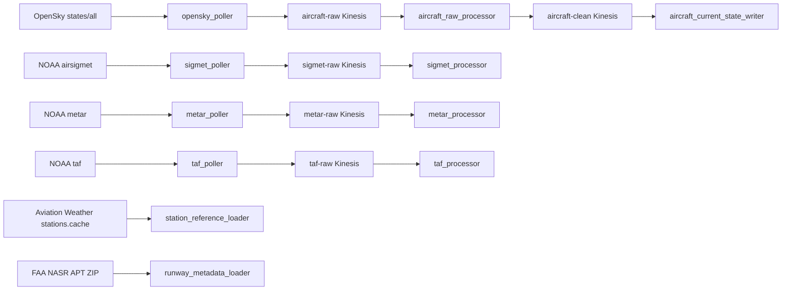
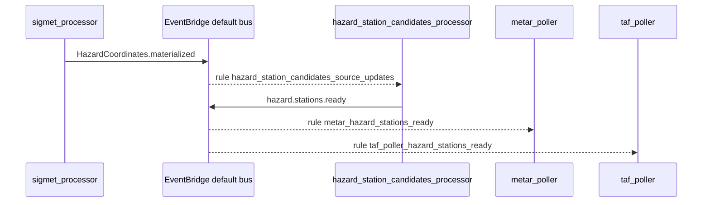

# Ingestion overview

**Canonical page:** this page
**Verified against:** `8abd2d5` on `docs/ws2-ingestion`
**Maturity:** CODE, TF, UNIT, INFRA
**Production authorization:** no grant found in the ingestion Lambda and Terraform sources cited on this page

## Purpose

This page maps Wilvor ingestion pipelines and airport/runway reference loaders as they exist in repository source. Per-pipeline behavior, tables, events, and test evidence live on the linked canonical pages. Downstream processing after ingestion is owned by WS3 (`docs/processing/`). Historical Firehose transport after `hazard.materialized` is owned by WS4 (`docs/historical/`, [`modules/historical_facts/README.md`](../../modules/historical_facts/README.md)).

## Implementation status

| Question | Result | Source |
| --- | --- | --- |
| Code | CODE | `functions/opensky_poller/app.py`, `functions/weather/*/app.py`, `functions/station_reference/loader/app.py`, `functions/runway_metadata/loader/app.py` |
| Terraform | TF in `envs/dev` | `envs/dev/main.tf` (`module.aircraft_foundation`, `module.sigmet`, `module.metar`, `module.taf`, `module.station_reference`, `module.runway_metadata`, `module.weather_events`) |
| Terraform in `envs/dev-historical-data` | absent at `8abd2d5` (search: `envs/dev-historical-data` `*.tf` for those module names) | `envs/dev-historical-data/main.tf` instantiates `historical_facts_data` only |
| Unit tests | UNIT | `tests/unit/aircraft`, `tests/unit/sigmet`, `tests/unit/metar`, `tests/unit/taf`, `tests/unit/runway_metadata` |
| Contract tests | none found | search: `tests/contracts` for aircraft, sigmet, metar, taf, station, runway |
| Infrastructure tests | INFRA | `tests/infrastructure/terraform/test_root_contract.py` (`test_dev_poller_schedules_are_disabled`) |
| Live-account infrastructure tests | files exist; require authenticated AWS and `terraform output` | `tests/infrastructure/aws/`; fixtures in `tests/infrastructure/conftest.py` (`terraform_outputs`, `aws_session`) |
| Integration tests | files exist; schema assertions read | `tests/integration/{aircraft,sigmet,metar,taf}` — see [Known limitations](#known-limitations) |
| Live harness | none found for these pipelines | search: `scripts/validate_*`; those scripts target AI specialists |
| Deployment | UNKNOWN | `not verified` |
| Production authorization | no grant found | ingestion sources cited on this page |

## Behavior

Wilvor ingestion has two families:

1. **Polled operational feeds.** OpenSky aircraft states, NOAA SIGMET/AIRMET GeoJSON, NOAA METAR GeoJSON, and NOAA TAF JSON. Each poller writes a raw S3 archive and a Kinesis raw stream. A processor Lambda consumes the stream.
2. **Reference loaders.** The station-reference loader fetches Aviation Weather `stations.cache.json.gz`. The runway-metadata loader fetches an FAA NASR APT CSV ZIP. Both write DynamoDB and publish EventBridge events. They are not Kinesis pipelines.

Scheduled EventBridge rules exist for every poller and both loaders. In `envs/dev` every `enable_*_schedule` input that was read is `false` (source: `envs/dev/main.tf`; tests: `tests/infrastructure/terraform/test_root_contract.py`, `test_dev_poller_schedules_are_disabled` for OpenSky, SIGMET, METAR, and TAF). METAR and TAF also have event-driven rules that are not gated by those schedule flags.

Caption: ingestion sources and stream processors as implemented at `8abd2d5`. Edges were read in the Lambda handlers and Terraform event-source mappings cited on the per-pipeline pages. This diagram does not record a deployed AWS account.

The weather coupling that scopes METAR and TAF to active hazards is:

Caption: EventBridge coupling read at `8abd2d5`. Solid arrows are PutEvents in CODE: `functions/weather/sigmet/processor/app.py` (`publish_hazard_coordinates_materialized`), `functions/weather/sigmet/hazard_station_candidates_processor/app.py` (`publish_hazard_stations_ready`). Dotted arrows are Terraform-only EventBridge subscriptions: `modules/sigmet/hazard_station_candidates_processor.tf` (`aws_cloudwatch_event_rule.hazard_station_candidates_source_updates`), `modules/metar/poller.tf` (`aws_cloudwatch_event_rule.metar_hazard_stations_ready`), `modules/taf/poller.tf` (`aws_cloudwatch_event_rule.taf_poller_hazard_stations_ready`). Canonical detail: [Hazard station candidates](hazard-station-candidates.md).

### Event catalog from ingestion producers

| Producer | Source | DetailType | Canonical page |
| --- | --- | --- | --- |
| Aircraft current-state writer | `wilvor.aircraft` | `aircraft.state.updated` | [Aircraft](aircraft.md) |
| SIGMET processor | `wilvor.weather` | `HazardCoordinates.materialized` | [SIGMET](sigmet.md) |
| SIGMET processor | `wilvor.weather` | `hazard.materialized` | [SIGMET](sigmet.md) |
| Hazard station candidates processor | `wilvor.weather` | `hazard.stations.ready` | [Hazard station candidates](hazard-station-candidates.md) |
| METAR processor | `wilvor.weather` | `metar.updated` | [METAR](metar.md) |
| TAF processor | `wilvor.weather` | `taf.materialized` | [TAF](taf.md) |
| Station reference loader | `wilvor.reference.station` | `station.reference.updated` | [Station reference](station-reference.md) |
| Runway metadata loader | `wilvor.reference-data` | `ReferenceData.changed` | [Runway metadata](runway-metadata.md) |

`module.weather_events` copies only `Weather.changed` and `metar.updated` from source `wilvor.weather` into a CloudWatch log group (source: `modules/weather_events/main.tf`, `aws_cloudwatch_event_rule.weather_changed`). SIGMET no longer publishes `Weather.changed`. `metar.updated` can reach that log group without `product_type`; SIGMET and TAF events include `product_type` but are not in the rule. See [Weather events](weather-events.md).

### Dev schedule flags

| Input | `envs/dev/main.tf` value | Expression still configured |
| --- | --- | --- |
| `enable_opensky_poller_schedule` | `false` | `rate(5 minutes)` |
| `enable_sigmet_poller_schedule` | `false` | `rate(2 minutes)` |
| `enable_metar_poller_schedule` | `false` | `rate(3 minutes)` |
| `enable_taf_poller_schedule` | `false` | `rate(10 minutes)` |
| `enable_station_reference_loader_schedule` | `false` | `rate(1 day)` |
| `enable_runway_loader_schedule` | `false` | `rate(1 day)` |

TF records those assignments. TF does not establish DEPLOYED.

### Timestamp roles

Clock names stay distinct. The producer that sets each field is cited on the pipeline page.

| Role | Typical setter |
| --- | --- |
| Source-event time | OpenSky `time_position`, NOAA observation/issue/valid times, SIGMET issue/valid times |
| Receive / fetch time | Poller `received_at` / `fetched_at_utc` |
| Process / materialize time | Processor wall clock |
| Freshness age | Processor comparison of source-event time to process time |
| TTL / expiry | Processor or loader, plus DynamoDB TTL attributes |

SIGMET `AVAILABLE` in other subsystem vocabulary is not an age-based freshness grade on these pipelines. Aircraft, METAR, and TAF processors write `freshness_status` values `FRESH`, `ACCEPTABLE`, `STALE`, and (aircraft only) `UNAVAILABLE` from their own thresholds.

## Interfaces

Terraform roots that instantiate these modules: `envs/dev/main.tf` only, at `8abd2d5`. Event bus name in that root is `default` (`local.default_event_bus_name`).

## Known limitations

- Poller and loader schedules are configured `false` in `envs/dev`. Freshness of NOAA and OpenSky data in that root depends on manual invoke or the event-driven METAR/TAF path, not on an enabled rate rule in that file.
- `envs/dev-historical-data` does not instantiate ingestion modules.
- Integration tests under `tests/integration/{aircraft,sigmet,metar,taf}` were read and assert older schema names than current CODE (`aircraft_current_state.v1` / `icao24`, `internal.sigmet.v1`, `metar_latest.v1`). They are not evidence that the v4/v2 contracts currently pass in a deployed environment. METAR's log-event predicate also expects `product_type` and `change_type`; current `metar.updated` uses `reason` instead. See [METAR](metar.md#known-limitations).
- `tests/integration/README.md` still names `Weather.changed` for SIGMET, METAR, and TAF. That file is owned by WS1 and was not edited here.
- No `scripts/validate_*` harness was found for these ingestion pipelines.
- Tests under `tests/infrastructure/terraform/` assert repository Terraform. Tests under `tests/infrastructure/aws/` require an authenticated AWS account and `terraform output`. The AWS layer is not a Terraform-source test and does not establish DEPLOYED.
- Deployment of any of these resources in an AWS account is UNKNOWN.
- `EXPECTED_MODULES` in `tests/infrastructure/terraform/test_root_contract.py` lists `aircraft_foundation`, `weather_events`, `sigmet`, `metar`, and `taf`. It does not list `station_reference` or `runway_metadata`.

## Historical record

No superseded statement is stored on this page. Legacy operator files that still describe `Weather.changed` as the SIGMET/METAR/TAF product event are listed in [Ingestion and reference data](README.md#historical-runbooks).

## Sources

- Source: `envs/dev/main.tf` (`module.aircraft_foundation`, `module.sigmet`, `module.metar`, `module.taf`, `module.station_reference`, `module.runway_metadata`, `module.weather_events`)
- Source: `modules/weather_events/main.tf` (`aws_cloudwatch_event_rule.weather_changed`)
- Tests: `tests/infrastructure/terraform/test_root_contract.py` (`test_dev_poller_schedules_are_disabled`, `EXPECTED_MODULES`)
- Tests: `tests/integration/aircraft/test_aircraft_pipeline.py`, `tests/integration/sigmet/test_sigmet_pipeline.py`, `tests/integration/metar/test_metar_pipeline.py`
