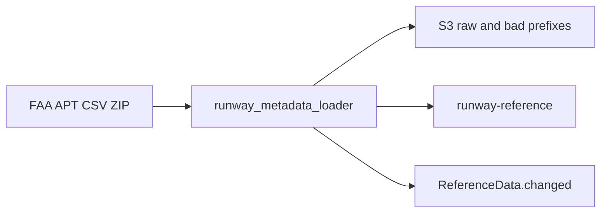

# Runway metadata

**Canonical page:** this page
**Verified against:** `8abd2d5` on `docs/ws2-ingestion`
**Maturity:** CODE, TF, UNIT
**Production authorization:** no grant found in `functions/runway_metadata/loader/app.py`

## Purpose

This page documents the FAA NASR APT CSV ZIP loader that fills `RunwayReference` for a configured ICAO set and publishes `ReferenceData.changed`. Station weather identity is [Station reference](station-reference.md). Airport assessment that might later read runways belongs to WS3 (`docs/processing/`).

## Implementation status

| Question | Result | Source |
| --- | --- | --- |
| Code | CODE | `functions/runway_metadata/loader/app.py` (`run_loader`), `cycle_control.py`, `faa_parser.py`, `persistence.py`, `source_loader.py`, `validation.py` |
| Terraform | TF | `modules/runway_metadata/`; `envs/dev/main.tf` (`module.runway_metadata`) |
| Unit tests | UNIT | `tests/unit/runway_metadata/` |
| Contract tests | none found | search: `tests/contracts` |
| Infrastructure tests | none found | `EXPECTED_MODULES` omits `runway_metadata` |
| Integration tests | none found | search: `tests/integration` for runway |
| Live harness | operator command file, not `scripts/validate_*` | `functions/Runway_Metadata_Commands.txt` |
| Deployment | UNKNOWN | `not verified` |
| Production authorization | no grant found | cited loader sources |

## Behavior

### External source

FAA 28-day subscription APT CSV ZIP. `envs/dev` pins `faa_apt_zip_url` to `https://nfdc.faa.gov/webContent/28DaySub/extra/09_Jul_2026_APT_CSV.zip` and `default_source_cycle` to `2026-07-09`. Required files inside the ZIP: `APT_BASE.csv`, `APT_RWY.csv`, `APT_RWY_END.csv` (source: `functions/runway_metadata/loader/faa_parser.py`, `REQUIRED_FILES`).

`prepare_source_artifact` accepts HTTPS (`download_http_zip`), local `source_zip_path`, or S3 replay `source_s3_bucket` + `source_s3_key` (source: `functions/runway_metadata/loader/source_loader.py`).

### Scheduling

`aws_cloudwatch_event_rule.runway_loader_schedule` default `rate(1 day)`, state from `enable_runway_loader_schedule` (source: `modules/runway_metadata/loader.tf`). `envs/dev` sets the flag `false`. Manual invoke payload fields used in the command file: `source_cycle`, `source_url`, `force_reload`, and for replay `source_s3_bucket` / `source_s3_key`.

`lambda_handler` with `source_directory` or `parse_only` runs `_parse_only` and does not write AWS.

### Validation, cycle control, snapshot

`build_airport_lookup` maps FAA identifiers to ICAO from `APT_BASE.csv`. Rows without ICAO are omitted. Duplicate FAA → multiple ICAO becomes a `RejectedRecord`. `filter_rows_to_supported_airports` silently drops airports not in `supported_airport_ids`. Dev list: `KSFO`, `KOAK`, `KSJC` (source: `envs/dev/main.tf`).

`join_and_normalize` produces `NormalizedRunway` with `source_record_hash` SHA-256 of `material_dict()`. `validation.py` checks ends, headings, coordinates, and declared distances.

`decide_cycle` (source: `functions/runway_metadata/loader/cycle_control.py`, `CycleDecisionType`):

| Decision | `should_process` |
| --- | --- |
| `FORCE_RELOAD` | true |
| `FIRST_LOAD` | true |
| `NEW_CYCLE` | true |
| `CORRECTED_PACKAGE` (same cycle, different ZIP SHA-256) | true |
| `DUPLICATE` | false |

Control item keys: `CONTROL_AIRPORT_ID = "SYSTEM"`, `CONTROL_RECORD_ID = "SOURCE#FAA_NASR"` (source: `functions/runway_metadata/loader/persistence.py`).

`run_loader`: prepare artifact → archive ZIP (skip re-upload on S3 replay) → read control → decide. Duplicate: `mark_duplicate_checked` and return `skipped: true` without changing runway rows. Otherwise `mark_load_started` → parse → archive rejects → `apply_runway_snapshot` → maybe `publish_reference_data_changed` → `mark_load_succeeded`. Failures call `mark_load_failed` and re-raise. EMF uses `wilvor_weather.monitoring.emit_metric` with `pipeline="runway_metadata"`.

`build_deletion_protection` blocks deletes when a replacement row was rejected (last-known-good). Snapshot diff uses `source_record_hash`.

Event when `_should_publish_event`: `Source` `wilvor.reference-data`, `DetailType` `ReferenceData.changed`, detail `reference_type` `RUNWAY`, `source` `FAA_NASR`, cycle, load id, change counts, `changed_airport_ids`. Published for `FIRST_LOAD` / `NEW_CYCLE` / `CORRECTED_PACKAGE` or when `stats.materially_changed_runways > 0`. No EventBridge rule in this repository subscribes to that detail-type (search: `ReferenceData.changed` in `modules/`).

Caption: runway loader path at `8abd2d5`. Sources: `functions/runway_metadata/loader/app.py` (`run_loader`), `persistence.py` (`publish_reference_data_changed`). The EventBridge output has no in-repo subscriber; that absence is a missing solid edge, not a dotted planned path.

### Freshness and timestamps

NASR cycle is the caller-supplied `source_cycle` string (dev `2026-07-09`). AIRAC is not named in this loader. Items store `source_cycle`, `ingested_at_utc`, `raw_s3_uri`, `load_id`. Control stores `last_successful_load_at_utc`, `source_zip_sha256`, `current_source_cycle`. Schema constants: `internal.runway.v1`, `internal.runway-airport-meta.v1`, `internal.runway-end.v1`.

## Interfaces

| Kind | Pattern | Source |
| --- | --- | --- |
| Table | `${name_prefix}-runway-reference` hash `airport_id` range `record_id` | `modules/runway_metadata/tables.tf` |
| Item kinds | `SYSTEM`/`SOURCE#FAA_NASR`; per-airport `META`; `RUNWAY#{physical id}` | `persistence.py` |
| Archive | `${name_prefix}-runway-archive-${account_id}-${aws_region}` | `modules/runway_metadata/archive.tf` |
| Event | `wilvor.reference-data` / `ReferenceData.changed` | `publish_reference_data_changed` |

No other `envs/dev` module is passed the runway table name.

## Known limitations

- Dev airport set is three ICAO ids.
- Facilities without ICAO never enter the catalog.
- `ReferenceData.changed` has no in-repo subscriber.
- Schedule is `false` in `envs/dev`. NASR URL and cycle are pinned, not auto-discovered.
- No Terraform-source infrastructure tests or integration tests for this module (`EXPECTED_MODULES` omits `runway_metadata`). Live-account tests under `tests/infrastructure/aws/` omit this loader from `LAMBDA_OUTPUTS` and do not establish DEPLOYED.
- `scripts/build_runway_metadata_loader.ps1` copies loader `*.py` and does not copy `functions/shared/wilvor_weather`, while `app.py` imports `wilvor_weather.monitoring`. Whether a given zip contains that package is UNKNOWN unless the zip is inspected; this page does not inspect build artifacts.
- PITR is `false` in `envs/dev`.

## Historical record

No superseded statement is stored on this page. [`functions/Runway_Metadata_Commands.txt`](../../functions/Runway_Metadata_Commands.txt) is a preserved operator command list, not current-status documentation.

## Sources

- Source: `functions/runway_metadata/loader/app.py` (`run_loader`)
- Source: `functions/runway_metadata/loader/cycle_control.py` (`decide_cycle`, `CycleDecisionType`)
- Source: `functions/runway_metadata/loader/persistence.py` (`publish_reference_data_changed`)
- Source: `envs/dev/main.tf` (`module.runway_metadata`)
- Tests: `tests/unit/runway_metadata/test_loader_workflow.py`, `test_duplicate_cycle.py`, `test_bad_record_isolation.py`, `test_persistence.py`
