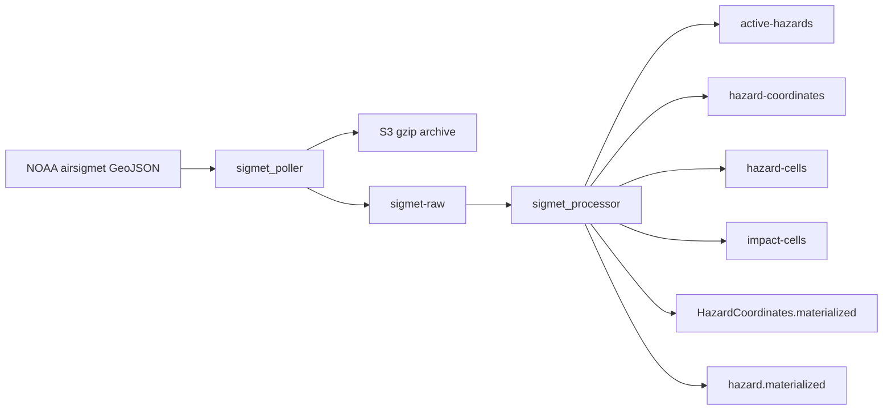

# SIGMET ingestion

**Canonical page:** this page
**Verified against:** `8abd2d5` on `docs/ws2-ingestion`
**Maturity:** CODE, TF, UNIT, INFRA
**Production authorization:** no grant found in `functions/weather/sigmet/processor/app.py`

## Purpose

This page documents NOAA AIRSIGMET polling, Kinesis processing into ActiveHazards v4 and child tables, and the events `HazardCoordinates.materialized` and `hazard.materialized`. Station scoping after those events is [Hazard station candidates](hazard-station-candidates.md). Historical geometry Firehose is a fail-open side path; canonical historical transport is WS4 ([`modules/historical_facts/README.md`](../../modules/historical_facts/README.md)).

## Implementation status

| Question | Result | Source |
| --- | --- | --- |
| Code | CODE | `functions/weather/sigmet/poller/app.py`, `functions/weather/sigmet/processor/app.py`, `functions/weather/sigmet/hazard_coordinates_processor/app.py` |
| Terraform | TF | `modules/sigmet/`; `envs/dev/main.tf` (`module.sigmet`) |
| Unit tests | UNIT | `tests/unit/sigmet/` |
| Contract tests | none found | search: `tests/contracts` for sigmet / hazard |
| Infrastructure tests | INFRA | `tests/infrastructure/terraform/test_root_contract.py`; `tests/infrastructure/terraform/test_historical_facts_contract.py` (`test_dev_sigmet_uses_historical_geometry_outputs`) |
| Live-account infrastructure tests | files exist; require authenticated AWS and `terraform output` | `tests/infrastructure/aws/test_compute.py`, `test_data_services.py`, `test_eventing_monitoring.py` name SIGMET outputs; fixtures in `tests/infrastructure/conftest.py` (`terraform_outputs`, `aws_session`) |
| Integration tests | file exists; assertions read | `tests/integration/sigmet/test_sigmet_pipeline.py` asserts `internal.sigmet.v1` and waits for `Weather.changed` |
| Live harness | none found | search: `scripts/validate_*` |
| Deployment | UNKNOWN | `not verified` |
| Production authorization | no grant found | cited SIGMET sources |

## Behavior

### External source

`fetch_noaa_sigmets` GET `NOAA_SIGMET_URL` with `User-Agent: Wilvor-SIGMET-Poller/0.1`, `Accept: application/json`, 30s timeout. HTTP 200 is required (source: `functions/weather/sigmet/poller/app.py`). Default and `envs/dev` URL: `https://aviationweather.gov/api/data/airsigmet?format=geojson` (source: `modules/sigmet/variables.tf`, `sigmet_api_url`; `envs/dev/main.tf`).

`extract_records` accepts GeoJSON `FeatureCollection.features`, a `data` list, or a top-level list; otherwise `[]`.

### Scheduling

`aws_cloudwatch_event_rule.sigmet_poller_schedule` uses `rate(2 minutes)` by default and `state` from `enable_sigmet_poller_schedule` (source: `modules/sigmet/poller.tf`). `envs/dev` sets the flag `false` (tests: `test_dev_poller_schedules_are_disabled`).

### Archive and Kinesis

`archive_raw_response` gzip-compresses JSON to `{RAW_PREFIX}/year=.../sigmet-{poll_id}.json.gz` with `ContentEncoding: gzip`. `publish_raw_records` wraps each feature in `schema_version` `raw.noaa.airsigmet.v1`, `source` `NOAA_AVIATION_WEATHER`, `product_type` `SIGMET`. Partition key is the first non-blank of `properties.id`, `airSigmetId`, `hazard`, `rawSigmet`, `validTimeFrom`, else `sigmet-{record_index}`. Batches of 500. Any `FailedRecordCount` fails the poller handler.

Stream: `${name_prefix}-sigmet-raw`, 1 shard, 24h, KMS `alias/aws/kinesis` (source: `modules/sigmet/streams.tf`).

### Processor

Kinesis mapping `aws_lambda_event_source_mapping.sigmet_raw_to_sigmet_processor`: batch 100, window 1s, `ReportBatchItemFailures`, `bisect_batch_on_function_error`, `starting_position = LATEST` (source: `modules/sigmet/processor.tf`). That mapping does not set `enabled = false`.

Processor constants (source: `functions/weather/sigmet/processor/app.py`):

- `SOURCE_SYSTEM` = `NOAA_AVIATIONWEATHER_SIGMET`
- `SCHEMA_VERSION` default / Terraform `wilvor.active_hazards.v4.0`
- Child schemas `wilvor.hazard_coordinates.v4.0`, `wilvor.hazard_cells.v4.0`, `wilvor.impact_cells.v4.0`
- `H3_RESOLUTION` default 4
- `RETENTION_AFTER_VALID_TO_HOURS` default 6
- Dev impact expansion: `impact_grid_distance = 12`, `impact_radius_nm = 300`, `impact_expansion_config_version = "wilvor.impact_expansion.dev_wide_v3"` (source: `envs/dev/main.tf`)

Validation: Kinesis JSON object, GeoJSON `Feature`, Polygon or MultiPolygon only. Unsupported geometry is `PermanentRecordError`.

`build_hazard_id` hashes `{source_system, source_product_id}` and prefixes `sigmet-`. The docstring states creation time, validity, geometry, altitude, and movement are excluded so an amendment keeps the same `hazard_id`. `build_source_version` hashes content including geometry, raw text, altitudes, movement, validity, impact config, and `materialization_contract: hazard_coordinates_metadata_v2`.

H3: `geometry_to_h3_cells` uses `h3.polygon_to_cells`; empty result falls back to `polygon_centroid_cell`. `expand_impact_cells` uses `h3.grid_ring` up to `IMPACT_GRID_DISTANCE`.

`determine_change_type` returns:

| Existing | Incoming | Result |
| --- | --- | --- |
| none | any | `NEW`, write |
| same `source_version`, status not `BUILDING`/`FAILED` | same | `UNCHANGED`, no write |
| same `source_version`, status `BUILDING` or `FAILED` | same | `UPDATED`, write (retry) |
| different version, older `source_event_time_utc` | older | `STALE`, no write |
| different version, not older | newer | `UPDATED`, write |

On write: parent `materialization_status` `BUILDING` → `materialize_dependent_rows` (coordinates, hazard_cells, impact_cells) → `validate_dependent_counts` → `mark_hazard_ready` → optional `publish_historical_geometry_fact` (Firehose, fail-open). Then `publish_hazard_coordinates_materialized` and `publish_hazard_materialized`.

Events (source: `publish_hazard_coordinates_materialized`, `publish_hazard_materialized`):

| Field | Coordinates event | Hazard event |
| --- | --- | --- |
| Source | `wilvor.weather` | `wilvor.weather` |
| DetailType | `HazardCoordinates.materialized` | `hazard.materialized` |

There is no `Weather.changed` put in `functions/weather/sigmet` at this commit (search: `Weather.changed` under that tree).

Permanent errors go to S3 `bad-records/source=sigmet_processor` and are not retried unless quarantine write fails. Transient errors return `batchItemFailures`.

### Standalone coordinates processor

`functions/weather/sigmet/hazard_coordinates_processor/app.py` can write HazardCoordinates and publish `HazardCoordinates.materialized`. Its Kinesis mapping is `enabled = false` (source: `modules/sigmet/hazard_coordinates_processor.tf`). Its `build_hazard_id` includes valid times and is not the same function as the v4 processor.

Caption: SIGMET poll and v4 processor path at `8abd2d5`. Sources: `functions/weather/sigmet/poller/app.py`, `functions/weather/sigmet/processor/app.py`, `modules/sigmet/processor.tf`. The disabled coordinates mapping is omitted.

### Freshness and timestamps

| Field | Semantics |
| --- | --- |
| Poller `received_at` | Poll wall clock on the Kinesis envelope |
| `created_at_utc` / `source_event_time_utc` | `get_issued_at`: issue/creation fields, else `validTimeFrom`, else envelope `received_at` |
| `valid_from_*` / `valid_to_*` | NOAA validity |
| `processed_at_utc` | Processor wall clock |
| `expires_at_epoch` | `valid_to` plus `RETENTION_AFTER_VALID_TO_HOURS` (6) |
| Status `EXPIRED` | `valid_to <= now_utc()` |

This processor does not write `freshness_status` `FRESH`/`STALE` in the METAR/TAF sense. `STALE` here is a change-type for an older incoming version.

## Interfaces

| Kind | Pattern | Source |
| --- | --- | --- |
| Tables | `${name_prefix}-active-hazards` (hash `hazard_id`), `-hazard-coordinates`, `-hazard-cells`, `-impact-cells`, `-hazard-station-candidates` | `modules/sigmet/tables.tf` |
| Archive | `${name_prefix}-sigmet-archive-${account_id}-${region}` | `modules/sigmet/archive.tf` |
| Event bus | `default` in `envs/dev` | `envs/dev/main.tf` |

PITR is `enabled = false` on the SIGMET tables in `tables.tf`.

## Known limitations

- Poller schedule is `false` in `envs/dev`. NOAA freshness in that root is on-demand.
- Processor does not publish `Weather.changed`. V4 events include `product_type` but are not in the weather-events log rule, so they are not copied to that log group. See [Weather events](weather-events.md).
- V4 processor unit tests invoke patched publisher helpers and do not assert EventBridge `DetailType` strings. See [`tests/unit/sigmet/README.md`](../../tests/unit/sigmet/README.md).
- Child-table builders comment that physical keys are retained and "will be migrated individually to the v4 contracts next" (source: `functions/weather/sigmet/processor/app.py`, comment above `build_coordinate_key`).
- Historical geometry Firehose is fail-open; oversized geometry is skipped (tests: `test_firehose_error_is_fail_open`, `test_oversized_geometry_skips_put_without_truncation`).
- Integration test `test_raw_stream_updates_hazard_indexes_emits_event_and_is_idempotent` asserts `schema_version == "internal.sigmet.v1"` and waits for `Weather.changed`. Current CODE uses `wilvor.active_hazards.v4.0` and `hazard.materialized`.
- `tests/unit/sigmet/README.md` previously listed `Weather.changed`; that sentence is now under Historical record on that README.
- Standalone coordinates consumer remains disabled.
- Live-account tests under `tests/infrastructure/aws/` require an authenticated AWS account and `terraform output`. They are not Terraform-source tests and they do not establish DEPLOYED.
- No SIGMET-specific `scripts/validate_*` harness.

## Historical record

Operator files [`functions/weather_pipeline_reproducibility.txt`](../../functions/weather_pipeline_reproducibility.txt) and [`functions/Wilvor_Aircraft_SIGMET_Integration_Test_Runbook_Original_Structure.txt.txt`](../../functions/Wilvor_Aircraft_SIGMET_Integration_Test_Runbook_Original_Structure.txt.txt) describe SIGMET → `Weather.changed` and `internal.sigmet.v1`. Those sentences are historical. Current events are `HazardCoordinates.materialized` and `hazard.materialized`.

## Sources

- Source: `functions/weather/sigmet/poller/app.py` (`fetch_noaa_sigmets`, `publish_raw_records`)
- Source: `functions/weather/sigmet/processor/app.py` (`build_hazard_id`, `build_source_version`, `determine_change_type`, `publish_hazard_materialized`)
- Source: `modules/sigmet/processor.tf` (`SCHEMA_VERSION`, event source mapping)
- Source: `envs/dev/main.tf` (`module.sigmet`)
- Tests: `tests/unit/sigmet/test_sigmet_poller.py`, `test_sigmet_processor_state.py` (`test_process_decoded_record_new_hazard`), `test_sigmet_processor_handler.py`, `test_active_hazards_v4_contract.py`
- Tests: `tests/integration/sigmet/test_sigmet_pipeline.py`
