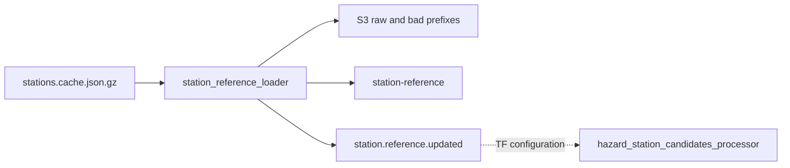

# Station reference

**Canonical page:** this page
**Verified against:** `8abd2d5` on `docs/ws2-ingestion`
**Maturity:** CODE, TF
**Production authorization:** no grant found in `functions/station_reference/loader/app.py`

## Purpose

This page documents the Aviation Weather station-cache loader that fills `StationReference` and publishes `station.reference.updated`. That event rebuilds hazard-station candidates ([Hazard station candidates](hazard-station-candidates.md)). Runway/airport physical data is [Runway metadata](runway-metadata.md), a separate pipeline.

## Implementation status

| Question | Result | Source |
| --- | --- | --- |
| Code | CODE | `functions/station_reference/loader/app.py` (`lambda_handler`, `_normalize_station`, `_publish_event`) |
| Terraform | TF | `modules/station_reference/`; `envs/dev/main.tf` (`module.station_reference`) |
| Unit tests | none found | search: `tests/unit` for `station_reference` directory or loader tests — no `tests/unit/station_reference/` |
| Contract tests | none found | search: `tests/contracts` |
| Infrastructure tests | none found | `EXPECTED_MODULES` in `tests/infrastructure/terraform/test_root_contract.py` omits `station_reference` |
| Integration tests | none found | search: `tests/integration` for station_reference |
| Live harness | none found | search: `scripts/validate_*` and `functions/*Station*` |
| Deployment | UNKNOWN | `not verified` |
| Production authorization | no grant found | cited loader sources |

Related UNIT coverage exists only as fakes inside `tests/unit/sigmet/test_hazard_station_candidates_processor.py`, which is not a loader test.

## Behavior

### External source

HTTPS GET of `STATION_CACHE_URL` or event `station_cache_url`, default `https://aviationweather.gov/data/cache/stations.cache.json.gz` (source: `functions/station_reference/loader/app.py`, `DEFAULT_URL`; `envs/dev/main.tf`). `_fetch_station_cache` uses `User-Agent: Wilvor-StationReferenceLoader/1.0`. `SOURCE_SYSTEM` is `NOAA_AVIATIONWEATHER_STATION_CACHE`.

There is no FAA/NASR input on this path. S3 is archive output only.

### Scheduling

`aws_cloudwatch_event_rule.station_reference_loader_schedule` default `rate(1 day)`, state from `enable_station_reference_loader_schedule` (source: `modules/station_reference/loader.tf`). `envs/dev` sets the flag `false`. The scheduled target has no input transformer; an empty EventBridge payload uses env defaults.

### Validation and load

`_iter_records` accepts a list, GeoJSON `features`, or `stations`/`data`/`items`. `_normalize_station` requires a station id and coordinates, computes H3 via `_latlng_to_h3`, and sets `airport_id` only when `is_airport` and `station_id` is four characters. Rejection reasons include `missing_station_id`, `missing_coordinates`, `invalid_coordinates`. Schema default `station-reference-v1`.

There is no NASR/AIRAC cycle control and no skip-if-unchanged. Loader CODE resolves `source_version` in this order: event `source_version`, env `SOURCE_VERSION`, HTTP `Last-Modified`, then `YYYY-MM-DD` (source: `functions/station_reference/loader/app.py`, `lambda_handler`). Terraform always sets env `SOURCE_VERSION` to `var.default_source_version` (source: `modules/station_reference/loader.tf`). That variable defaults to nonempty `awc-stations-current` (source: `modules/station_reference/variables.tf`). `envs/dev` does not override it, so the configured Lambda uses `awc-stations-current`. Last-Modified and the date string are fallback branches that run only when both the event field and env `SOURCE_VERSION` are empty. They are not the configured `envs/dev` path. The Terraform variable description that calls this a Last-Modified fallback does not match that CODE precedence.

`lambda_handler` archives the raw gzip, splits valid vs failures, raises `RuntimeError` if zero valid rows, batch-writes with `overwrite_by_pkeys=["station_id"]`, archives partial failures, then `_publish_event`.

Event: `Source` `wilvor.reference.station`, `DetailType` `station.reference.updated`. Detail includes `correlation_id`, `schema_version`, `source_system`, `source_version`, counts, S3 URIs, `table_name`, `h3_resolution`, `updated_at_utc`.

Caption: station-reference load and downstream EventBridge edge at `8abd2d5`. Solid edges: `functions/station_reference/loader/app.py` (`lambda_handler`, `_publish_event`). Dotted edge: Terraform-only EventBridge subscription in `modules/sigmet/hazard_station_candidates_processor.tf` (`aws_cloudwatch_event_rule.hazard_station_candidates_source_updates` includes `station.reference.updated`).

## Interfaces

| Kind | Pattern | Source |
| --- | --- | --- |
| Table | `${name_prefix}-station-reference` hash `station_id`; GSIs `airport-station-index`, `h3-station-index` | `modules/station_reference/tables.tf` |
| Archive | `${name_prefix}-station-reference-archive-${account_id}-${aws_region}` | `modules/station_reference/archive.tf` |
| Dev H3 | `station_h3_resolution = 4` | `envs/dev/main.tf` |
| Dev DynamoDB | read 10, write 200 | same |
| Downstream | `module.sigmet` and `module.airport_status` receive table name/ARN | `envs/dev/main.tf` |

## Known limitations

- No unit, Terraform-source infrastructure, or integration tests for this loader were found. `EXPECTED_MODULES` in `tests/infrastructure/terraform/test_root_contract.py` omits `station_reference`. Live-account tests under `tests/infrastructure/aws/` omit this loader from `LAMBDA_OUTPUTS` and do not establish DEPLOYED.
- Terraform configures nonempty env `SOURCE_VERSION` (`awc-stations-current` in `envs/dev`). HTTP Last-Modified and the date fallback are unused on that configured path.
- Every successful run upserts all valid stations. There is no content-hash skip.
- `is_airport` / `airport_id` is a four-character heuristic, not runway-reference quality. The loader comment defers diversion suitability.
- Schedule is `false` in `envs/dev`.
- PITR follows `enable_point_in_time_recovery`, which `envs/dev` sets `false`.
- SIGMET module default GSI name does not match `h3-station-index` unless overridden; `envs/dev` does override. See [Hazard station candidates](hazard-station-candidates.md).

## Historical record

No superseded statement is stored on this page.

## Sources

- Source: `functions/station_reference/loader/app.py` (`lambda_handler`, `_fetch_station_cache`, `_publish_event`)
- Source: `modules/station_reference/tables.tf` (`aws_dynamodb_table.station_reference`)
- Source: `envs/dev/main.tf` (`module.station_reference`)
