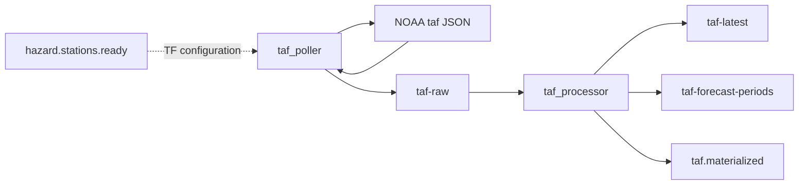

# TAF ingestion

**Canonical page:** this page
**Verified against:** `8abd2d5` on `docs/ws2-ingestion`
**Maturity:** CODE, TF, UNIT, INFRA
**Production authorization:** no grant found in `functions/weather/taf/processor/app.py`

## Purpose

This page documents hazard-scoped NOAA TAF polling, latest-state plus forecast-period materialization, and `taf.materialized`. Station lists come from [Hazard station candidates](hazard-station-candidates.md). Airport-status consumption of `taf.materialized` belongs to WS3 (`docs/processing/`).

## Implementation status

| Question | Result | Source |
| --- | --- | --- |
| Code | CODE | `functions/weather/taf/poller/app.py`, `functions/weather/taf/processor/app.py` |
| Terraform | TF | `modules/taf/`; `envs/dev/main.tf` (`module.taf`) |
| Unit tests | UNIT | `tests/unit/taf/` |
| Contract tests | none found | search: `tests/contracts` for taf |
| Infrastructure tests | INFRA | `tests/infrastructure/terraform/test_root_contract.py` (`enable_taf_poller_schedule`) |
| Live-account infrastructure tests | files exist; require authenticated AWS and `terraform output` | `tests/infrastructure/aws/test_compute.py`, `test_data_services.py`, `test_eventing_monitoring.py` name TAF outputs; fixtures in `tests/infrastructure/conftest.py` (`terraform_outputs`, `aws_session`) |
| Integration tests | file exists; assertions read | `tests/integration/taf/test_taf_pipeline.py` |
| Live harness | none found for this pipeline | search: `scripts/validate_*` |
| Deployment | UNKNOWN | `not verified` |
| Production authorization | no grant found | cited TAF sources |

## Behavior

### External source

`fetch_taf_records` GET `NOAA_TAF_URL` (default and `envs/dev`: `https://aviationweather.gov/api/data/taf`) with `ids` and `format=json`, `User-Agent: Wilvor-TAF-Poller/0.2`, 60s timeout, chunks of `TAF_STATION_CHUNK_SIZE` (dev 100). HTTP 204, including `HTTPError` code 204, skips that chunk (source: `functions/weather/taf/poller/app.py`, `fetch_taf_records`; tests: `test_fetch_taf_records_skips_204`, `test_fetch_taf_records_skips_http_204`).

### Scheduling and event-driven trigger

Event-driven path: `aws_cloudwatch_event_rule.taf_poller_hazard_stations_ready` matches `wilvor.weather` / `hazard.stations.ready` (source: `modules/taf/poller.tf`). `get_station_ids` reads `detail.hazard_version_key` and queries `HAZARD_STATION_CANDIDATES_TABLE_NAME`. Comment in code: "Production path: hazard.stations.ready -> HazardStationCandidates -> station IDs." That query does not call METAR's `is_candidate_current`.

Fallback: `TAF_STATION_IDS` env via `get_station_ids_from_env`. `envs/dev` sets `taf_station_ids = ""`. A direct invoke without `hazard_version_key` raises if that env is empty.

Schedule: `enable_taf_poller_schedule = false`, expression `rate(10 minutes)` (source: `envs/dev/main.tf`). Comment in that file: keep automatic polling disabled until manual testing is complete. A second comment says the processor can publish `Weather.changed`; current CODE publishes `taf.materialized` (see [Historical record](#historical-record)).

Empty station list: `fetch_taf_records` returns `[]`; the handler still archives and publishes zero Kinesis records.

### Archive, Kinesis, normalization

Poller gzip-archives and publishes `schema_version` `raw.noaa.taf.v1` with a `trigger` block from the event detail. Batches of 500. Any Kinesis failure fails the poll.

Processor mapping: batch 100, `ReportBatchItemFailures`, `bisect_batch_on_function_error` (source: `modules/taf/processor.tf`). Parent schema Terraform: `internal.taf.v1`. Period items use `internal.taf_forecast_period.v1` in `build_period_item`.

`normalize_taf` requires `icaoId`. Times: `issueTime`, `validTimeFrom`, `validTimeTo`; period `timeFrom`/`timeTo`. Visibility `normalize_visibility` (`6+` → qualifier `GREATER_THAN_OR_EQUAL`). Wind `normalize_wind_direction` (`VRB` → variable). Ceiling from BKN/OVC/VV. `detect_taf_amendment` / `detect_taf_correction` inspect raw text. `source_version` equals `taf_version`, a 32-character hash of station, times, raw text, periods, and remarks.

`classify_change`: `NEW`; same `source_version` → `UNCHANGED`; newer `issued_at_epoch` → `UPDATED`; same issue epoch, different version → `CORRECTED`; older issue → `STALE`.

`materialize_taf_version` conditional-puts the parent without embedding `forecast_periods`, writes the child table, then `update_latest_ready` sets `period_materialization_status` `READY`. `publish_taf_materialized` uses `DetailType` `taf.materialized`, `event_type` `taf.materialized`, `product_type` `TAF`. Wrapper `publish_weather_changed` calls `publish_taf_materialized`.

Permanent errors archive to `bad-records/source=taf_processor` (`taf_bad_record.v1`) without retry unless archive fails.

Caption: TAF path after `hazard.stations.ready`, read at `8abd2d5`. Dotted edge: Terraform-only EventBridge subscription `modules/taf/poller.tf` (`aws_cloudwatch_event_rule.taf_poller_hazard_stations_ready`). Solid edges: `functions/weather/taf/poller/app.py` (`get_station_ids`), `functions/weather/taf/processor/app.py` (`publish_taf_materialized`).

### Freshness and timestamps

| Field | Semantics |
| --- | --- |
| `issued_at_*` / `source_event_time_utc` | TAF issue time |
| `valid_from` / `valid_to` | Bulletin window |
| `received_at_utc` | Poller envelope |
| `processed_at_utc` / `materialized_at_utc` | Processor clocks |
| `expires_at_epoch` | `valid_to` plus 12 hours |
| `freshness_status` | `classify_freshness`: `STALE` if `now > valid_to`; else `FRESH` if issue age ≤ 6 hours, `ACCEPTABLE` if ≤ 24 hours, else `STALE` |

## Interfaces

| Kind | Pattern | Source |
| --- | --- | --- |
| Stream | `${name_prefix}-taf-raw` | `modules/taf/streams.tf` |
| Tables | `${name_prefix}-taf-latest` hash `station_id`; `${name_prefix}-taf-forecast-periods` hash `taf_version_key` range `period_key` | `modules/taf/tables.tf` |
| Event | `wilvor.weather` / `taf.materialized` | `publish_taf_materialized` |

`module.weather_events` does not list `taf.materialized` (source: `modules/weather_events/main.tf`, `detail-type` `Weather.changed`, `metar.updated` only). The TAF event detail includes `product_type` `TAF`, so the product-type metric filter would match if the log rule included this DetailType. See [Weather events](weather-events.md). `modules/airport_status/processor.tf` does listen for `metar.updated` and `taf.materialized` (WS3).

## Known limitations

- TAF candidate query does not filter expired HSC rows the way METAR does.
- `taf_station_ids` is empty in `envs/dev`. Manual invoke without `hazard.stations.ready` fails unless that env is overridden.
- `envs/dev/main.tf` comment that the processor publishes `Weather.changed` does not match `publish_taf_materialized`.
- `taf.materialized` is not copied to the weather-changed log group. Its detail includes `product_type` `TAF`, but that field is never evaluated by the weather-events metric filter because the rule does not match this DetailType.
- Integration tests expect `forecast_periods` on the latest item and `product_type == "TAF"` in the weather log. Current parent write strips periods; the weather-events rule does not match `taf.materialized`.
- Unit tests for the poller cover `TAF_STATION_IDS`. They do not assert the HSC `hazard_version_key` path.
- Live-account tests under `tests/infrastructure/aws/` require an authenticated AWS account and `terraform output`. They are not Terraform-source tests and they do not establish DEPLOYED.
- PITR on TAF tables is `enabled = false`.

## Historical record

Comments and runbooks that name `Weather.changed` as the TAF product event are historical. Current DetailType is `taf.materialized`. The wrapper name `publish_weather_changed` remains in CODE and only calls `publish_taf_materialized` (source: `functions/weather/taf/processor/app.py`).

## Sources

- Source: `functions/weather/taf/poller/app.py` (`get_station_ids`, `fetch_taf_records`)
- Source: `functions/weather/taf/processor/app.py` (`classify_change`, `classify_freshness`, `publish_taf_materialized`)
- Source: `modules/taf/processor.tf` (`SCHEMA_VERSION`)
- Source: `envs/dev/main.tf` (`module.taf`)
- Tests: `tests/unit/taf/test_taf_poller.py`, `test_taf_processor.py` (`test_publish_taf_materialized`)
