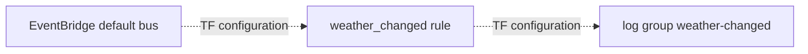

# Weather events

**Canonical page:** this page
**Verified against:** `8abd2d5` on `docs/ws2-ingestion`
**Maturity:** TF, INFRA
**Production authorization:** no grant found in `modules/weather_events/main.tf`

## Purpose

This page documents `module.weather_events`, which copies a subset of EventBridge weather events into CloudWatch Logs. It is not a poller or processor. Producer events are [SIGMET](sigmet.md), [METAR](metar.md), [TAF](taf.md), and [Hazard station candidates](hazard-station-candidates.md).

## Implementation status

| Question | Result | Source |
| --- | --- | --- |
| Code | none for a Lambda | this module is Terraform plus dashboard widgets |
| Terraform | TF | `modules/weather_events/`; `envs/dev/main.tf` (`module.weather_events`) |
| Unit tests | none found | search: `tests/unit` for weather_events |
| Contract tests | none found | search: `tests/contracts` |
| Infrastructure tests | INFRA | `tests/infrastructure/terraform/test_root_contract.py` (`EXPECTED_MODULES` includes `weather_events`; outputs `weather_changed_log_group_name`, `weather_events_dashboard_name`) |
| Live-account infrastructure tests | files exist; require authenticated AWS and `terraform output` | `tests/infrastructure/aws/test_eventing_monitoring.py` (`test_weather_changed_log_group_exists`, dashboard output `weather_events_dashboard_name`); fixtures in `tests/infrastructure/conftest.py` (`terraform_outputs`, `aws_session`) |
| Integration tests | helpers wait on this log group | `tests/helpers/integration_support.py` (timeout text `Weather.changed`); pipeline tests under `tests/integration/{sigmet,metar,taf}` |
| Live harness | none found | search: `scripts/validate_*` |
| Deployment | UNKNOWN | `not verified` |
| Production authorization | no grant found | `modules/weather_events/main.tf` |

## Behavior

`aws_cloudwatch_event_rule.weather_changed` matches:

- `source`: `wilvor.weather`
- `detail-type`: `Weather.changed`, `metar.updated`

The target is log group `/aws/events/${name_prefix}-weather-changed` with 3-day retention (source: `modules/weather_events/main.tf`). A resource policy allows EventBridge to write that group.

`modules/weather_events/monitoring.tf` defines a failed-invocations alarm, metric filter `aws_cloudwatch_log_metric_filter.weather_changed_by_product` with pattern `{ $.detail.product_type = "*" }` into namespace `Wilvor/WeatherEvents` metric `WeatherChangedEvents`, and a dashboard with widgets labeled METAR, TAF, and SIGMET.

Reaching the log group and satisfying that metric filter are different:

| Producer event | In the log rule | `detail.product_type` | Metric filter |
| --- | --- | --- | --- |
| `metar.updated` | yes | absent; classification is `reason` | does not match |
| `hazard.materialized` / `HazardCoordinates.materialized` | no | present, default `SIGMET` | never evaluated |
| `taf.materialized` | no | present, `TAF` | never evaluated |
| `Weather.changed` | yes | no current producer puts this DetailType | n/a |

Sources: `modules/weather_events/main.tf` (`aws_cloudwatch_event_rule.weather_changed`); `modules/weather_events/monitoring.tf` (`aws_cloudwatch_log_metric_filter.weather_changed_by_product`); `functions/weather/metar/processor/app.py` (`publish_metar_updated_event`); `functions/weather/sigmet/processor/app.py` (`publish_hazard_materialized`, `publish_hazard_coordinates_materialized`); `functions/weather/taf/processor/app.py` (`publish_taf_materialized`).

Caption: log-capture configuration at `8abd2d5`. Dotted edges are Terraform-only EventBridge subscription and target wiring in `modules/weather_events/main.tf` (`aws_cloudwatch_event_rule.weather_changed`, `aws_cloudwatch_event_target.weather_changed_logs`). They do not record an apply. They also do not imply that captured events satisfy the product-type metric filter.

## Interfaces

| Kind | Value | Source |
| --- | --- | --- |
| Bus | `var.event_bus_name` default `default`; `envs/dev` passes `local.default_event_bus_name` | `modules/weather_events/variables.tf`, `envs/dev/main.tf` |
| Captured DetailTypes | `Weather.changed`, `metar.updated` | `aws_cloudwatch_event_rule.weather_changed` |
| Not in the rule | `hazard.materialized`, `HazardCoordinates.materialized`, `hazard.stations.ready`, `taf.materialized`, `aircraft.state.updated` | same event_pattern; producer pages |

## Known limitations

- SIGMET processor publishes `hazard.materialized` and `HazardCoordinates.materialized`, not `Weather.changed`. Those details include `product_type` but are not in this rule, so they are not copied to this log group and never reach the product-type metric filter.
- TAF processor publishes `taf.materialized` with `product_type` `TAF`. That DetailType is also absent from the rule.
- METAR `metar.updated` is the v4 producer event this rule currently matches. Its detail has `reason` and does not include `product_type`, so the log copy can succeed while `WeatherChangedEvents` still does not increment.
- Integration helpers still wait for `Weather.changed` (`tests/helpers/integration_support.py`, `wait_for_weather_event`). That wait text does not match current SIGMET/TAF DetailTypes. METAR integration predicates also expect `product_type` and `change_type`; see [METAR](metar.md#known-limitations).
- Dashboard product-type widgets are Terraform labels. They are not evidence that SIGMET or TAF currently emit `Weather.changed`, and they are not evidence that `metar.updated` supplies `product_type`.
- Live-account tests under `tests/infrastructure/aws/` require an authenticated AWS account and `terraform output`. They are not Terraform-source tests and they do not establish DEPLOYED.

## Historical record

Legacy operator runbooks under `functions/` described this log group as the SIGMET/METAR/TAF verification sink for `Weather.changed`. That was the older product event. [`tests/integration/README.md`](../../tests/integration/README.md) now documents current producer DetailTypes and keeps the `Weather.changed` wording under its Historical record. Current producer DetailTypes are listed in [Overview](overview.md#event-catalog-from-ingestion-producers).

## Sources

- Source: `modules/weather_events/main.tf` (`aws_cloudwatch_event_rule.weather_changed`)
- Source: `modules/weather_events/monitoring.tf`
- Source: `envs/dev/main.tf` (`module.weather_events`)
- Tests: `tests/infrastructure/terraform/test_root_contract.py` (`EXPECTED_MODULES`, `EXPECTED_OUTPUTS`)
- Tests: `tests/infrastructure/aws/test_eventing_monitoring.py` (`test_weather_changed_log_group_exists`) — live-account suite, not DEPLOYED
