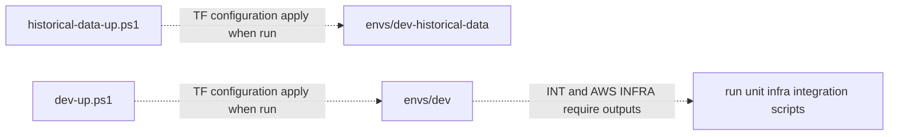

# Lifecycle

**Canonical page:** this page for how roots, scripts, and tests relate. Command flags remain in [`../../scripts/README.md`](../../scripts/README.md).
**Verified against:** `8abd2d5` on `docs/ws1-platform-foundations`
**Maturity:** CODE, TF, INFRA, LIVE
**Production authorization:** no grant found. `dev-down.ps1` and `dev-reset.ps1` refuse `envs/dev-historical-data`.

## Purpose

This page explains the relationship between Terraform roots, PowerShell lifecycle scripts, AWS development resources, and existing test/validation tools. It does not invent deployment procedures. Running `dev-up.ps1` mutates AWS; this documentation task does not run it.

## Implementation status

| Question | Result | Source |
| --- | --- | --- |
| Code | CODE | `scripts/dev-up.ps1`, `dev-down.ps1`, `dev-reset.ps1`, `historical-data-up.ps1` |
| Terraform | TF | `envs/dev/main.tf`, `envs/dev-historical-data/main.tf` |
| Unit tests | none found for the `.ps1` lifecycle scripts | `not read` |
| Contract tests | none found for lifecycle scripts | |
| Infrastructure tests | INFRA | `tests/infrastructure/terraform/test_historical_facts_contract.py` (`test_dev_down_refuses_data_plane_and_deactivates_when_enabled`) |
| Integration tests | suite present; pipeline assertions not sampled on this page | `tests/integration/conftest.py` (`environment == "dev"`) |
| Live harness | LIVE | `scripts/validate_*.py`, `scripts/poll-all-once.ps1` |
| Deployment | UNKNOWN | `not verified` |
| Production authorization | no grant found | no prod root; scripts default to `envs/dev` |

## Terraform roots

| Root | Module | Daily teardown |
| --- | --- | --- |
| `envs/dev` | Ingestion, processing, Operational API, historical transport, historical analytics | `scripts/dev-down.ps1` |
| `envs/dev-historical-data` | `historical_facts_data` persistent bucket | refused by `dev-down.ps1` / `dev-reset.ps1` |

`envs/dev/providers.tf` and `envs/dev-historical-data` require Terraform `>= 1.6.0` and AWS provider `~> 5.0`. Variables: `aws_region`, `aws_profile`, `project_name`, `environment` (source: `envs/dev/variables.tf`). Committed tfvars for `dev`: region `us-west-1`, profile `wilvor-dev`, project `wilvor`, environment `dev`.

`enable_historical_facts = true` appears in `envs/dev/main.tf` on `module.historical_facts` and `module.operational_api` at `8abd2d5`. `enable_historical_analytics = true` is set on `module.historical_analytics`. Those assignments are TF. They do not establish DEPLOYED.

There is no `scripts/historical-data-down.ps1` (asserted by `test_dev_down_refuses_data_plane_and_deactivates_when_enabled`).

## PowerShell lifecycle scripts

Defaults below are from the script `param()` blocks.

### `scripts/dev-up.ps1`

Default `-TerraformDirectory envs/dev`. Steps documented in `scripts/README.md` and implemented in the script: AWS auth (optional SSO login), every `scripts/build_*.ps1` unless `-SkipBuild`, `terraform init`, `fmt -check`, `validate`, `plan -out=tfplan`, apply the saved plan, write outputs under `test-results/lifecycle/`, restore OpenSky credentials unless `-SkipSecretRestore`.

This script applies Terraform. Documentation does not run it.

### `scripts/dev-down.ps1`

Requires `-Force`. Default directory `envs/dev`. Throws if `-TerraformDirectory` matches `dev-historical-data` (source: `scripts/dev-down.ps1`). When `enable_historical_facts` output is true and a coverage Lambda is set, the script invokes coverage `DEACTIVATE`, requires a durable deactivation object, and aborts destroy if that write cannot be confirmed (source: `scripts/dev-down.ps1`; tests: `tests/infrastructure/terraform/test_historical_facts_contract.py`, `test_dev_down_refuses_data_plane_and_deactivates_when_enabled`).

### `scripts/dev-reset.ps1`

Requires `-Force`. Runs down, then up. Also refuses `dev-historical-data`.

### `scripts/historical-data-up.ps1`

Default `-TerraformDirectory envs/dev-historical-data`. Throws unless the directory matches `dev-historical-data` (source: `scripts/historical-data-up.ps1`). Init, fmt-check, validate, plan, apply. There is no matching destroy script in `scripts/`.

Canonical flag tables and troubleshooting remain in [`../../scripts/README.md`](../../scripts/README.md).

Caption: lifecycle relationship at `8abd2d5`. Dotted edges are configuration and operator scripts, not a recorded apply. Sources: `scripts/dev-up.ps1`; `scripts/historical-data-up.ps1`; `tests/integration/conftest.py`.

## AWS development resources

`envs/dev` configures, among other resources, Kinesis streams, DynamoDB tables, Lambda functions, S3 archive buckets, EventBridge rules on the default bus, API Gateway HTTP API, Firehose (when historical facts are enabled), Glue/Athena (when historical analytics is enabled), CloudWatch, and an OpenSky secret. Resource names use `${project_name}-${environment}-…` (`local.name_prefix` in `envs/dev/main.tf`). With committed tfvars that prefix is `wilvor-dev`. Whether those names exist in an account is UNKNOWN.

Timed poller schedules are disabled in `envs/dev/main.tf`. Event-driven processor triggers are enabled. See [`../overview/architecture.md`](../overview/architecture.md).

`envs/dev-historical-data` configures the persistent historical facts bucket only. `dev-down` must not target it.

## Testing and validation tools

| Tool | What it is | AWS effect |
| --- | --- | --- |
| `scripts/run-unit-tests.ps1` | pytest under `tests/unit/<Target>` | none intended |
| `python -m pytest tests/contracts` | AI and schema contracts | none intended |
| `scripts/run-infrastructure-tests.ps1 -Target terraform` | fmt/validate/HCL contracts | none, optional plan file |
| `scripts/run-infrastructure-tests.ps1 -Target aws` | read-only account checks | reads Terraform outputs and AWS; documented read-only in [`../../tests/infrastructure/README.md`](../../tests/infrastructure/README.md) |
| `scripts/run-integration-tests.ps1` | deployed pipeline tests | writes fixture records into the `dev` environment, then deletes most of them unless `-KeepArtifacts` |
| `scripts/poll-all-once.ps1` | operator poll | invokes aircraft/SIGMET pollers; METAR/TAF skipped unless `-IncludeMetar` / `-IncludeTaf` |
| `scripts/validate_historical_query_runtime.py` | closed historical operations | dry-run makes zero AWS calls; other actions use operator SSO |
| `scripts/validate_historical_analytics.ps1` | Athena validation | dry-run prints SQL only |
| `scripts/validate_historical_specialist_anthropic_live.py` | Historical specialist harness | no AWS; live Anthropic only with `WILVOR_RUN_LIVE_ANTHROPIC=1` |
| `scripts/validate_live_ops_specialist_anthropic_live.py` | Live Ops specialist harness | live Anthropic only with `WILVOR_RUN_LIVE_LIVE_OPS_ANTHROPIC=1` |
| `scripts/validate_decision_specialist_anthropic_live.py` | Decision specialist harness | live Anthropic only with `WILVOR_RUN_LIVE_DECISION_ANTHROPIC` |

Integration and AWS infrastructure tests fail unless Terraform outputs report `environment = dev` (source: `tests/integration/conftest.py`; `tests/infrastructure/aws/test_identity.py`, `test_tests_are_targeting_dev_environment`).

Evidence directories are gitignored: `test-results/` (source: `.gitignore`).

Do not treat a harness file as a current pass. Do not treat Terraform as DEPLOYED.

Ingestion runbooks under `functions/*.txt` are owned by WS2. Names: `local_runner_documentation.txt`, `metar_pipeline_runbook.txt`, `weather_pipeline_reproducibility.txt`, `Runway_Metadata_Commands.txt`, `Wilvor_Aircraft_SIGMET_Integration_Test_Runbook_Original_Structure.txt.txt`.

## Known limitations

- This page does not record that `dev-up` has been applied.
- `scripts/README.md` previously described `enable_historical_facts` as the committed default `false`. Committed `envs/dev/main.tf` assigns `true`. See the historical-enablement note in `scripts/README.md`.
- `scripts/README.md` documents `-TerraformDirectory "envs/staging"` as a usage example for `dev-up.ps1`. `scripts/dev-up.ps1` itself defaults to `envs/dev` and does not mention staging. No `envs/staging/main.tf` exists at `8abd2d5`.
- AWS tests and integration tests require an already-applied `dev` stack. This documentation task does not apply one.
- Live harnesses that call Anthropic or Athena are operator tools. Documentation work does not execute them against external APIs.

## Historical record

No superseded statement is stored on this page. The `enable_historical_facts` wording correction lives in [`../../scripts/README.md`](../../scripts/README.md).

## Sources

- Source: `scripts/dev-up.ps1`
- Source: `scripts/dev-down.ps1`
- Source: `scripts/dev-reset.ps1`
- Source: `scripts/historical-data-up.ps1`
- Source: `envs/dev/main.tf`
- Source: `envs/dev-historical-data/main.tf`
- Source: `tests/integration/conftest.py`
- Source: `tests/infrastructure/aws/test_identity.py` (`test_tests_are_targeting_dev_environment`)
- Tests: `tests/infrastructure/terraform/test_historical_facts_contract.py` (`test_dev_down_refuses_data_plane_and_deactivates_when_enabled`)
