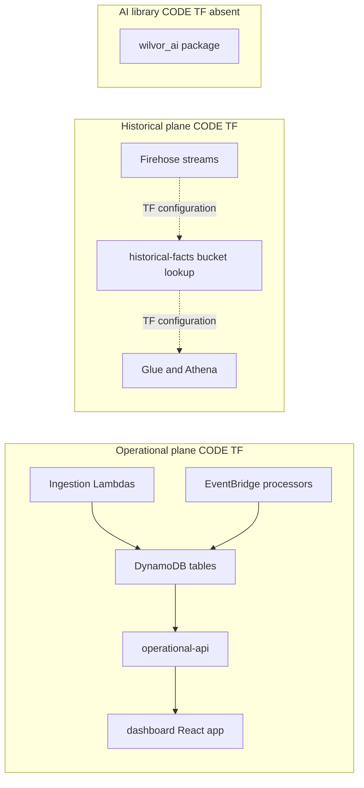
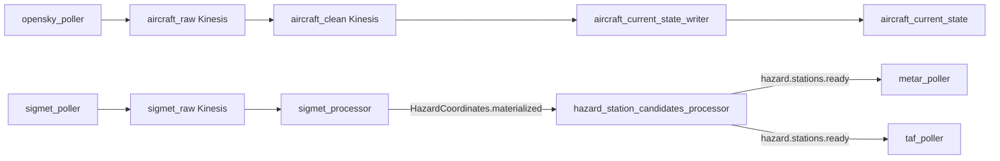
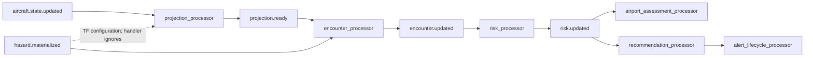
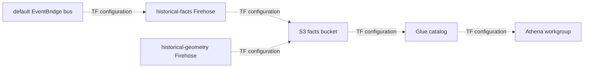
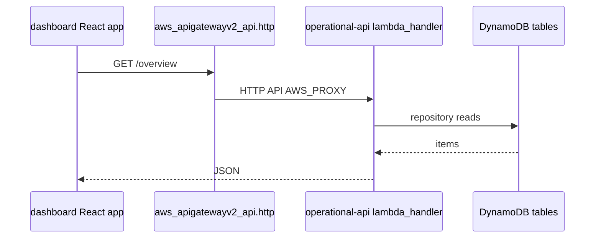
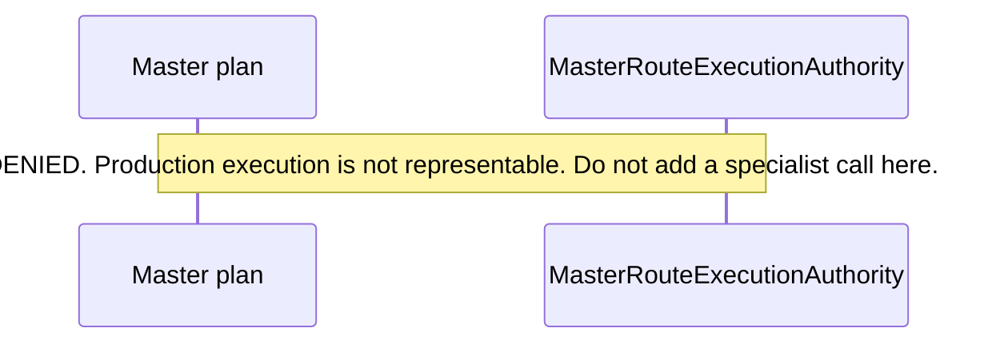

# Architecture

**Canonical page:** this page
**Verified against:** `8abd2d5` on `docs/ws1-platform-foundations`
**Maturity:** CODE, TF, UNIT, CONTRACT, INFRA, INT, LIVE
**Production authorization:** `MasterRouteExecutionAuthority.DENIED`. Production execution is not representable (source: `functions/shared/wilvor_ai/master_routing.py`, `MasterRouteExecutionAuthority`).

## Purpose

This page maps the implemented Wilvor system: ingestion, event-driven processing, operational DynamoDB state, historical storage and analytics, the Operational API, the React console, and AI library code. Pipeline internals, API response schemas, DynamoDB keys, and AI specialist catalogs stay on their canonical pages.

## Implementation status

| Question | Result | Source |
| --- | --- | --- |
| Code | CODE | `functions/`, `dashboard/`, `functions/shared/` |
| Terraform | TF | `envs/dev/main.tf`, `envs/dev-historical-data/main.tf` |
| Unit tests | UNIT | `tests/unit/` (ingestion, processors, operational API, historical, shared) |
| Contract tests | CONTRACT | `tests/contracts/` (AI contracts and Master routing) |
| Infrastructure tests | INFRA | `tests/infrastructure/terraform/`, `tests/infrastructure/aws/` |
| Integration tests | INT | `tests/integration/{aircraft,sigmet,metar,taf}/` |
| Live harness | LIVE | `scripts/validate_*.py` |
| Deployment | UNKNOWN | `not verified` |
| Production authorization | `DENIED` | `functions/shared/wilvor_ai/master_routing.py` (`MasterRouteExecutionAuthority`) |

## Planes

Wilvor's repository separates operational runtime, historical collection, and AI library code.



Caption: three planes at `8abd2d5`. Solid edges inside the operational subgraph are handler or table wiring read in Terraform and application source. Dotted edges inside the historical subgraph are Terraform configuration. The AI subgraph has no runtime edge: search of `*.tf` for `bedrock`, `anthropic`, and `wilvor_ai` returned no matches, and the Operational API does not import `wilvor_ai`. Sources: `envs/dev/main.tf`; `modules/operational_api/api.tf`; `dashboard/src/routes/routeDefinitions.ts`; `functions/operational_api/app.py`.

## Aircraft and weather ingestion

`envs/dev/main.tf` instantiates `aircraft_foundation`, `sigmet`, `metar`, `taf`, `station_reference`, `runway_metadata`, and `weather_events`.

| Source | Poller or loader | Raw path | Processor | Current table resource |
| --- | --- | --- | --- | --- |
| OpenSky | `opensky_poller` | Kinesis `aircraft_raw` then `aircraft_clean` | `aircraft_raw_processor`, `aircraft_current_state_writer` | `aws_dynamodb_table.aircraft_current_state` |
| SIGMET | `sigmet_poller` | Kinesis `sigmet_raw` | `sigmet_processor` plus hazard-coordinates and hazard-station-candidates processors | `active_hazards`, `hazard_cells`, `impact_cells`, `hazard_coordinates`, `hazard_station_candidates` |
| METAR | `metar_poller` | Kinesis `metar_raw` | `metar_processor` | `metar_latest` |
| TAF | `taf_poller` | Kinesis `taf_raw` | `taf_processor` | `taf_latest`, `taf_forecast_periods` |
| Station cache | `station_reference` loader | archive in module | loader writes table | `station_reference` |
| FAA APT CSV | `runway_metadata` loader | archive in module | loader writes table | `runway_reference` |

Timed schedules in `envs/dev/main.tf` at `8abd2d5`:

- `enable_opensky_poller_schedule = false` (`rate(5 minutes)` expression still supplied)
- `enable_sigmet_poller_schedule = false` (`rate(2 minutes)`)
- `enable_metar_poller_schedule = false` (`rate(3 minutes)`)
- `enable_taf_poller_schedule = false` (`rate(10 minutes)`)
- `enable_runway_loader_schedule = false` (`rate(1 day)`)
- `enable_station_reference_loader_schedule = false` (`rate(1 day)`)

METAR and TAF pollers also have EventBridge rules on `source = wilvor.weather`, `detail-type = hazard.stations.ready` (source: `modules/metar/poller.tf`, `aws_cloudwatch_event_rule.metar_hazard_stations_ready`; `modules/taf/poller.tf`, `aws_cloudwatch_event_rule.taf_poller_hazard_stations_ready`). The SIGMET hazard-station-candidates processor publishes that detail type (source: `functions/weather/sigmet/hazard_station_candidates_processor/app.py`, `publish_hazard_stations_ready`; tests: `tests/unit/sigmet/test_hazard_station_candidates_processor.py`).

`weather_events` logs `wilvor.weather` events with detail types `Weather.changed` and `metar.updated` to CloudWatch Logs (source: `modules/weather_events/main.tf`, `aws_cloudwatch_event_rule.weather_changed`).

External URLs configured in `envs/dev/main.tf`:

- SIGMET: `https://aviationweather.gov/api/data/airsigmet?format=geojson`
- METAR: `https://aviationweather.gov/api/data/metar?format=geojson`
- TAF: `https://aviationweather.gov/api/data/taf`
- Station cache: `https://aviationweather.gov/data/cache/stations.cache.json.gz`
- FAA APT zip: `https://nfdc.faa.gov/webContent/28DaySub/extra/09_Jul_2026_APT_CSV.zip`
- Runway loader airports: `KSFO`, `KOAK`, `KSJC`

Ingestion module internals belong with WS2 (`docs/ingestion/**` when published). Unit READMEs already exist for aircraft, SIGMET, METAR, and TAF under `tests/unit/`.



Caption: selected ingestion movement at `8abd2d5`, not every SIGMET Lambda. Solid edges follow Kinesis mappings and EventBridge publish/subscribe read in source. `sigmet_processor` publishes `HazardCoordinates.materialized` (source: `functions/weather/sigmet/processor/app.py`, `publish_hazard_coordinates_materialized`) and `hazard.materialized` (source: same file, `publish_hazard_materialized`). The hazard-station-candidates processor is an EventBridge target of `HazardCoordinates.materialized` (source: `modules/sigmet/hazard_station_candidates_processor.tf`, `aws_cloudwatch_event_rule.hazard_station_candidates_source_updates`). Timed poller schedules are disabled in `envs/dev/main.tf`; the `hazard.stations.ready` rules are separate resources. This view omits the separate `hazard_coordinates_processor` Lambda. Sources: `modules/aircraft_foundation`; `modules/sigmet`; `modules/metar/poller.tf`; `modules/taf/poller.tf`.

## Event-driven processing

Processors subscribe to the default EventBridge bus (`local.default_event_bus_name = "default"` in `envs/dev/main.tf`). Event triggers are enabled in that root at `8abd2d5`.

| Module | EventBridge source / detail-type | Lambda | DynamoDB resource |
| --- | --- | --- | --- |
| `projection` | TF: `wilvor.aircraft` / `aircraft.state.updated` (handler processes this type). TF: `wilvor.weather` / `hazard.materialized` (handler ignores it) | `projection_processor` | `aircraft_projection`, `aircraft_projection_points`, `aircraft_projection_cells` |
| `encounter` | `wilvor.projection` / `projection.ready`; `wilvor.weather` / `hazard.materialized` (handler processes both) | `encounter_processor` | `aircraft_hazard_encounter` |
| `risk` | `wilvor.encounter` / `encounter.updated`, `encounter.resolved` | `risk_processor` | `risk_results` |
| `airport_status` | `wilvor.weather` / `metar.updated`, `taf.materialized`; also publishes `wilvor.airport` / `airport.status.updated` | `airport_status_materializer` | `airport_status` |
| `airport_assessment` | `wilvor.risk` / `risk.updated` | airport assessment processor | `airport_assessment` |
| `recommendations` | `wilvor.risk` / `risk.updated`; `wilvor.assessment` / `airport.assessment.completed` | recommendation processor | `recommendations` |
| `active_alerts` | `wilvor.recommendation` / `recommendation.updated`; `wilvor.risk` / `risk.resolved`; `wilvor.encounter` / `encounter.resolved` | alert lifecycle processor | `active_alerts` |

Sources: `modules/projection/processor.tf`; `functions/projection/processor/app.py` (`lambda_handler`); `modules/encounter/processor.tf`; `functions/encounter/processor/app.py` (`lambda_handler`); `modules/risk/processor.tf`; `modules/airport_status/processor.tf`; `modules/airport_assessment/processor.tf`; `modules/recommendations/processor.tf`; `modules/active_alerts/processor.tf`. Enable flags: `envs/dev/main.tf` (`enable_projection_event_trigger`, `enable_encounter_event_trigger`, `enable_risk_event_trigger`, `enable_event_trigger`).



Caption: selected processing chain at `8abd2d5`, not every EventBridge rule. Solid edges are handler paths read in application source. The dotted edge is Terraform only: `modules/projection/processor.tf` (`aws_cloudwatch_event_rule.hazard_materialized`) targets the projection Lambda, and `lambda_handler` ignores any `detail-type` other than `aircraft.state.updated` (source: `functions/projection/processor/app.py`). Encounter handles `hazard.materialized` (source: `functions/encounter/processor/app.py`, `handle_hazard_materialized`). Omitted from this view: `airport_status` on `metar.updated` / `taf.materialized`; `recommendations` on `airport.assessment.completed`; `active_alerts` on `risk.resolved` and `encounter.resolved`; `risk` on `encounter.resolved`. Processor algorithms belong with WS3 (`docs/processing/**` when published).

## DynamoDB operational state

Operational API table environment keys in `envs/dev/main.tf` (`module.operational_api.table_names`) at `8abd2d5`:

- `AIRCRAFT_CURRENT_STATE_TABLE_NAME`
- `AIRCRAFT_PROJECTION_TABLE_NAME`
- `AIRCRAFT_PROJECTION_POINTS_TABLE_NAME`
- `ACTIVE_HAZARDS_TABLE_NAME`
- `HAZARD_COORDINATES_TABLE_NAME`
- `AIRCRAFT_HAZARD_ENCOUNTER_TABLE_NAME`
- `RISK_RESULTS_TABLE_NAME`
- `AIRPORT_STATUS_TABLE_NAME`
- `METAR_LATEST_TABLE_NAME`
- `TAF_LATEST_TABLE_NAME`
- `TAF_FORECAST_PERIODS_TABLE_NAME`
- `AIRPORT_ASSESSMENT_TABLE_NAME`
- `RECOMMENDATIONS_TABLE_NAME`
- `ACTIVE_ALERTS_TABLE_NAME`

Additional operational tables exist in Terraform and are not in that API map, including `hazard_cells`, `impact_cells`, `hazard_station_candidates`, `aircraft_projection_cells`, `station_reference`, and `runway_reference`. Key design and current-set rules belong with WS3 (`docs/data/dynamodb.md` when published) and [`functions/shared/wilvor_operational/README.md`](../../functions/shared/wilvor_operational/README.md).

## Historical storage and analytics

Two Terraform roots implement historical infrastructure.

`envs/dev-historical-data/main.tf` instantiates only `module.historical_facts_data`. That module owns the persistent bucket (`force_destroy = false`). Canonical page: [`modules/historical_facts_data/README.md`](../../modules/historical_facts_data/README.md).

`envs/dev/main.tf` sets `enable_historical_facts = true` on `module.historical_facts` and on `module.operational_api`, and `enable_historical_analytics = true` on `module.historical_analytics` (tests: `tests/infrastructure/terraform/test_historical_facts_contract.py`, `test_dev_historical_facts_collection_is_enabled`; `tests/infrastructure/terraform/test_historical_analytics_contract.py`, `test_dev_wires_analytics_enabled_and_collection_enabled`).

`modules/historical_facts` does not create the S3 bucket. When enabled, it looks up `${name_prefix}-historical-facts-${account_id}-${aws_region}` (source: `modules/historical_facts/README.md`). EventBridge rules in `modules/historical_facts/events.tf`:

| Rule key | source | detail-types |
| --- | --- | --- |
| encounter | `wilvor.encounter` | `encounter.updated`, `encounter.resolved` |
| risk | `wilvor.risk` | `risk.updated`, `risk.resolved` |
| hazard_version | `wilvor.weather` | `hazard.materialized` |
| control | `wilvor.historical.control` | `collection.probe` |

SIGMET DirectPut uses the geometry Firehose stream (wired in `envs/dev/main.tf` `module.sigmet`). Persistence terms `ACCEPTED_FOR_BOUNDED_DELIVERY_RETRY` and `DURABLY_PERSISTED` are defined in the historical-facts module README; this page does not redefine them.

`modules/historical_analytics` configures Glue tables and an Athena workgroup over those facts. Canonical page: [`modules/historical_analytics/README.md`](../../modules/historical_analytics/README.md). Query operations live in [`functions/shared/wilvor_historical_query/README.md`](../../functions/shared/wilvor_historical_query/README.md). The Operational API route list in `modules/operational_api/api.tf` `local.route_keys` has no historical-query HTTP route.



Caption: historical path at `8abd2d5`. Every edge is dotted Terraform configuration. No application handler on this page was read as executing these hops. The bucket resource is in `envs/dev-historical-data`, not in `modules/historical_facts`. Whether either root is applied is UNKNOWN. Sources: `modules/historical_facts/events.tf`; `envs/dev-historical-data/main.tf`; `modules/historical_analytics`.

WS4 owns `docs/historical/**` when published.

## Operational API

Terraform: `modules/operational_api/api.tf`.

- Lambda `${name_prefix}-operational-api`, handler `app.lambda_handler`, `runtime = python3.12`
- API Gateway HTTP API `protocol_type = "HTTP"`
- CORS `allow_methods` GET and OPTIONS; origins `http://localhost:3000` and `http://localhost:5173` from `envs/dev/main.tf`
- `reserved_concurrent_executions = 5` via `lambda_reserved_concurrency`
- No `authorizer`, `jwt`, or `cognito` resource in `modules/**/*.tf` (search at `8abd2d5`)

`local.route_keys` (source: `modules/operational_api/api.tf`):

```text
GET /health
GET /overview
GET /freshness
GET /system-health
GET /system-health/dashboards/{dashboardId}
GET /system-health/dashboards/{dashboardId}/widgets/{widgetId}/image
GET /aircraft
GET /aircraft/{aircraftId}
GET /map/aircraft
GET /hazards/active
GET /encounters/active
GET /airports
GET /airports/status
GET /airports/{airportId}
GET /recommendations/active
GET /alerts/active
```

`lambda_handler` returns 405 when `method != "GET"` (source: `functions/operational_api/app.py`, `lambda_handler`). `/health` reports service `wilvor-operational-api` and does not claim pipeline health.

The Operational API Lambda source tree has no `wilvor_ai` import. Current-set filtering uses `wilvor_operational` through the API repository (source: `functions/shared/wilvor_operational/README.md`). Unit coverage includes `tests/unit/operational_api/test_current_alerts.py` (`test_active_alerts_list_returns_current_set_only`).

WS3 owns `docs/api/**` when published.

## React dashboard

Canonical console documentation: [`dashboard/README.md`](../../dashboard/README.md).

Routes registered in `dashboard/src/routes/routeDefinitions.ts` (`ROUTES`), all `implemented: true` at `8abd2d5`: `/`, `/aircraft`, `/airports`, `/encounters`, `/recommendations`, `/alerts`, `/system-health`. There is no `/ai` route in that table.

The HTTP client in `dashboard/src/api/operationalApi.ts` calls the Operational API paths above. Vite binds port `5173` with `strictPort: true` so the origin matches the API CORS allowlist (source: `dashboard/vite.config.ts`; `modules/operational_api/variables.tf` cited in that file).



Caption: console read path at `8abd2d5`. Sources: `dashboard/README.md`; `modules/operational_api/api.tf` (`aws_apigatewayv2_api.http`, `aws_apigatewayv2_integration.lambda`); `functions/operational_api/app.py` (`lambda_handler`). This diagram does not show writes; the handler rejects non-GET methods with 405.

The React app is not deployed by Terraform in this repository. CloudWatch dashboard resources in modules are pipeline health dashboards, not this UI.

WS3 owns `docs/dashboard/**` when published; until then `dashboard/README.md` remains canonical.

## AI components

Canonical package page: [`functions/shared/wilvor_ai/README.md`](../../functions/shared/wilvor_ai/README.md). WS5 owns `docs/ai/**` when published.

What exists as CODE:

- Contract types and `V1_AUTHORITY` with `AgentAuthorityMode.READ_ONLY_ADVISORY` (source: `functions/shared/wilvor_ai/contracts.py`)
- `MasterSpecialist`: `LIVE_OPS`, `HISTORICAL_ANALYTICS`, `DECISION` (source: `functions/shared/wilvor_ai/master_contracts.py`, `MasterSpecialist`)
- `MasterSpecialistAdapterDescriptor` docstring: "Planned binding only. Nothing on this object can be called to run a specialist." (source: `functions/shared/wilvor_ai/master_specialist_adapters.py`)
- Offline contract tests under `tests/contracts/`
- Operator harnesses under `scripts/validate_*anthropic_live.py`

What was not found:

- Terraform for Bedrock, Anthropic, or `wilvor_ai` (search: `*.tf`)
- Operational API import of `wilvor_ai`
- Dashboard `/ai` route
- A production execution member of `MasterRouteExecutionAuthority`



Caption: shape required while `MasterRouteExecutionAuthority` has only `DENIED`. Source: `functions/shared/wilvor_ai/master_routing.py`, `MasterRouteExecutionAuthority`. Verified at `8abd2d5`. Tests: `tests/contracts/test_master_routing.py`, `test_live_ops_only_is_bounded_and_not_executable_authority`.

## Interfaces

| Interface | Kind | Source |
| --- | --- | --- |
| Default EventBridge bus | AWS configuration | `envs/dev/main.tf` (`local.default_event_bus_name`) |
| Operational HTTP API | GET routes | `modules/operational_api/api.tf` (`local.route_keys`) |
| Dashboard routes | React | `dashboard/src/routes/routeDefinitions.ts` (`ROUTES`) |
| Historical Firehose | TF, gated | `modules/historical_facts/events.tf` |
| AI V1 authority | CODE enum | `functions/shared/wilvor_ai/contracts.py` (`V1_AUTHORITY`) |

## Known limitations

- Deployment of any plane is UNKNOWN. Terraform source is not an apply record.
- Timed ingestion schedules are disabled in `envs/dev`.
- Projection Terraform subscribes to `hazard.materialized`, but `functions/projection/processor/app.py` `lambda_handler` ignores that detail-type and processes `aircraft.state.updated` only.
- Comments in `envs/dev/main.tf` still say some event triggers should stay disabled until manual verification; the assigned flags are `true`. Current status follows the assignments.
- `modules/historical_facts/README.md` still says `enable_historical_facts` must remain `false` in env/dev. Committed `envs/dev/main.tf` assigns `true`. WS4 owns that module README. This page follows the Terraform assignment.
- `test_root_contract.py` `EXPECTED_MODULES` lists `aircraft_foundation`, `weather_events`, `sigmet`, `metar`, and `taf` only. Later modules are asserted by other Terraform contract tests, not that set.
- No combined integration test exists (`tests/integration/combined/` is `.gitkeep` only).
- The Operational API has no authorizer in Terraform.
- AI is not an execution path of the Operational API.

## Historical record

An earlier revision of this page drew a solid `hazard.materialized` → `projection_processor` edge from the Terraform rule alone. Current text follows the handler: that EventBridge target is TF configuration; the Lambda ignores the event.

The root README before this documentation program was the heading `# wilvor-infra` only.

## Sources

- Source: `envs/dev/main.tf`
- Source: `envs/dev-historical-data/main.tf`
- Source: `modules/operational_api/api.tf` (`local.route_keys`, `aws_lambda_function.api`, `aws_apigatewayv2_api.http`)
- Source: `functions/operational_api/app.py` (`lambda_handler`)
- Source: `dashboard/src/routes/routeDefinitions.ts` (`ROUTES`)
- Source: `functions/shared/wilvor_ai/master_routing.py` (`MasterRouteExecutionAuthority`)
- Source: `functions/shared/wilvor_ai/master_contracts.py` (`MasterSpecialist`)
- Tests: `tests/contracts/test_master_routing.py` (`test_live_ops_only_is_bounded_and_not_executable_authority`)
- Tests: `tests/infrastructure/terraform/test_historical_facts_contract.py` (`test_dev_historical_facts_collection_is_enabled`)
- Tests: `tests/infrastructure/terraform/test_historical_analytics_contract.py` (`test_dev_wires_analytics_enabled_and_collection_enabled`)
- Source: `functions/projection/processor/app.py` (`lambda_handler`)
- Source: `functions/encounter/processor/app.py` (`lambda_handler`, `handle_hazard_materialized`)
- Tests: `tests/unit/sigmet/test_hazard_station_candidates_processor.py`
