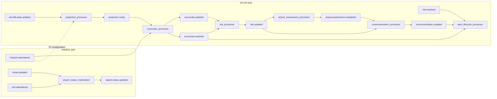

# Operational processing

**Canonical page:** this page
**Verified against:** `8abd2d5` on `docs/ws3-processing-api`
**Maturity:** CODE, TF, UNIT
**Production authorization:** no grant found in processor source. Stored recommendation actions are advisory evidence only. `ADVISORY_NOTICE` states: "Wilvor does not issue autonomous flight-control, diversion, landing, dispatch, or ATC instructions." (source: `functions/recommendations/processor/app.py`, `ADVISORY_NOTICE`)

## Purpose

This page maps the implemented deterministic operational pipeline: aircraft state and weather inputs through projection, encounters, risk, airport assessment, recommendations, and alerts. Per-processor Terraform, Lambda behavior, and tests live on the module READMEs linked below. Current-set membership at read time is defined in [`functions/shared/wilvor_operational/README.md`](../../functions/shared/wilvor_operational/README.md). Table keys and TTL are in [`docs/data/dynamodb.md`](../data/dynamodb.md).

## Implementation status

| Question | Result | Source |
| --- | --- | --- |
| Code | CODE | `functions/{projection,encounter,risk,airport_status,airport_assessment,recommendations,active_alerts}/` |
| Terraform | TF | `modules/{projection,encounter,risk,airport_status,airport_assessment,recommendations,active_alerts}/`; `envs/dev/main.tf` |
| Unit tests | UNIT | `tests/unit/{projection,encounter,risk,airport_status,recommendations,active_alerts}/`. No dedicated `tests/unit/airport_assessment/` processor suite was found |
| Contract tests | none found | search: `tests/contracts/` for processor handlers |
| Infrastructure tests | none found | search: `tests/infrastructure/` for these processor modules |
| Integration tests | none found | search: `tests/integration/` for these processor modules |
| Live harness | none found | search: `scripts/validate_*` for these processors |
| Deployment | UNKNOWN | `not verified` |
| Production authorization | no grant found | `functions/recommendations/processor/app.py` (`ADVISORY_NOTICE`) |

## Behavior

Processors subscribe to the default EventBridge bus (`local.default_event_bus_name = "default"` in `envs/dev/main.tf`). Event triggers are enabled in that root at `8abd2d5` (`enable_projection_event_trigger`, `enable_encounter_event_trigger`, `enable_risk_event_trigger`, `enable_event_trigger`).

There are no DynamoDB streams, SQS queues, or DLQ resources in these processor modules (search: `stream_enabled`, `dead_letter`, `aws_sqs` under `modules/{projection,encounter,risk,airport_status,airport_assessment,recommendations,active_alerts}`). Failures surface as Lambda errors and CloudWatch / EventBridge failed-invocation alarms.

Caption: processing movement at `8abd2d5`. Solid edges are EventBridge patterns with a Lambda target whose handler processes that `detail-type`. The dotted `hazard.materialized` edge to `projection_processor` is Terraform configuration: `aws_cloudwatch_event_rule.hazard_materialized` and `aws_cloudwatch_event_target.projection_processor_hazard` exist and are `ENABLED` when `enable_projection_event_trigger` is true, but `lambda_handler` returns `{ ignored: True, reason: "UNSUPPORTED_EVENT_TYPE" }` when `detail-type` is present and is not `aircraft.state.updated`, including `hazard.materialized` (source: `modules/projection/processor.tf`; `functions/projection/processor/app.py`, `lambda_handler`). A missing `detail-type` does not take that ignore branch. `airport.status.updated` is published and matched by `aws_cloudwatch_event_rule.airport_status_updated`; that rule has no `aws_cloudwatch_event_target` (source: `modules/airport_status/processor.tf`). Airport assessment reads `airport_status` by table scan rather than by that event (source: `functions/airport_assessment/processor/app.py`, `scan_airports`).

### Processor map

| Stage | Canonical page | EventBridge source / detail-type handled in Python | Writes |
| --- | --- | --- | --- |
| Projection | [`modules/projection/README.md`](../../modules/projection/README.md) | `wilvor.aircraft` / `aircraft.state.updated` | `aircraft_projection`, `aircraft_projection_points`, `aircraft_projection_cells` |
| Encounter | [`modules/encounter/README.md`](../../modules/encounter/README.md) | `wilvor.projection` / `projection.ready`; `wilvor.weather` / `hazard.materialized` | `aircraft_hazard_encounter` |
| Risk | [`modules/risk/README.md`](../../modules/risk/README.md) | `wilvor.encounter` / `encounter.updated`, `encounter.resolved` | `risk_results` |
| Airport status | [`modules/airport_status/README.md`](../../modules/airport_status/README.md) | `wilvor.weather` / `metar.updated`, `taf.materialized` | `airport_status` |
| Airport assessment | [`modules/airport_assessment/README.md`](../../modules/airport_assessment/README.md) | `wilvor.risk` / `risk.updated` | `airport_assessment` |
| Recommendations | [`modules/recommendations/README.md`](../../modules/recommendations/README.md) | `wilvor.risk` / `risk.updated`; `wilvor.assessment` / `airport.assessment.completed` | `recommendations` |
| Active alerts | [`modules/active_alerts/README.md`](../../modules/active_alerts/README.md) | `wilvor.recommendation` / `recommendation.updated`; `wilvor.risk` / `risk.resolved`; `wilvor.encounter` / `encounter.resolved` | `active_alerts` |

### Relationships that are not implemented

These look plausible and are omitted because they were not found in source:

- `hazard.materialized` causing projection work in Python (Terraform invokes the Lambda; the handler ignores the event).
- `airport.status.updated` invoking any Lambda.
- `encounter.updated` targeting recommendations or alerts.
- `airport.assessment.completed` targeting alerts.
- `risk.updated` targeting alerts (alerts listen to `risk.resolved`).
- DynamoDB stream or SQS triggers for these seven processors.

### Advisory boundary

Risk scoring is an advisory MVP model (source: `functions/risk/processor/app.py`, scoring comment block). Recommendation `EVALUATE_DIVERSION` is a stored advisory label for HIGH risk with `COMPLETE` assessments; it is not a clearance, selected diversion, route, or dispatch or ATC instruction (source: `functions/recommendations/processor/app.py`, `action_for`, `ADVISORY_NOTICE`). A stored LOW risk is not a statement that an aircraft is safe.

## Interfaces

Upstream producers used by this chain. Canonical ingestion pages: [Aircraft](../ingestion/aircraft.md), [SIGMET](../ingestion/sigmet.md), [METAR](../ingestion/metar.md), [TAF](../ingestion/taf.md). Index: [`docs/ingestion/README.md`](../ingestion/README.md).

| Event | source | Producer |
| --- | --- | --- |
| `aircraft.state.updated` | `wilvor.aircraft` | `functions/aircraft_current_state_writer/app.py` |
| `hazard.materialized` | `wilvor.weather` | `functions/weather/sigmet/processor/app.py` |
| `metar.updated` | `wilvor.weather` | `functions/weather/metar/processor/app.py` |
| `taf.materialized` | `wilvor.weather` | `functions/weather/taf/processor/app.py` |

Downstream HTTP reads: [`docs/api/operational-api.md`](../api/operational-api.md). Presentation: [`dashboard/README.md`](../../dashboard/README.md). Pointer: [`docs/dashboard/README.md`](../dashboard/README.md).

## Known limitations

- `hazard.materialized` is attached to the projection Lambda in Terraform and ignored in Python (source: `functions/projection/processor/app.py`, `lambda_handler`).
- Encounter production treats `valid_until_epoch == now_epoch` as still ready; the Operational API `is_current_projection` requires `valid_until_epoch > now_epoch` (source: `functions/encounter/processor/app.py`, `projection_is_ready`; `functions/shared/wilvor_operational/current_set.py`, `is_current_projection`).
- No dedicated processor unit tests were found under `tests/unit/airport_assessment/`.
- No DLQ is configured on these processor Lambdas.
- Deployment of the `dev` stack is UNKNOWN.
- `envs/dev/main.tf` still contains comments that originally described keeping some triggers disabled; the assigned values at `8abd2d5` are `true`.

## Historical record

No superseded statement is stored on this page.

## Sources

- Source: `envs/dev/main.tf` (`module.projection`, `module.encounter`, `module.risk`, `module.airport_status`, `module.airport_assessment`, `module.recommendations`, `module.active_alerts`)
- Source: `modules/projection/processor.tf` (`aws_cloudwatch_event_rule.aircraft_state_updated`, `aws_cloudwatch_event_rule.hazard_materialized`)
- Source: `functions/projection/processor/app.py` (`lambda_handler`)
- Source: `modules/airport_status/processor.tf` (`aws_cloudwatch_event_rule.airport_status_updated`)
- Source: `functions/recommendations/processor/app.py` (`ADVISORY_NOTICE`, `lambda_handler`)
- Tests: `tests/unit/projection/test_projection_processor.py`; `tests/unit/encounter/test_encounter_processor.py`; `tests/unit/risk/test_risk_processor.py`; `tests/unit/airport_status/test_airport_status_materializer.py`; `tests/unit/recommendations/test_recommendation_processor.py`; `tests/unit/active_alerts/test_active_alert_processor.py`
